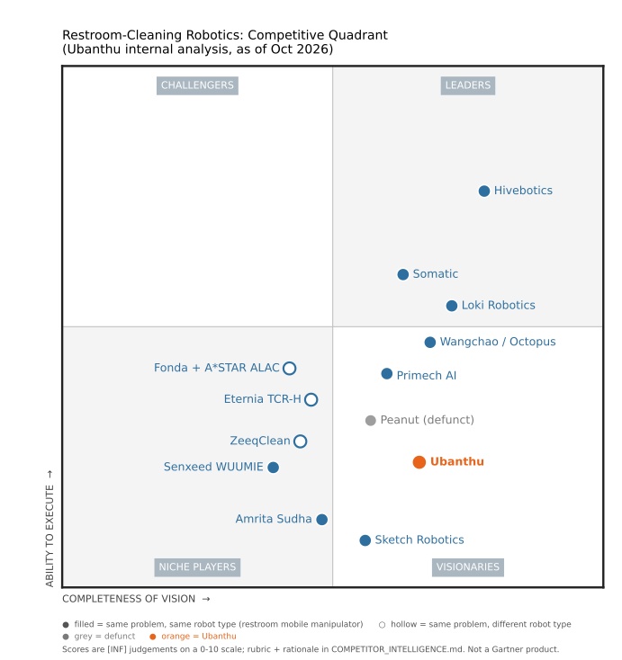

# Competitor Intelligence: Restroom / Toilet Cleaning Automation

**Owner:** Ubanthu Robotics · **Last updated:** 2026-10-25 · **Sources:** [SOURCES.md](SOURCES.md) · **Rules:** [CLAUDE.md](CLAUDE.md)

**Confidence tags:** `[V]` verified · `[3P]` third-party report · `[CC]` company or institution claim · `[INF]` inferred · `[UNV]` unverified · `[CONFLICT]` sources disagree
**Citations:** `[S012]` = source ID in SOURCES.md. An asterisk (`[S012*]`) means the source was cited by an AI summary (S001) and **nobody here has opened it yet**.

> ⚠️ **Evidence status (2026-09-30):** Everything below currently comes from one ChatGPT web-research summary ([S001](_general/2026-09-30_S001_chatgpt-india-restroom-robotics-landscape.md)). No primary source has been checked yet. Read everything as provisional until specific company material is added.

---

## Executive Overview

- **India has several restroom-automation efforts but few mature direct competitors** `[3P][S001]`. Most Indian cleaning robots target floors. Fixture-level robotic cleaning (toilets, urinals, sinks) is rare.
- **Closest Indian players to a mobile manipulator robot:** Sketch Robotics (startup, incorporated May 2025) and Amrita's Sudha (academic prototype). IIT Madras has a TRL-2 patent application.
- **Closest Indian commercial player overall:** HapiHygi (HygiSeat), but it is a *fixed retrofit seat cleaner*, not a mobile robot.
- **Internationally the field is further ahead.** Hivebotics (Singapore, Abluo) is the main benchmark: deployed in hospitals and airports, and a reported US$6M Series A in Sep 2026 to move toward volume production `[3P][S011*]`.
- **No verified presence of the international players in India** `[3P][S001]`. RIFE Technologies claims to sell a washroom robot in India but this is unverified.

## Competitive Quadrant `[INF]`

*Gartner-style quadrant (inspired by Gartner's Magic Quadrant layout; **not a Gartner product**). Ubanthu internal judgement, Oct 2026. Regenerate after editing scores: `python _general/quadrant/make_quadrant.py`.*

**Markers:** ● filled = same problem **and** same robot type (restroom mobile manipulator) · ○ hollow = same problem, different robot type (fixed / semi-autonomous / arm not confirmed) · grey = defunct · **orange = Ubanthu**.

**Rubric (0–10 each, 5 = midline):**
- **Ability to execute:** money raised; deployed hours/sites; real (not rendered) working product; team depth; manufacturing/supply; customers and distribution.
- **Completeness of vision:** fixture scope (toilet, urinal, sink, floor, squat); autonomy across buildings (doors, lifts); **cleaning verification / contamination AI**; product roadmap; IP; go-to-market reach.

| Company | Vision | Execute | Quadrant | Why (short) |
|---|---|---|---|---|
| [Hivebotics](hivebotics/hivebotics.md) | 7.8 | 7.6 | Leader | ~US$8.3M; 10,000 h, 20+ sites, 4 continents; scored before/after check; distributors in 5 regions |
| [Loki Robotics](loki-robotics/loki-robotics.md) | 7.2 | 5.4 | Leader (borderline) | ~US$13M in ~18 months; real robot in restrooms + lifts; learning + teleop; US field ops; custom hardware to "hundreds of robots". No customers named yet |
| [Somatic](somatic/somatic.md) | 6.3 | 6.0 | Leader (borderline) | US$7.5–20M; 10+ US pilots; granted US patent (tool change + door opening); YC. Thin first-hand data |
| [Wangchao / Octopus](wangchao-octopus/wangchao-octopus.md) | 6.8 | 4.7 | Visionary | Working C1 on video (squat toilet, lifts, turnstiles, doors), granted patents; but founded Dec 2025, no named customers |
| [Primech AI](primechai/primechai.md) | 6.0 | 4.1 | Visionary | Broad claims (squat, elevator, ozone); listed parent; but US$12k robot revenue and a lawsuit against its ex-CTO |
| [Peanut (defunct)](peanut/peanut.md) | 5.7 | 3.2 | Visionary (grey) | 13,000 h in hotel bathrooms and a before/after patent, but ceased operating; scored on its current state |
| [Fonda + A*STAR ALAC](fonda-global-alac/fonda-global-alac.md) | 5.3 | 2.9 | Visionary (just past the line; next to Peanut, slightly below) | Vision: per-bowl QR cleaning-status tracking + 3D bowl scanning (verification-adjacent), A*STAR R&D, MUSE Gold. Execution: no named deployment, internal FM tool, MOUs only (S098, S099). Placed by team 2026-10-19 |
| [Eternia TCR-H](eternia-robotics/eternia-robotics.md) | 4.6 | 3.6 | Niche ○ (arm not confirmed; low data) | Lid lifting, fixture ID claimed; productisation stage; few sources opened |
| [ZeeqClean](zeeqclean/zeeqclean.md) | 4.4 | 2.8 | Niche ○ (arm not confirmed; low data) | Claims lid lifting, contactless, UV; unsourced |
| [Senxeed WUUMIE](senxeed-robotics/senxeed-robotics.md) | 3.9 | 2.3 | Niche (low data) | Tool changing claimed; cited source was the wrong product page |
| [Amrita Sudha](amrita-sudha/amrita-sudha.md) | 4.8 | 1.3 | Niche | Research prototype; stain recognition + cleanliness monitoring (closest to our CV loop) |
| [Sketch Robotics](sketch-robotics/sketch-robotics.md) | 5.6 | 0.9 | **Visionary (very low execution)** | Same robot type and an India focus (6-DOF arm, VLM perception, UV-C claimed), so vision is above the midline; but incorporated May 2025, no prototype seen, ~₹10–15L grant `[INT]`. Placement set by team (2026-10-19) |
| [Nolon AI](nolon/nolon.md) | 4.2 | 0.7 | Niche (very low execution) | Same robot type and city; toilet brush + urinal nozzle on xArm6/MiR, but simulation only, 2–10 staff, no funding found, CEO now at Origin |
| **Ubanthu** | 6.6 | 2.4 | **Visionary** (orange dot) | Placed by the team (2026-10-19): strong contamination-verification vision, early execution |

Not plotted: fixed retrofits (HapiHygi, Hachimichi, ATSC), adjacent categories (Genrobotics, Solinas, VAATA, Origin/construction), and unverified RIFE.

## Competitive Landscape

### Framework: three architectures `[INF][S001]`

| Architecture | Idea | Players |
|---|---|---|
| **1. Mobile manipulator robot** | A robot drives into the restroom and cleans the fixtures | Hivebotics, Eternia/TCR-H, Primech HYTRON, ZeeqClean, Senxeed, Sketch Robotics, Amrita Sudha, IIT Palakkad, IIT Madras (concept) |
| **2. Fixed fixture automation** | The toilet/seat cleans itself | HapiHygi, Hachimichi, ATSC, VAATA (chemical dosing only) |
| **3. Human + machine hybrid** | Semi-autonomous machine assists a cleaner | Fonda Global ALAC |
| *Adjacent: sanitation infrastructure* | Sewer and septic robots | Genrobotics, Solinas |
| *Adjacent: same robot, other trade* | Mobile manipulator + tool station in construction | Origin (OG-1, drywall finishing) |

### Master table

| Company | Region | Product | Architecture | Stage | Relevance to us | Folder |
|---|---|---|---|---|---|---|
| [Sketch Robotics](sketch-robotics/sketch-robotics.md) | 🇮🇳 Kochi, Kerala | Autonomous Washroom Cleaning Robot | Mobile manipulator | Early startup (inc. May 2025); no prototype seen; ~₹10–15L KSM `[INT]` | 🔴 Direct on paper · 🟡 low near-term threat `[INT]` | [sketch-robotics/](sketch-robotics/) |
| [Amrita Vishwa Vidyapeetham: Sudha](amrita-sudha/amrita-sudha.md) | 🇮🇳 Kerala | Sudha service robot | Mobile manipulator | Research prototype | 🟠 Tech benchmark | [amrita-sudha/](amrita-sudha/) |
| [HapiHygi Innovations](hapihygi/hapihygi.md) | 🇮🇳 Gandhinagar, Gujarat | HygiSeat | Fixed retrofit | TRL 7 claimed, pilots | 🟠 Adjacent | [hapihygi/](hapihygi/) |
| [IIT Madras](iit-madras/iit-madras.md) | 🇮🇳 Chennai | Autonomous toilet-cleaning system (patent) | Concept | TRL 2 | 🟡 IP watch | [iit-madras/](iit-madras/) |
| [IIT Palakkad](iit-palakkad/iit-palakkad.md) | 🇮🇳 Palakkad | Inter-IIT toilet-cleaning robot | Mobile | Student prototype (2018) | ⚪ Historical | [iit-palakkad/](iit-palakkad/) |
| [Hachimichi](hachimichi/hachimichi.md) | 🇮🇳 Pune | SeatO'fresh | Fixed retrofit | Commercial (84 units, 2021) | 🟡 Adjacent | [hachimichi/](hachimichi/) |
| [ATSC / i-Hub Gujarat](atsc-ihub-gujarat/atsc-ihub-gujarat.md) | 🇮🇳 Gujarat | Automatic Toilet Seat Cleaner | Fixed | Under development | 🟡 Adjacent | [atsc-ihub-gujarat/](atsc-ihub-gujarat/) |
| [VAATA](vaata/vaata.md) | 🇮🇳 Chennai | DryTab | Cistern dosing | Commercial | ⚪ Low | [vaata/](vaata/) |
| [RIFE Technologies](rife-technologies/rife-technologies.md) | 🇮🇳 | "Washroom Cleaning Robot" | Unknown | Claimed deployments `[UNV]` | 🟠 Verify: possible reseller | [rife-technologies/](rife-technologies/) |
| [Genrobotics](genrobotics/genrobotics.md) | 🇮🇳 Kerala | Sewer/manhole robots | Adjacent | Commercial | ⚪ Adjacent | [genrobotics/](genrobotics/) |
| [Origin (Artila Robotics)](origin-artila/origin-artila.md) | 🇺🇸 San Francisco + 🇮🇳 Bengaluru (Dec 2024; ex-"10xConstruction") | OG-1: drywall finishing (compound, sanding, priming, painting) | Adjacent: wheeled base + lift column + arm (14 ft) + swappable tool station; learned "Construction Action Model" + teleop; **surface-defect / quality CV** | **US$20M** (Accel, Zacua; Oct 2026); **RaaS US$25–40k/month**; 6 robots live; **V3 assembled in a Bengaluru plant (3–5 → 20/month) for export** | 🟡 Adjacent competitor / potential entrant (near-identical robot); India-built/US-sold template; Bengaluru talent competitor. Early backer **Day Zero Ventures** (Mar 2025) | [origin-artila/](origin-artila/) |
| [Solinas](solinas/solinas.md) | 🇮🇳 Chennai (IITM incubator) | Septic-tank cleaning robot | Adjacent | Commercial | ⚪ Adjacent | [solinas/](solinas/) |
| [Nolon AI](nolon/nolon.md) | |
| [Hivebotics](hivebotics/hivebotics.md) | 🇸🇬 Singapore (NUS spin-out, 2021) | Abluo (Mark 1 / Mark II) | Mobile manipulator, **contactless** | **~US$8.3M raised**: pre-seed $1.3M (2023), seed $1M (2025), **Series A $6M** (Sep 2026: Vertex, Farglory, Rigel) `[3P][S073]`; ~10,000 h, 20+ sites | 🔴 **Main benchmark**; claims scored before/after verification | [hivebotics/](hivebotics/) |
| [Loki Robotics](loki-robotics/loki-robotics.md) | 🇨🇭 Zürich + 🇺🇸 Dallas (~2025) | Loki: restroom + day-porter cleaning robot | Mobile manipulator; vertical-column arm; scrub-head swapping; learned policies + teleop | **~US$13M raised** (CHF 1.6M pre-seed May 2025; **US$11.8M Apr 2026**); real robot on video; US field deployments starting | 🔴 **Direct, fast-moving**; AI-native | [loki-robotics/](loki-robotics/) |
| [Nolon AI](nolon/nolon.md) | 🇮🇳 Bengaluru (HSR Layout; site © 2024) | "Nolon Bot": autonomous toilet-cleaning robot | Mobile manipulator: **UFACTORY xArm6** on a **MiR-class AMR**, toilet brush + urinal nozzle (**simulation only**, Aug 2025) | 2–10 staff; no funding or customers found; real 2024 demo = **AUBO arm scrubbing a sink**; **CEO now at Origin, CTO now co-founder of XP Robotics** | 🟡 Direct but very early; **likely dormant** | [nolon/](nolon/) |
| [Peanut Robotics](peanut/peanut.md) | 🇺🇸 San Francisco (2018) | Hotel bathroom-cleaning mobile manipulator | Mobile manipulator; tool carrier; Orbbec Gemini 2 ×4 | **Wound down (~2024)**; ~$9.5M raised (post-money $40M, May 2022); 13,000 h in hotels `[S075][S090]` | ⚪ Defunct, but 🔴 **precedent + 2 active US patents with before/after imaging claims** | [peanut/](peanut/) |
| [Somatic](somatic/somatic.md) | 🇺🇸 USA | Commercial restroom-cleaning robot ("BCR-01"?) | Mobile manipulator; jet + vacuum + blower | Series A US$7.16M (Mar 2022); 10+ pilots; **RaaS ~US$4.5K/month** (per Hivebotics deck) `[3P][S075]` | 🟠 Benchmark (US) | [somatic/](somatic/) |
| [Wangchao Innovation / Octopus Robotics](wangchao-octopus/wangchao-octopus.md) | 🇨🇳 Hangzhou (inc. Dec 2025) | **C1** restroom robot (+ X1, C2, C3) | Mobile manipulator; **steam >120 °C**, 6-axis arm 900 mm, tool rack; 50 kg | Launched 2026; Canton Fair; Vanke Service channel via Lingqing; no named restroom customers `[CC][S078]` | 🔴/🟠 **New Chinese direct competitor**; price threat `[INF]` | [wangchao-octopus/](wangchao-octopus/) |
| [Eternia Robotics / Cleaning Robotics](eternia-robotics/eternia-robotics.md) | 🇸🇬 Singapore | TCR-H | Mobile | Being productised | 🔴 Benchmark | [eternia-robotics/](eternia-robotics/) |
| [Primech AI](primechai/primechai.md) | 🇸🇬 Singapore / US-listed parent | HYTRON | Mobile manipulator | Early commercial: US$12k robot revenue FY26; **suing ex-CTO over HYTRON development** | 🟠 Benchmark; delivery doubtful `[INF]` | [primechai/](primechai/) |
| [Fonda Global + A*STAR](fonda-global-alac/fonda-global-alac.md) | 🇸🇬 Singapore | ALAC | Hybrid / semi-autonomous | Unknown | 🟡 Benchmark | [fonda-global-alac/](fonda-global-alac/) |
| [ZeeqClean](zeeqclean/zeeqclean.md) | Asia (Taiwan? `[INF]`) | ZC-01 | Mobile | Unknown | 🟠 Benchmark | [zeeqclean/](zeeqclean/) |
| [Senxeed Robotics](senxeed-robotics/senxeed-robotics.md) | 🇯🇵 Japan | WUUMIE | Mobile, multi-tool | Unknown | 🟠 Benchmark | [senxeed-robotics/](senxeed-robotics/) |

*Relevance ratings are our own first-pass analysis `[INF]`, not source facts.*

---

# Company Profiles

Each company has its own file with its full profile, its people and its open questions. **Anything new about a company goes into its file.** This master doc only carries the overview, comparisons and findings.

| 🇮🇳 India | 🌏 International |
|---|---|
| [Sketch Robotics](sketch-robotics/sketch-robotics.md) | [Hivebotics](hivebotics/hivebotics.md) |
| [Amrita: Sudha](amrita-sudha/amrita-sudha.md) | [Eternia Robotics / Cleaning Robotics](eternia-robotics/eternia-robotics.md) |
| [HapiHygi Innovations](hapihygi/hapihygi.md) | [Primech AI](primechai/primechai.md) |
| [IIT Madras](iit-madras/iit-madras.md) | [Fonda Global + A*STAR: ALAC](fonda-global-alac/fonda-global-alac.md) |
| [IIT Palakkad](iit-palakkad/iit-palakkad.md) | [ZeeqClean](zeeqclean/zeeqclean.md) |
| [Hachimichi](hachimichi/hachimichi.md) | [Senxeed Robotics](senxeed-robotics/senxeed-robotics.md) |
| [ATSC / i-Hub Gujarat](atsc-ihub-gujarat/atsc-ihub-gujarat.md) | [Somatic](somatic/somatic.md) |
| [VAATA](vaata/vaata.md) | [Wangchao / Octopus Robotics](wangchao-octopus/wangchao-octopus.md) |
| [RIFE Technologies](rife-technologies/rife-technologies.md) | [Peanut Robotics](peanut/peanut.md) (defunct) |
| [Genrobotics](genrobotics/genrobotics.md) | [Loki Robotics](loki-robotics/loki-robotics.md) |
| [Solinas](solinas/solinas.md) | [Origin (Artila Robotics)](origin-artila/origin-artila.md) (adjacent: construction) |

---

# Cross-Competitor Comparisons

### Capability matrix (corrected against source text)

`✓` stated by a source · `✗` stated absent / not applicable · `?` claimed by S001's table but **not supported by the cited text** · `—` no info

| Capability | Sketch | Amrita Sudha | HapiHygi | IITM | Hivebotics | Eternia TCR-H | Primech HYTRON | ZeeqClean | Fonda ALAC | Somatic | Wangchao C1 | Peanut (defunct) | Loki | Nolon (sim) |
|---|---|---|---|---|---|---|---|---|---|---|---|---|---|---|
| Mobile platform | ✓ | ✓ | ✗ | concept | ✓ | ✓ | ✓ | ✓ | — | ✓ | ✓ 50 kg, 734 mm long | ✓ holonomic | ✓ | ✓ MiR-class AMR (sim) |
| Robotic arm | ✓ 6-DOF | ✓ | ✗ | concept | ✓ 6-DOF (Mk2) | ? | ✓ patent; functions on site imply arm `[INF]` | — | — | ✓ cobot (render) | ✓ 6-axis, 900 mm, 3 kg | ✓ (on vertical conveyor in patent) | ✓ on vertical column; custom arm in dev | ✓ xArm6 (sim) |
| Toilet | ✓ | ✓ | seat only | ✓ | ✓ | ✓ | ✓ | ✓ | ✓ | ✓ | ✓ | ✓ hotel bathrooms | ✓ (video) | ✓ toilet-brush tool (sim) |
| Urinal | ? | — | ✗ | — | ✓ | ✓ | ✓ brushing (site) | ✓ | — | — | ✓ (YouTube text) | — | ✓ (video) | ✓ urinal nozzle (sim) |
| Sink / basin | ✓ | — | ✗ | — | ✓ | — | ✓ sink + countertop (site) | — | — | — | ✓ countertops | ✓ (patent) | ✓ (video) | — |
| Floor | ✓ | — | ✗ | — | ✓ | ✓ | ✓ mopping + blower drying | ✓ | — | — | ✓ wash + dry | ✓ vacuum/mop (patent) | — | — |
| **Squat (Indian/Asian) toilet** | — | — | — | — | not listed in Mk2 brochure `[S061]`; no evidence | — | **✓ claimed (S042)** | — | — | — | **✓ shown on video** (water jet + hot air) `[V][S082]` | — | — | — |
| Mirror | — | — | — | — | ✓ "sinks & mirrors" `[S061]` | — | ✓ wiping | — | — | — | walls/glass/partitions (VLA claim) | ✓ (patent) | — | — |
| Doors / elevators | — | — | ✗ | — | **same floor only** (no lift claim) `[S061]`; door opening + lift on roadmap, elevator co-development sought `[S075]` | — | ✓ both claimed | — | — | — | ✓ door opening (video) + IoT lift/gate calling | — | ✓ elevator (video) | — |
| Fixture recognition | ✓ VLM | ✓ | ✗ | — | **Mask R-CNN** segmentation `[S075]` | ✓ | ✓ camera (patent) | lid detection | — | — | VLA claim; **RGB-D + vision model + ICP 6-DoF pose (patent CN122493419A)** `[S083]` | ICP + RANSAC registration; VLMs (CTO) | learned policies (end-to-end + teleop) | — (RGB-D camera only) |
| **Stain / dirt detection** | — | **✓** | ✗ | intended | **✓ stain-pixel highlighting in segmented bowl** (deck screenshot); "multi-surface stain detection" claimed `[S075]` | — | "may" (patent); "UV bacteria detection" listed for Mark 2 (deck) | — | stain *removal* | — | not claimed | — | — | — |
| Cleanliness verification | — | **✓** | — | — | **✓ "scored before-and-after check" every job** (S056); shown as one "Improvement Score" + re-clean if needed `[S075]` | — | "may" (patent) | — | QR-tracked cleaning status per bowl (ALAC 2.0) `[S070]` | — | "quality inspection" step (no detail) | **before/after room images "for comparison" (patent claim 1)** | — | — |
| Lid / seat lifting | — | — | — | — | — | ✓ | — | ✓ | ✓ | — | — | — | ✓ lid up in video (method unclear) | — |
| Steam | — | — | ✗ | — | ✓ **173 °C**, 3/5/8 bar, 75 g/min (7 min start-up) `[S061]` | — | — | — | — | ✗ | claimed >120 °C (website); **not seen in video** (water jet + hot-air drying) | ✗ | ✗ | ✗ |
| Jet / spray | spray | spray | spray | — | **contactless:** high-pressure steam + chemical jet + vacuum + blow-dry; **no brushes** | — | e-water (electrolysed/ozone) jetting + detergent; "high-pressure" unconfirmed | pressurised | — | chemical water jet + vacuum + blower | spray | spray bottle tool; fluid through arm | contact microfibre scrub heads; fluid system | liquid nozzle (urinal) |
| UV-C | ✓ | — | ✓ | — | — | — | — | ✓ | — | — | — | — | — | — |
| Tool disinfection | — | — | — | — | — | ✓ brush | ✓ ozone wash in dock (patent) | — | — | — | colour-coded tool sets per zone | auto pad swap (patent) | scrub-head swap from bins | — |
| Cleanliness / hygiene reporting | — | — | — | — | ✓ "outcomes can be audited"; HiveIntelligence validates jobs (S056) | — | not mentioned; dashboard shows task status only | — | — | — | logs time, area, steam temp (hospital) | — | telemetry/fleet dashboard (jobs) | — |
| Time per toilet | — | — | — | — | **5 min** (urinal 3–5, sink 2–4) `[S061]` | — | ~6 min (basin/urinal ~3) | — | — | — | — | — | — | — |
| Commercial deployments | none found | none found | pilots (claimed) | ✗ | ✓ ~10,000 h, 20+ sites, 4 continents (S056) | pilot history | early: army-camp lease, SG hospital; US$12k lease revenue FY26 | — | — | 10+ pilots (per Hivebotics) | claimed; none named | ✓ 13,000 h hotels (ceased) | LOIs; US field ops from Oct 2026 | none found |

### What stands out `[INF]`
- **⚠️ Updated 2026-10-06: post-clean verification is no longer unclaimed.** **Hivebotics** says "every job ends with a scored before-and-after check, so cleaning outcomes can be audited" (S056), and Amrita Sudha claims cleanliness monitoring. **The differentiator for Ubanthu must now be the *quality* of contamination detection** (what is detected, how accurately, what evidence), not merely having verification. **Update 2026-10-10:** Hivebotics' deck shows the method. It segments the bowl, highlights stain pixels before and after, and outputs **one "Improvement Score"** (e.g. 0.0538), re-cleaning if needed. It looks **prototype-grade: RGB, area-based, with a water/drain false positive visible** `[INF][S075]`. That leaves Ubanthu room on contamination *type*, robustness and audit-grade evidence.
- **New Chinese entrant (2026-10-13): Wangchao/Octopus C1.** It has a steam + tool-rack arm like Hivebotics, but is 50 kg and has elevator/door IoT. Its AI pitch is a spatial "VLA", **not stain detection**. Verification is still Ubanthu's opening `[INF][S078]`.
- **Indian (squat) toilets (updated 2026-10-13):** **Wangchao/Octopus C1 is shown cleaning a squat pan on video** (high-pressure spray + hot-air drying) `[V][S082]`, the first *demonstrated* case on file. Primech HYTRON only *claims* squat support `[CC][S042]`. No Indian player claims it.
- **Fleet dashboards:** Primech's reports task status only `[CC][S042]`; **Hivebotics claims audited cleaning outcomes** via HiveIntelligence `[CC][S056]`.

### Hardware & manufacturing suppliers

**Legend:** **Named** = the company or its own document names the supplier · **Candidate** = indirect evidence (e.g. an employee's work), not tied to the product itself · — = no info. Details and evidence are in each company file.

| Component | Primech HYTRON | Hivebotics Abluo | Sketch Robotics | Others |
|---|---|---|---|---|
| **Manufacturer / assembly** | **Named:** unnamed China production partner, "300 robots' initial capacity" (Jul 2025) `[CC][S044]` | — | — | — |
| **Robot arm** | **Named (as example):** **Elite Robots, Shanghai** ("such as those supplied by…", patent WO 2025/259179 p.9) `[V][S054]`. Likely, not confirmed for the shipping unit | **Confirmed: UFACTORY 850**. Brochure specs match (S061/S063) + UF850 config/URDF edits in their GitHub fork of UFACTORY's `xarm_ros2` `[V][S071]`. *History:* Elephant Robotics myCobot 320 M5 in 2021–22 NUS patent `[V][S065]` | 6-DOF arm, supplier unknown `[CC][S002*]` | — |
| **Compute** | **Named:** NVIDIA Jetson Orin "Super" `[CC][S044]` | **Named:** AMD Ryzen Embedded 8845HS + NVIDIA RTX A400 `[CC][S061]` | — | **Wangchao C1: Named NVIDIA Jetson Orin**; AI-chip partner **Zhonghao Xinying** `[CC][S078]` |
| **Robot arm + base (Nolon, sim)** | — | — | — | **Nolon:** real 2024 demo on an **AUBO 6-DoF** arm (fixed); sims with **Franka Panda** (Jul 2025) and **UFACTORY xArm6**; pitch-deck BOM (US$32–48K) shows **Universal Robots arm + pendant, RealSense, 3D LiDAR, ODrive controllers, ADIRATH battery, Invento Robotics unit** `[CC][S140]`; (kinematics match exactly) on a **MiR-class AMR** (`mir_base.stl`); RealSense D435/D455 CAD; 2D LiDAR; ROS 2 Jazzy, Nav2, MoveIt 2, Isaac Sim USD. Simulation only `[V][S132]` |
| **Compute / software (Origin, adjacent)** | — | — | — | **Origin: dual NVIDIA Jetson AGX Orin**; ROS 2 + MoveIt 2 + Nav2; Isaac Sim/Lab; custom BMS + inverters; Android operator app `[CC][S112]`. [Full stack](origin-artila/origin-tech-stack.md) |
| **Robot arm (Origin, adjacent)** | — | — | — | **Origin: Universal Robots** in both generations: blue e-Series cap (Nov 2025) `[V][S115]`; 2026 OG-1 shows **black UR-logo caps**, 1300 mm-reach class → **most likely UR15** `[V][S123]` + `[INF]`. Base/lift/body **in-house** (3-wheel counterbalanced) `[S120][S122]` |
| **Robot arm (Loki)** | — | — | — | **Loki:** white cobot (brand unidentified) on a vertical column; **building its own arm, grippers, tool changer, dock** (job ads) `[V][S100][S101]` |
| **Depth cameras (Peanut)** | — | — | — | **Peanut: Orbbec Gemini 2 ×4** (chosen from 6 evaluated), per ex-engineer résumé `[V][S089]` |
| **Sensor layout (Wangchao C1)** | — | — | — | **From patent Fig. 3:** low-mounted depth camera + RGB camera on the gripper + multi-line LiDAR + side IR; magnetic quick-release tools (spray / suction / air-dryer) `[V][S086]`; brands unknown |
| **Navigation controller / base** | **Candidate:** SEER Robotics (Roboshop), mecanum-wheel AGV, from an engineer's résumé; not tied to HYTRON `[S049]` | **Mecanum** base in ros2_control (custom; supplier unidentified) `[V][S071]`; 0.8 m/s `[S061]` | — | — |
| **3D LiDAR** | **Candidate:** Hesai (model unknown), from an engineer's driver work; not tied to HYTRON `[S048]` | **Identified (high confidence): Livox Mid-360**. All 6 brochure specs match, incl. distinctive 360°×59° FOV `[S061][S063]` | — | — |
| **Force/torque sensor** | **Candidate:** KWR75 (believed Kunwei, China), from an engineer's driver work `[S048]` | Likely **UFACTORY 6-axis F/T sensor** (UFACTORY FT API enabled for real hardware, Aug 2026) `[INF][S071]` | — | — |
| **Camera** | Wrist camera on arm; brand unknown `[V][S041][S054]` | **Confirmed: Luxonis OAK-D S2 PoE** (brochure depth+RGB; code + exact spec match) `[V][S071][S072]` · **Orbbec Gemini 335Le** (Jul 2026, code) `[V][S071]` · RealSense D435i wrist (robot model/sim) `[S071]` | VLM perception claimed; camera unknown | — |
| **Fleet software** | Open-RMF (from engineer's résumé) `[S049]`; own task-management dashboard `[CC][S042]` | Own: **HiveOS** (brochure) / **HiveIntelligence** (Vertex release) `[CC][S061][S056]`; **Named: Formant** for fleet management `[CC][S075]` | — | — |
| **Cleaning tools / consumables** | Own brush/ozone system (patents) `[S041][S054]` | **Named: Kärcher** (MOU; steam, vacuum, floor tools) `[CC][S075]`; steam unit likely **Kärcher SGV 8/5** (spec match) `[INF][S104]` | — | — |
| **Motion-planning software** | — | **Named: PickNik MoveIt Pro** (R&D partner; UI shown in deck) `[V][S075][S071]` | — | — |
| **Perception model** | — | **Mask R-CNN** fixture segmentation (topic in deck screenshot) `[V][S075]` | VLM claimed | — |

**Legend addition:** **Identified** = the model is pinned down by matching published specs (the company didn't name it).

**Pattern so far** `[INF]`: **Hivebotics' hardware is now fully mapped from public code + brochure + deck: UFACTORY 850 + Livox Mid-360 + Luxonis OAK-D S2 / Orbbec Gemini 335Le + AMD/NVIDIA compute + custom mecanum base + Kärcher cleaning tools, on PickNik MoveIt Pro and Formant.** Their own unit cost was **US$53.75k (2024)**, targeting ~US$24k at scale `[S076]`. **Both leading competitors build on Chinese off-the-shelf cobot arms and LiDARs**: Primech (Elite Robots arm named; Hesai candidate; SEER candidate) and Hivebotics (**UFACTORY 850 + Livox Mid-360**). Compute differs: Primech = NVIDIA Jetson Orin; Hivebotics = **x86 AMD Ryzen + NVIDIA RTX A400 GPU**. **Arm + LiDAR + compute is commodity hardware, roughly US$10–15k of bill of materials** (general-knowledge price estimate, unverified). **Differentiation is in the end-effector/cleaning system and software**, which is where Ubanthu competes.

### Pricing

| Company | Purchase | RaaS / month | Unit cost | Source |
|---|---|---|---|---|
| **Hivebotics** | ~US$55–65k (model: $65k yr 1 → $55k yr 5; deck's $50k is a sizing assumption) | **~US$2,000** (Rome €1,250; SG S$2,000) | **US$53.75k (2024)** → ~US$24.4k target | `[CC][S075][S076]` |
| **Somatic** | — | **~US$4,500** | — | per Hivebotics deck `[3P][S075]` |
| **Primech HYTRON** | — | **~US$1,800** | — | per Hivebotics deck `[3P][S075]` |
| *Origin OG-1 (adjacent: construction)* | Not sold | **US$25,000–40,000** ("outcome as a service"; replaces a 5-person crew costing ~US$50k/month) | — | `[3P][S113]` |

**Analysis** `[INF]`: all three price for **high-wage markets** (cleaner ≥ US$1.5–3.5k/month). At Indian wages (~US$150–250/month, general knowledge), none of these price points pays back. An India-priced robot is an open gap.

### Target markets
- Airports and hospitals: Hivebotics `[CC]`; airports, malls, hospitals, corporate campuses: RIFE `[UNV]`
- B2B washrooms: Hachimichi
- Railways: SNJB patent (research)

---

## Patent / Research Landscape

| ID | Title | Owner | Filed | Status | Source |
|---|---|---|---|---|---|
| **US 11,407,118 B1** | Peanut: mobile robot + **arm on vertical conveyor** + tool carrier; claim 1 includes **images before and after the task "for comparison"**. [Details](peanut/peanut.md#patents) | "Individual" (inventors Augenbraun, Ghosh, Hansen, Verheye) | 2019-12-10 (priority 2018-12-10) | **Granted 2022-08-09; active to 2040** | S092 |
| **US 12,397,440 B1** | Peanut CIP: arm + **automatic cleaning-pad remover/installer** + imaging during task; fluid through arm | "Individual" | 2022-07-06 (priority 2018-12-10) | **Granted 2025-08-26; active** | S093 |
| **US 12,440,076 B2** / WO 2025/035010 | Somatic: **bathroom cleaning robot** with body-mounted tools, tool-change module, **door-opening module** | Somatic Holdings, Inc. | 2023-08-08 | **Granted 2025-10-14**; EP pending | S094 |
| **CN310188487S** | Design patent: "Intelligent Cleaning Robot (Wangchao C1)"; shape only (8 views). [EN translation](wangchao-octopus/patents/CN310188487S_design-patent_EN.pdf) | Hangzhou Wangchao Innovation Robot (designer 王辉) | 2026-03-04 | **Granted 2026-09-04** | S084 |
| **CN122493419A** | Toilet-fixture identification with depth camera + vision large model: RGB-D alignment → 2D detection as mask → confidence-weighted ICP to template → 6-DoF pose → hand-eye + anti-collision. **No dirt detection.** [Details](wangchao-octopus/wangchao-octopus.md#patents) | Hangzhou Wangchao Innovation Robot (inventor 王辉) | 2026-07-02 | **Granted 2026-10-09 as CN 122493419 B** (6 claims, narrowed; fast-tracked) | S083, S095 |
| **WO 2023/075687** | Robot Alignment and Manipulation: YOLOv5 fixture detection + 3-step alignment; point-cloud waypoint cleaning (MoveIt); pneumatic tool changer with disposable brush heads; arm = myCobot 320. **Applicant NUS**; inventors incl. Hivebotics founders. [Deep dive](hivebotics/hivebotics-patent-WO2023075687.md) | NUS (Hivebotics founders) | 2022-10-25 (priority 2021-10-29) | **Ceased** (~Apr 2024): no national-phase entries, so free prior art | S065, S066 |
| **WO 2025/259179** | Fluid connection between cleaning robot and base station: **robot's arm picks up the station's connector and plugs it into the robot** for water refill and waste drain; QR-code docking; connection check. **Names Elite Robots (Shanghai) as example arm.** Describes detergent→brush→rinse, **no ozone**. India designated. [Deep dive](primechai/primechai-patent-WO2025259179.md) | Primech AI | 2025-05-15 (priority 2024-06-14) | Published 2025-12-18. Search report: LG KR 10-2014-0036653 "X" vs claims 16–17; Lim/Samsung "Y" vs 1–5, 9–12, 21–23 | S054 |
| **WO 2025/259178** | A Cleaning Robot: mobile robot with **ozone water made on board** (core claim); arm, tool changer (brush and fan), fixture-recognition camera in dependent claims. Stain detection mentioned but **not claimed**. **India designated.** [Deep dive](primechai/primechai-patent-WO2025259178.md) | Primech AI | 2025-05-15 (priority 2024-06-14) | Published 2025-12-18. Search report: core claims 1–7, 20, 21 already shown by CN 111466837 A | S041 |
| IN 202541062468 | A System and Method for Autonomous Toilet Cleaning | IIT Madras | 2025-06-30 | Published 2025-07-11, TRL 2 | S005*, S016* |
| IN 201821008841 | Smart (automatic) toilet cleaning for Indian Railways: robotic arm, brush, water jets, sensors, door lock, IoT | SNJB's college / Indian inventors | 2018 | Application | S030*, S031* |
| ATSC patent | Autonomous toilet-seat cleaner | ATSC (i-Hub Gujarat) | — | Patent-pending | S009* |
| Paper | Restroom cleaning system for convenience stores (fixture mechanisms + floor robot), *Advanced Robotics* 36(23), 2022 | Tokyo Metropolitan Univ. | — | Published | S032* |

---

## People

Each company file has its own **People Directory**. There is no combined list.

| Company | People on file |
|---|---|
| [Sketch Robotics](sketch-robotics/sketch-robotics.md#people-directory) | 11 (3 founders, 6 team, 2 mentors) |
| [HapiHygi](hapihygi/hapihygi.md#people-directory) | 2 |
| [Hivebotics](hivebotics/hivebotics.md#people-directory) | 24 (8 current named staff on LinkedIn + 5 GitHub-only engineers; **6 advisors** incl. 2 angel investors; 5 former/early; 15 photos) |
| [Somatic](somatic/somatic.md#people-directory) | 6 (patent inventors) |
| [Loki Robotics](loki-robotics/loki-robotics.md#people-directory) | 3 (2 co-founders, 1 director) |
| [Nolon AI](nolon/nolon.md#people-directory) | 4 (CEO Sathya Narayanan R, CTO Raushan Kumar, CRO Vijeth Rai, intern Aayush Rath; 3 photos) |
| [Origin (Artila Robotics)](origin-artila/origin-artila.md#people-directory) | 5 (3 co-founders, Senior Robotics/Sim Engineer Saketh Vaishya, supply-chain lead "Sathya …"; 2 photos) |
| [Peanut Robotics](peanut/peanut.md#people-directory) | 15 (CEO, 4 co-founders, 6 staff, 4 extra patent inventors; no photos) |
| [Wangchao / Octopus](wangchao-octopus/wangchao-octopus.md#people-directory) | 1 (legal representative He Bing) |
| [IIT Madras](iit-madras/iit-madras.md#people-directory) | 1 |
| [Primech AI](primechai/primechai.md#people-directory) | 10 (CEO, Primech AI COO, ex-CTO, 3 execs, 4 technical hires from Mar–Jul 2026) |

## Important Findings

1. **Hivebotics raised a US$6M Series A (4 Sep 2026)** led by Vertex (remit covers SEA *and India*), with strategic co-investors **Rigel** (restroom-fixture maker) and **Farglory** (property) `[V][S056]`. Earlier: US$1.3M pre-seed (Nov 2023, Feedback Ventures) and US$1M seed (Oct 2025, K2 Holdings), so **~US$8.3M in total**. Crunchbase's "$14.3M" double-counts the Series A `[3P][INF][S073]`. It claims ~10,000 operating hours at 20+ sites and **scored before/after verification of every job**, so it is **the most direct threat to Ubanthu's contamination-verification positioning**. Most likely foreign entrant into India.
2. **The only Indian startup building a mobile restroom manipulator is Sketch Robotics**, incorporated May 2025 `[3P]`. But it is a 9-person team fresh out of CUSAT with no visible prototype and an estimated ₹10–15 lakh of KSM funding `[INT][S040]`. It is a watch-list item, not an imminent threat.
3. **(Updated 2026-10-10) Hivebotics' verification is real but basic** `[V][S075]`: segmented bowl, stain-pixel highlight, one "Improvement Score", re-clean loop; prototype-grade (RGB, area-based, with a visible water false positive). Its investor deck also shows **pricing (~US$2k/month RaaS, ~US$50–55k purchase), unit cost (US$53.75k in 2024), "$150M LOIs" with inconsistent unit counts, and distributors in HK, the Middle East, the US, Canada and the Nordics**. [Details](hivebotics/hivebotics-series-a-deck.md).
3b. **Contamination detection and cleaning verification are thinly claimed across the field** `[INF]`. This is a possible positioning angle for Ubanthu.
4. **Primech's patent (WO 2025/259178) centres on ozone water, not perception.** It shows an arm with a tool changer and a fixture-recognition camera. Stain detection and cleaning verification are only mentioned as possibilities and are not claimed. The core claims already face strong prior art. India is designated `[V][S041]`, `[INF]`.
5. **Hivebotics' public GitHub (S071) shows its 2026 engineering focus is force-compliant manipulation** (F/T sensing, admittance/FDCC compliance control, toilet-seat lifting sim; MoveIt Pro), **not perception**. Nothing public touches contamination detection. Cameras changed within ~6 months (OAK-D S2 → Orbbec Gemini 335Le).
6. **Hivebotics' core patent lapsed** `[V][S065][S066]`. WO 2023/075687 (NUS-owned; founders as inventors) ceased ~Apr 2024 with no national filings, so its alignment, waypoint and tool-changer methods are **free prior art**. It also shows Hivebotics **switched from disposable-brush contact cleaning (myCobot arm, 2021–22) to contactless steam (UFACTORY 850, 2026)**. Field deployment confirmed in **Orlando, FL** (S068).
7. **Primech's HYTRON is far less mature than its marketing** `[V][S043][S044]`. FY2026 robot revenue was US$12k and the robotics segment lost US$2.48M, against a 300-robot rollout plan and a ">99% disinfection" claim (lab not named). Primech is **suing its former Primech AI CTO** (49% shareholder, lead patent inventor) over missed HYTRON milestones and source code; he counter-claims IP ownership. See [SEC deep dive](primechai/primechai-sec-filings.md).
9. **US patents now cover key parts of the restroom-robot architecture (2026-10-19)** `[V][S092]–[S094]`. **Peanut US 11,407,118** (active to 2040) claims a cleaning robot whose cameras capture the room **before and after the task for comparison**, though only in combination with a conveyor-mounted arm. **Somatic US 12,440,076** claims a bathroom robot with **tool change + door opening**. **Before any US launch, Ubanthu needs a freedom-to-operate check**, and its own patents must target the *specific* contamination-detection method, not generic before/after imaging `[INF]`.
10. **Peanut Robotics (2018–~2024) is the cautionary precedent**: ~$9.5M raised, 13,000 h in hotel bathrooms, sub-$10k BOM. But each surface needed **2–4 h of operator teaching** (later 15 min), and the hotel market collapsed in COVID. **Setup cost per site, not robot cost, is a killer** `[INF][S089]`.
11. **Origin (adjacent, construction) shows an India-built, US-priced robotics model (2026-10-23)** `[CC][3P][S112][S113]`. Bengaluru-engineered OG-1 (38 of 40 open roles in Bengaluru), **V3 assembled in a Bengaluru SEZ plant (3–5 → 20 robots/month) for export**, rented to US contractors at **US$25–40k/month**, ~15× restroom RaaS because it replaces a whole crew. Its CV stack includes **surface-defect detection and surface-quality models**, the construction twin of our contamination verification. Lessons: price against the labour/liability replaced; export-zone manufacturing is viable for an Indian robotics startup; they will compete for the same Bengaluru perception/ROS/embedded talent.
8. **S001's comparison table overstates capabilities** for Primech, Eternia and Hivebotics compared with its own cited text. The corrected matrix is above. Don't reuse the original table.

## Open Questions / Information Gaps

**Verification (high priority)**
- [ ] Open S002, S003, S005, S011, S020 (the primary sources behind the key claims) and upgrade `*` to checked
- [ ] Find the original MeitY post for HapiHygi's TRL 7 / 500+ claim (S014 is a mirror)
- [ ] Find a real WUUMIE source for Senxeed (S028 is the wrong page)
- [ ] RIFE: identify the actual washroom robot model and its maker
- [x] ~~Confirm the `primechai/` folder = Primech AI~~ (confirmed by its contents: patent and filings)

**Missing data**
- [ ] Pricing / business model for every competitor (sale vs. RaaS vs. lease)
- [ ] Funding for HapiHygi, Eternia, ZeeqClean, Senxeed
- [ ] Teams and founders for Hivebotics, Primech, Eternia, ZeeqClean, Senxeed, Hachimichi, ATSC
- [ ] Amrita Sudha: lab, professor, papers
- [ ] Squat toilets: Primech claims support (S042); **Wangchao shows it on video (S082)**. How well does it work in real (dirty) conditions?
- [ ] Any international player with an Indian distributor or deployment?

---

## Change Log

| Date | Change | Source |
|---|---|---|
| 2026-09-30 | Knowledge base created. | — |
| 2026-09-30 | Processed ChatGPT India landscape report: 17 organisations profiled, 33 sources registered, capability matrix corrected, 6 people added, folders created per company. | S001 |
| 2026-09-30 | Sketch Robotics: added team page and 3 LinkedIn screenshots. Founder names confirmed; titles, backgrounds and 8 photo crops added; 2 CUSAT mentors and 1 possible team member added. | S034–S037 |
| 2026-09-30 | **Restructured:** each company moved to its own file (`<company>/<company>.md`); master doc keeps overview, comparisons, findings; combined People Directory replaced by one per company. | — |
| 2026-09-30 | Sketch Robotics: office address and Street View added; 6 more team members with photos; Sajeem confirmed as Hardware Engineer; internal notes (no prototype media, same-college team, ~₹10–15L KSM estimate, execution doubts) added. Threat downgraded to low near-term. | S038–S040 |
| 2026-10-02 | Primech AI: OCR'd and analysed patent WO 2025/259178 (deep-dive file created); arm, tool changer, ozone-water system and inventors added; arm conflict vs. website recorded; capability matrix and patent table updated. | S041 |
| 2026-10-02 | Primech AI: official HYTRON page added (specs, functions, squat-toilet support, ~6 min/toilet, task-management software); arm conflict downgraded to "very likely has arm"; capability matrix extended (squat toilet, mirror, doors/elevators, hygiene reporting, time per toilet). | S042 |
| 2026-10-02 | Primech AI: SEC 20-F FY2026 and 26 6-Ks read (deep-dive file created): financials (robot revenue US$12k, segment loss US$2.48M), 51/49 ownership, management, partners (Chinachem, Savills, Aramark, GAIB, WELLE), >99% disinfection claim, **lawsuit vs former CTO**. Threat rating lowered. | S043, S044 |
| 2026-10-02 | Correction: Zhang Youwei's employment dates. "May 2024 – Mar 2026" was wrong. Mar 2026 is when he moved from Primech to Primech AI's payroll; he was later **suspended and terminated** by Primech AI (date not disclosed, before 7 Aug 2026). Fixed in the Primech profile and SEC deep dive. | S044 |
| 2026-10-02 | Primech AI: searched all filings for HYTRON unit counts and found **none**. Added named deployment sites (Temasek Polytechnic, Singapore mall, large Singapore hospital), Japan/Europe partners (Golden Rim, TCOrobotics), China production partner, and HYTRON Lite. | S044 |
| 2026-10-03 | Primech AI: South Korea distribution agreement added (unnamed distributor; trial first; "projected ~US$4.08M over 3 years", conditional; **not in SEC filings**). Region-by-region deployment table added to the Primech profile. | S045, S046 |
| 2026-10-03 | Primech AI: engineer Josef Gstoettner profiled (LinkedIn, GitHub, public résumé). **First supply-chain evidence:** SEER Robotics navigation controller (Roboshop), mecanum-wheel AGV base, Hesai LiDAR driver work, KWR75 force/torque sensor, Open-RMF fleet management; Hong Kong engineering team since Mar 2026. New "Hardware & supply chain" section in Primech profile. | S047–S049 |
| 2026-10-03 | Primech AI: LiDAR evidence re-checked. Hesai link = medium (real hardware, model unknown, not directly tied to HYTRON); laser_filters downgraded to no evidence; new **`hytron.yml` / host `hytron8`** proves engineer works on HYTRON robots. | S048 |
| 2026-10-03 | Primech AI: caveat added to supply-chain section. Engineer evidence shows Primech AI team's components, **not** which robot they're on (mecanum/SEER AGV and toilet-cleaning fleet are separate résumé bullets; Hesai and HYTRON never co-mentioned). Rows downgraded to "HYTRON candidates". | S047–S049 |
| 2026-10-06 | Primech AI: 3 more staff profiled: Patrick Yeung (Head of System Architect, HK), Ivan Immanuel (Robotics SW Eng, CV/ML, SG), Mohamad Hafizuddin Majek (Robotics Service Eng, SG). Team analysis: 4 technical hires Mar–Jul 2026, i.e. a rebuild after the CTO exit; no senior CV/perception lead visible. | S050–S053 |
| 2026-10-06 | Primech AI: second patent WO 2025/259179 OCR'd and analysed (deep-dive file). **Elite Robots (Shanghai) named as arm**; arm-plugged docking; detergent cycle with no ozone (conflict with 259178/website); base-station design; gaps listed. | S054 |
| 2026-10-06 | New master table **Hardware & manufacturing suppliers** (cross-competitor, Named vs Candidate). Primech supplier summary added at top of its supply-chain section; Elite Robots added to the analysis. | S041–S054 |
| 2026-10-06 | Primech AI: LinkedIn URLs added for Patrick Yeung, Ivan Immanuel, Mohamad Hafizuddin Majek. | S050–S052 |
| 2026-10-06 | **Hivebotics** profile rebuilt: Gemini team/timeline (S055) organised and fact-checked against the Vertex Series A release (S056, now read) and web search (S057). New: co-investors Farglory + Rigel, 10,000 h / 20+ sites, contactless method, **scored before/after check**, team of 6 named, Hivebotics-vs-Primech comparison. Master capability matrix and "what stands out" corrected (verification no longer unique). | S055–S057 |
| 2026-10-06 | Hivebotics: CEO Rishab Patwari profiled (LinkedIn, GitHub, personal site); **first photo of Abluo** (from his LinkedIn banner); arm supplier candidate UFACTORY xArm added to supplier table (weak). Gemini claim "Series A–C startup engineer" not supported. | S058–S060 |
| 2026-10-08 | **Hivebotics hardware identified** from Abluo MK-2 brochure (S061) + spec checks (S063): arm **UFACTORY 850**, LiDAR **Livox Mid-360** (high confidence), compute **AMD Ryzen 8845HS + NVIDIA RTX A400** (named). Gemini analysis (S062) verified except "225 kg" (wrong) and AMR-supplier speculation. Full spec deep-dive file; supplier table and capability matrix updated; Abluo vs HYTRON spec comparison. | S061–S063 |
| 2026-10-08 | **Hivebotics:** Vishal's notes docx processed (S064); patent WO 2023/075687 OCR'd and analysed (ceased, NUS-owned, myCobot 320, disposable brushes) (S065, S066); 7 new people incl. CTO photo, Head of Eng. Kendrick Chin, Sales & Service Dir. Cawley Mah, Dmitri Manajev (Zurich), Peera Tienthong (Orlando deployment), ex-engineer Zhicheng Lin (S067–S069); A*STAR/Fonda hypothesis evaluated (no evidence yet). **Fonda ALAC** profile updated: ALAC 2.0, MUSE Gold 2025, A*STAR credits (S026, S070). Patent table, capability matrix, supplier table, findings updated. | S064–S070 |
| 2026-10-08 | **Correction:** the 2023 Hivebotics prototype photo (S064) shows a **Western toilet seen top-down**, not a squat toilet (spotted by Vishal). Removed the squat-toilet claim from the Hivebotics profile and the capability matrix. Primech remains the only competitor claiming squat-toilet support. | S064 |
| 2026-10-08 | **Hivebotics GitHub** (github.com/hivebotics) analysed: all 5 forks and 14+ branches compared with upstream (S071). **UF850 confirmed by code**; mecanum base; UFACTORY F/T sensor (likely); compliance control + seat-lift sim; MoveIt Pro 9; cameras **Luxonis OAK-D S2 PoE** (confirmed: code + spec match, S072), **Orbbec Gemini 335Le**, RealSense D435i (wrist, sim). 5 new engineers from commits. Supplier table, specs file, findings updated. | S071, S072 |
| 2026-10-10 | **Hivebotics Crunchbase** (S073) processed: funding history now **pre-seed US$1.3M (Nov 2023, lead Feedback Ventures) → seed US$1M (Oct 2025, K2 Holdings) → Series A US$6M (Sep 2026)**, so ~US$8.3M in total (Crunchbase's $14.3M double-counts the Series A). Both conflict with Gemini's $244k / $2.5M (marked `[CONFLICT]`). 7 investors incl. **NUS GRIP** and a pre-seed SPV; 2 registered trademarks (class 7); LionsBot listed as competitor. Landscape row and finding #1 updated; findings renumbered. Also fixed broken camera/base rows in the Abluo specs table. | S073 |
| 2026-10-10 | **Hivebotics confirmed as an NUS GRIP company** (website, per Vishal; S074). GRIP pre-seed: up to S$250k under GRIP 2.0 (Mar 2024), ~S$100k for earlier teams; Hivebotics' amount unknown. Added to funding table and timeline. | S074 |
| 2026-10-10 | **Hivebotics Pre-A/Series A investor deck** (24 Oct 2025, 31 pp.) + ROI/financial model (Jul 2024) + video list analysed (S075–S077). New deep-dive file. Key: **cleaning-validation method shown** (bowl segmentation + stain pixels + one Improvement Score; Mask R-CNN; MoveIt Pro UI; real wrist camera); **pricing** (~US$50–55k or ~US$2k/month RaaS) and **unit cost** (US$53.75k → 24k); traction claims ($150M LOIs, $1.8M POs, inconsistent); partners **Kärcher, PickNik, Formant**; distributors Chaico, Kintsugi, PCCI/Nexus, Bunzl, Ready Robotics; exit talks Kärcher/Xiaomi/SoftBank; 4 new advisors incl. 2 angels; ops history Sep 2023 → Mar 2025. Gemini's "$2.5M" reconciled as cumulative capital. **New competitor: Somatic (US)**, profile created. Pricing table filled; supplier table, capability matrix, finding #3, people count updated; Primech RaaS ~US$1.8K (per Hivebotics). Profile photo replaced with deck photos. | S075–S077 |
| 2026-10-13 | **New competitor: Wangchao Innovation / Octopus Robotics (望潮创新, Hangzhou)** from Vishal's links. Website content pulled from the site's product/news API (S078); RobotMap company data (S079: inc. 4 Dec 2025, RMB 6M, legal rep He Bing); YouTube channel list (S080); Facebook/logo screenshots (S081). C1 specs (734×510×510 mm, 50 kg, 6-axis 900 mm/3 kg arm, IP54, >120 °C steam, Jetson Orin, IoT lift/gates), X1/C2/C3, "垂境 VLA", compute partner Zhonghao Xinying, Lingqing/Vanke Service cooperation. Added to the landscape table, profile index, **capability matrix (also added the missing Somatic column)**, supplier table and people count. | S078–S081 |
| 2026-10-13 | **Wangchao C1 video frame-analysed** (S082): real white C1; **squat toilet cleaned on camera** (first demonstrated case; master squat finding updated); water jet + hot-air drying (no steam seen); door opening, lift, turnstiles shown; showroom setting. **Patent CN122493419A** found and read (S083): RGB-D + vision model fixture pose for arm, no dirt detection. Patent table, capability matrix, open questions updated; how-to-search guide added to the profile. | S082, S083 |
| 2026-10-13 | **Wangchao design patent CN310188487S** (C1 shape; filed 4 Mar 2026, granted 4 Sep 2026; designer 王辉) translated to an English PDF (S084). Baidu AI summary logged (S085): 2 patents + 2 software copyrights; claim that CN122493419 is granted (B) is `[CONFLICT]` with Google Patents (A, pending). Patent table updated. | S084, S085 |
| 2026-10-13 | **CN122493419A full text** (26 pp., from Vishal) processed (S086): English PDF built; **Fig. 3 labelled C1 hardware** added (depth cam low on body, RGB cam on gripper, magnetic quick-release, spray/suction/air-dry tools, multi-line LiDAR, side IR). The document is the A publication; a B grant is still unconfirmed. Supplier table updated. | S086 |
| 2026-10-19 | **New profile: Peanut Robotics** (SF, 2018 – ~2024, wound down) from Vishal's docs (notes S087, tracker S088, résumés S089–S090, AI summary S091) + **2 US patents read** (S092, S093: before/after imaging; pad swap). **Somatic patent US 12,440,076 found** (S094: tool change + door opening); Somatic website/YC lead added. Master: landscape row, index, capability matrix (+Peanut column), supplier table (Orbbec Gemini 2), patent table (+3), people count, findings 9–10. | S087–S094 |
| 2026-10-19 | **Wangchao CN 122493419 B: granted 9 Oct 2026** (granted PDF from Vishal, S095). The `[CONFLICT]` is resolved. Claims narrowed 9 → 6 (curvature-weighted ICP + hand-eye/back-off now in claim 1); examiner cited unrelated art (Ambarella, yoga trainer). Duplicate copy of the PDF removed. | S095 |
| 2026-10-19 | **Competitive quadrant added** (Gartner-style, Ability to Execute × Completeness of Vision; `_general/quadrant/`, editable script) with rubric and per-company scores `[INF]`; Ubanthu marked as a placeholder for the team to set. Root **README.md** added as the GitHub home page. **Peanut:** Ashis Ghosh's 2 Forbes articles processed (S096, S097): lessons on configuration-heavy deployment, reflective surfaces, recovery and observability; status now `[CONFLICT]` (2026 bylines say CTO). | S096, S097 |
| 2026-10-19 | Quadrant revised per team: Sketch moved to Visionaries (5.6, 0.9); Ubanthu shown as an orange dot at (6.6, 2.4); markers redefined (filled = same robot type, hollow = different robot type); chart enlarged. |  |
| 2026-10-19 | **Fonda ALAC** updated: AI overview from Vishal fact-checked (S098). The A*STAR institute claim (SIMTech/I2R) conflicts with Fonda's own source (ARTC) and was rejected; the CESG debut was unverified; co-bot/internal-FM model judged plausible. New: **23 Apr 2024 Temasek Polytechnic showcase** with SMS Amy Khor; MOUs with TP + 11 industry partners for commercialisation (S099). Quadrant unchanged. | S098, S099 |
| 2026-10-19 | **New profile: Loki Robotics** (Zürich/US): website + 7 site videos frame-analysed (S100), job ads (S101), pre-seed CHF 1.6M May 2025 (S102), **US$11.8M Form D Apr 2026** (S103). Added to landscape, index, capability matrix (+Loki column), supplier table, people, quadrant (7.2 / 5.4). IP note re Peanut US 11,407,118 (vertical-column arm). | S100–S103 |
| 2026-10-19 | Quadrant: Fonda ALAC changed to a filled marker (same robot type) per team; label moved right. |  |
| 2026-10-19 | Quadrant: Fonda ALAC moved next to Peanut, slightly below (5.3 / 2.9), per team. |  |
| 2026-10-20 | **Hivebotics Abluo Mark 2 BOM estimate** (Excel, 32 lines, low/mid/high, live formulas): mid ≈ **US$49k/robot incl. warranty** (36–62k) vs their own model US$53.7k (S076). Component list prices web-checked (S104). New candidate: steam unit = **Kärcher SGV 8/5** (8 bar / 173 °C spec match). | S104, S076 |
| 2026-10-20 | **Correction:** Hivebotics' "~US$50k per robot" (deck p.8) is a **market-sizing assumption** (2,000 robots/yr × $50k = $100M SAM), not a quoted price. Model price: **$65k yr 1 → $55k yr 5**; ROI sheet $55k incl. AMC. | S075, S076 |
| 2026-10-23 | **New profile: Origin (Artila Robotics, Inc.)**, adjacent: OG-1 drywall-finishing mobile manipulator (14 ft reach, swappable tool station, learned CAM + DAgger teleop, **scan-and-grade-each-pass quality map**). US$20M (Accel, Zacua; Oct 2026); SF/NY/**Bengaluru**. Added to landscape (new adjacent row), index, people. Not on quadrant. Pasted AI summary logged as [UNV]. | S105–S108 |
| 2026-10-23 | **Origin:** second AI summary checked (S109, S110). Confirmed: CEO Yogesh Ghaturle co-founded **Perpule (acquired by Amazon 2021, ~US$14.7M)**; CTO Tushar Makkar ex-Eightfold AI; Ashish Daga ex-Morphle Labs. Unverified: Indian subsidiary (Nov 2024), board seat, RaaS model. Construction competitors noted (Canvas, PaintJet, Okibo). | S109, S110 |
| 2026-10-23 | **Origin deep-dive (overnight):** 40 job ads read (S112): formerly **10xConstruction**; **V3 assembly moving in-house to Bengaluru** (19-person plant, 3–5 → 20 robots/month, SEZ factory, exports); dual Jetson AGX Orin, ROS 2/MoveIt 2/Nav2, Isaac Sim; surface-defect CV; UL/CE/FCC. **Pricing US$25–40k/month RaaS, deals US$2–2.5M, 6 robots live** (Dealroom/Mint, S113). LinkedIn hiring post + V3 photo (S111); former-name directories (S114). Landscape row, pricing table (adjacent row) and new finding 11 added. | S111–S114 |
| 2026-10-23 | **Origin arm:** Nov 2025 NYC robot used a **Universal Robots** arm (blue e-Series joint cap; Tushar Makkar's post, S115). Model unconfirmed (Gemini's UR10e is a guess); 2026 V3 arm looks different, unidentified. Gemini's "RobotMeta" claim unsupported (S116). Added to supplier table. | S115, S116 |
| 2026-10-24 | **Origin:** early investor **Day Zero Ventures** (Bengaluru pre-seed fund) confirmed via CB Insights (seed, 1 Mar 2025); fund profile from AI summary unverified. Person card: **Saketh Vaishya** (Senior Robotics Software & Simulation Engineer since Nov 2025; ex-Techolution, SS Innovations); his site/GitHub reveal no Origin internals (robot repos empty). Threat level raised to 🟡 adjacent competitor / potential entrant. | S117–S119 |
| 2026-10-24 | **Origin job-board digest** (`origin-artila/jobs/origin-jobs-digest.md`): 41 roles organised (synthesis, index, per-role summaries, tools). Refresh: 34 open, 7 closed since 23 Oct (incl. Perception Engineer, Senior Mech Design, Data Ops Manager), 1 new (Logistics & Freight Manager: inbound from India, China, Taiwan, SEA, US, Europe). | S112 |
| 2026-10-24 | **Origin tech & hardware stack** file (`origin-artila/origin-tech-stack.md`): every hardware/software statement from 41 job ads grouped by subsystem (arm, lift column, base, tools, power/BMS/inverters, buses, safety ISO 13849/IEC 61508, sensors, dual Jetson AGX Orin, ROS 2/MoveIt 2/Nav2, VLA π0/OpenVLA, world models, Isaac, Android operator app). New: plan to **build 80 robots in 12 months, 200/yr**. Supplier table updated. | S112 |
| 2026-10-24 | **Origin:** (1) 2026 OG-1 arm is **Universal Robots** (UR logo on black caps), sized like a 1300 mm-reach arm → most likely **UR15** (UR16e ruled out) (S123); (2) YouTube autonomy-stack videos: baselines Nav2 MPPI, π0, cuMotion, SAM3, ChatGPT/Gemini, Depth Anything V3, YOLO26s vs Origin's fine-tuned models; **"Foundational Quality Model" defect heatmap** = analogue of our contamination heatmap (S121); (3) base/lift/body built in-house (extrusion prototype, 3-wheel counterbalanced) (S120, S122); (4) Forbes article summarised (S120): Vivin Hegde on board, operator model, 2027 trades roadmap. Full Forbes text kept local (gitignored). | S120–S123 |
| 2026-10-24 | **Origin fleet-size timeline** added (1 prototype Mar 2025 → 4–6 active Oct 2026 → plan 80 in 12 months, 150 by end-2027, 200/yr); robot generations V1–V3. CTO Tushar Makkar background from résumé (NITK 2015; Eightfold, Rivigo; no prior robotics); founders' GitHubs (no robotics code). **Résumé PDF had been pushed by mistake (24 Oct, commit 549ecf8); removed from the repo and gitignored.** | S124, S125 |
| 2026-10-24 | **Origin media kit** processed (S126 PDFs, S127 photos/videos): **tool swaps and material loading are manual** (video captions + "crews handle site mapping and material replenishment"); "without human intervention" = task execution only; no automatic tool changer. Founded Jan 2025; official titles Head of Autonomy (Makkar) / Head of Hardware (Daga); founder bios; US expansion NJ/FL/TX/CA; "Gen3" robot photo; Better Capital logo in kit. Media kit kept local (gitignored). | S126, S127 |
| 2026-10-24 | **Origin revenue check:** no revenue/profit disclosed anywhere. Estimate [INF]: 4–6 robots × US$25–40k/month ≈ US$1.2–2.9M annualised at most; almost certainly loss-making (~124 staff per Inc42, plant + fleet build-out). | S113, S120, S128 |
| 2026-10-25 | **New profile: Nolon AI** (Bengaluru): toilet-cleaning mobile manipulator, **simulation only** (GitHub sim stack Aug 2025: UFACTORY xArm6 + MiR-class base, toilet brush, urinal nozzle, ROS 2/Nav2/MoveIt 2/Isaac). Team: CEO Sathya Narayanan R (**now at Origin**, supply chain/deployment), CTO Raushan Kumar (ex-Samsung, 150+ robots deployed), CRO Vijeth Rai (PhD robotics), intern Aayush Rath. Added to landscape, index, capability matrix (+Nolon column), supplier table, people, quadrant (4.2 / 0.7). Origin profile: "Sathya …" identified. | S129–S134 |
| 2026-10-25 | **Nolon:** CRO Vijeth Rai's site + repo `nolon_armcontrol` (S135, S136): **real 2024 AUBO-arm sink-scrubbing demo** in an Indian washroom; 2025 MoveIt Task Constructor sims (spray mirror → brush swipes) on a Panda + box AMR. CTO Raushan Kumar is now **co-founder of XP Robotics** (humanoids) (S137, S138); his Oct 2026 arm photo is probably XP's. Team dispersed → Nolon likely dormant. | S135–S138 |
| 2026-10-25 | **Nolon:** website (incl. team section) last deployed **~21 Aug 2025** (Netlify deploy timestamp in 404 ETag); not updated since the CEO joined Origin. | S139 |
| 2026-10-25 | **Nolon pitch deck** (Jul 2025, local only) processed (S140): roadmap MVP Sep '25 → V1 Mar '26 → V2 Dec '26 (none delivered); **BOM US$38K/48K/32K**; UR arm, RealSense, LiDAR, ODrive, Invento parts; target US FM providers in CA/NY/TX; "no steam" (dig at Hivebotics). **Sathya was a founding member at Perpule** → explains his move to Origin (Ghaturle). Deck's competitor table claims **Somatic ~US$1M ARR** (added to Somatic as [UNV]). | S140 |
| 2026-10-29 | **Hivebotics cameras:** current depth camera most likely **Orbbec Gemini 335Le** (OAK-D S2 fork idle since Jan 2026; Orbbec fork developed Jul–Sep 2026). Likely reason: active stereo handles white/shiny restroom surfaces better than the OAK-D S2's passive stereo [INF]. Two cameras = body camera + wrist camera. New GitHub activity: e-stop recovery, Foxglove adapter. | S141 |
| 2026-10-29 | **Hivebotics camera generations** (Vishal, from their YouTube videos): RealSense D415-type on the 2024 prototype (teaser) → white-housed wrist camera on Mark 1 → OAK-D S2 PoE (code/brochure) → black camera on Mark 2 (likely Orbbec Gemini 335Le). **Livox Mid-360 now seen on video** (Nov 2024 teaser), not just spec-matched. | S142 |
