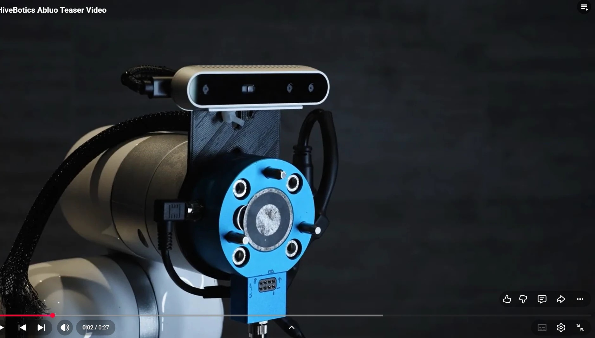
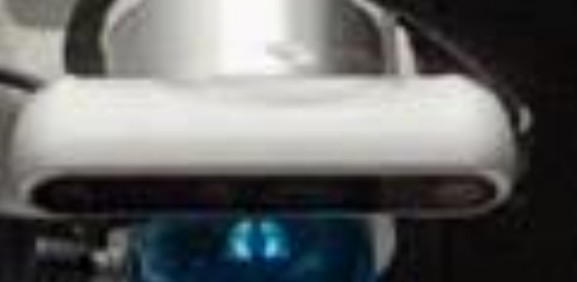

# Hivebotics GitHub (github.com/hivebotics): what the code reveals

[← Hivebotics profile](hivebotics.md) · [← Master document](../COMPETITOR_INTELLIGENCE.md) · Sources: **[S071]** GitHub org + fork diffs, **[S072]** camera spec check · **Added:** 2026-10-08

**What was examined (2026-10-08, via the GitHub API):**
- Org profile and all 5 public repos.
- **Every branch compared against its upstream** (commits ahead, authors, dates, files changed).
- Key diffs read in full (DepthAI, Orbbec, the RealSense commit).
- All 7 contributor profiles.

All repos are **forks of hardware-driver repos**. Hivebotics' own robot code (e.g. `hivebotics_description`, referenced in a commit) is **private**.

## 1. Org

| | |
|---|---|
| Org | **hivebotics** ("HiveBotics", "Autonomous Bathroom Cleaning Robots", Singapore) |
| Created | **20 Jun 2021** (matches "founded 2021") |
| Public repos | 5 (all forks) |
| Public member | **kuralme** (M. Ege Kural) |

## 2. Repos, newest first

| Last push | Repo (fork of) | Hivebotics' own work | Reveals |
|---|---|---|---|
| **21 Sep 2026** | **xarm_ros2** (xArm-Developer = **UFACTORY's official ROS 2 driver**) | **14 branches**, ~20 own commits, Dec 2025 → Sep 2026 | **UF850 arm**, mecanum base, force/torque sensing, compliance control, seat-lift sim, MoveIt Pro, wrist RealSense (sim) |
| **9 Sep 2026** (commits Mar–Jul) | **OrbbecSDK_ROS2** (Orbbec) | 4 commits; merged PR #1 (30 Jul 2026) | **Orbbec Gemini 335Le** depth camera (named in their config) |
| 25 Jan 2026 | **depthai-ros** (Luxonis) | `hivebotics-humble`, `hivebotics-kilted` branches | **Luxonis OAK-D S2 PoE** camera (model file wired into their URDF) |
| Jan 2024 | descartes_capability (MoveIt Cartesian-path add-on) | **No own commits** (extra commits are another fork's) | Weak: Cartesian path tooling explored in 2024 (ROS Noetic era) |
| May 2024 | ydlidar_ros2_driver (YDLIDAR) | **No own commits** | Weak: a **YDLIDAR 2D LiDAR** on an older prototype? `[INF]` |

### Why "xarm" if they use the UFACTORY 850? (Vishal's question)
**`xarm_ros2` is UFACTORY's official ROS 2 package for *all* its arms**: xArm 5/6/7, Lite 6 **and UFACTORY 850**. The name is historical. Hivebotics' commits edit **UF850-specific files**: `xarm_controller/config/uf850_controllers.yaml`, `xarm_description/urdf/uf850/uf850.ros2_control.xacro`, and new low-poly UF850 meshes (`xarm_description/meshes/uf850/collision/link*_low.stl`). Commit: "config(uf850): drop 8.x leftovers from the admittance controller". **This is code-level confirmation of the UF850** `[V][S071]`. Together with the brochure spec match (S061/S063), the arm is now **confirmed**.

## 3. xarm_ros2: branch-by-branch timeline `[V][S071]`

| Date | Author | Commit (abridged) | Meaning `[INF]` |
|---|---|---|---|
| 28–29 Dec 2025 | Arshad Khan | "updated xarm_ros2 package to work internally"; bio_gripper API fix | Fork adopted for production |
| 8 Jan 2026 | Arshad Khan | "added camera name according to rs_launch.py" → RealSense **D435i** macro gets `camera_name:='wrist_mounted'` | **Intel RealSense D435i as wrist camera** (in robot description / Gazebo sim) |
| 20 Jan 2026 | Arshad Khan | "relax some constraints on traj execution to avoid **MTC** failure" | Uses **MoveIt Task Constructor** |
| 1–9 Feb 2026 | Arshad Khan | "added extra joints for **wheel** in joint broadcasters"; "added joint_velocity_controller as **mecanum** won't work"; "removed base joints from arm joints control" | **Mecanum-wheel base** in the same ros2_control setup as the arm |
| 3 Mar 2026 | Cherie (cheriehu) | "use low poly arm meshes for collision and visual geometries" (UF850 meshes) | Faster collision checking |
| 5–16 Mar 2026 | Arshad Khan | added controllers; "**ros2 state interface for topic-based FT sensor**"; platform controllers; joint2 sim pose | **Force/torque sensing** integrated |
| 18 Mar 2026 | kendrickchin | "enable initial pose reading from **hivebotics_description**" | Private robot-description package exists |
| 1 Apr 2026 | yqchau | "updated controller params" | — |
| 16 Jun 2026 | kuralme | "init **moveitpro 9** build" | Testing **PickNik MoveIt Pro 9** (commercial motion-planning platform; general knowledge) |
| 26 Jul 2026 | Dmitri Manajev | "config(uf850): drop 8.x leftovers from the **admittance controller**"; "fix **jtac** warnings" | Admittance (compliant) control. "JTAC" is likely MoveIt Pro's joint-trajectory admittance controller `[INF]` |
| 6 Aug 2026 | shalman-khan | "feat(uf850): add **cartesian_compliance_controller (FDCC)**" | Forward-dynamics compliance control (open-source FZI controller; general knowledge) |
| 11–12 Aug 2026 | shalman-khan, kendrickchin | "enable **ft_sensor_enable/set_zero**, collision_sensitivity/rebound, get_ft_sensor_data services for **real-hardware FT streaming**"; "enable **ft_sensor_iden_load/cali_load** for payload gravity compensation" | These are **UFACTORY's own FT-sensor API calls**, so the robot very likely uses **UFACTORY's 6-axis F/T sensor** on real hardware `[INF]` |
| 13 Sep 2026 | Dmitri Manajev | "fix(ft): align broadcaster frame with Gazebo sensor origin" | — |
| **21 Sep 2026** | shalman-khan | "Add FDCC compliance controller config and **seat-lift sim** hooks" (branch `feat-FDCC-Seat-Lift-Sim-Site`) | **Lifting the toilet seat with force-compliant control**, in simulation |

**Analysis** `[INF]`:
- **Contact-rich manipulation is current R&D** (Mar → Sep 2026): F/T sensing, admittance/compliance control, seat lifting.
- This fits the brochure's "seat lifting, flushing" claims, and suggests those tasks **were still being engineered in Aug–Sep 2026**, after the Mar 2026 Mk2 brochure.
- "Contactless" applies to the *cleaning*; *seat lifting* is contact-based and force-controlled.

## 4. Cameras

| Camera | Evidence | When | Status |
|---|---|---|---|
| **Luxonis OAK-D S2 PoE** (auto-focus) | Their DepthAI fork wires `OAK-D-S2-POE.stl` into the robot URDF as `link_camera` (Arshad Khan, "changes to include this camera in hivebotics") `[V][S071]`. **The brochure's camera specs match it exactly** `[S072]`: stereo **OV9282 1280×800 @120 fps, global shutter, 89.5° DFOV**; colour **IMX378 4056×3040 @60 fps, rolling shutter, 78° DFOV** (78° = AF variant) | Dec 2025 – Jan 2026 | **Confirmed** (code + spec match) as the **Mk2 brochure's depth + RGB camera** |
| **Orbbec Gemini 335Le** (Ethernet) | Named in Hivebotics' added `mode_config.yaml` ("setting these does nothing on gemini 335Le"); custom passive/active/adaptive stream modes to save bandwidth `[V][S071]` | Mar – Jul 2026 | **In use as of Jul 2026.** Possibly additional or replacing the OAK-D. Newer than the brochure |
| **Intel RealSense D435i** | Robot description: `camera_name:='wrist_mounted'` on UF850's D435i macro `[V][S071]` | Jan 2026 | **Wrist camera in the robot model.** A real `/wrist_mounted_camera/color/image_raw` feed appears in the Oct 2025 investor deck screenshot (S075), so **a wrist camera exists on the real robot**; the model on hardware is unconfirmed |

### Camera update, 29 Oct 2026 re-check `[V][S141]` + `[INF]`

**Which depth camera now?** Most likely the **Orbbec Gemini 335Le**:
- The **Luxonis (OAK-D) fork has had no commits since 25 Jan 2026**. The **Orbbec fork** got real feature work in **Jul 2026** ("add passive/active/adaptive publish modes for camera streams", merged 30 Jul by kendrickchin) and an update in Sep 2026.
- The brochure (Mar 2026) still listed OAK-D specs because it was written from the earlier robot. No commit says the OAK-D was removed, so "replaced" is inferred, not proven.
- No camera-related commits between 8 Oct and 29 Oct 2026 (newest work: e-stop recovery, F/T payload compensation, a Foxglove adapter).

**Why switch? (inferred from specs, general knowledge)**

| | Luxonis OAK-D S2 PoE | Orbbec Gemini 335Le |
|---|---|---|
| Depth method | **Passive stereo** (S2 has **no IR dot projector**; the "Pro" model has one) | **Active stereo**: IR projector adds texture |
| Problem in restrooms | White ceramic, tiles and painted walls are **low-texture and shiny**, so passive stereo gives holes or noise in the depth image | Projected IR pattern gives depth on plain/shiny surfaces and in dim light |
| Connection | Ethernet PoE | Ethernet (GigE), rugged (IP-rated) |
| On-board AI | Yes (Myriad X VPU) | No (depth only); their AI runs on the robot PC |

So the likely reason is **better depth on toilets, urinals and walls**. Peanut's CTO named reflective restroom surfaces as a core perception problem (S096/S097).

**What the Orbbec change itself tells us:** the stream-mode feature lets each camera stream publish **only when needed, always, or at a low rate until enough consumers subscribe**. It is a **bandwidth/compute-saving** measure, consistent with **several cameras on one robot network** (Ethernet cameras + PC with an RTX A400).

**Why more than one camera?** Two different jobs `[INF]`:
1. **Body camera** (OAK-D → Gemini 335Le): sees the restroom and the fixture from a distance (navigation, fixture detection, Mask R-CNN segmentation).
2. **Wrist camera** (RealSense D435i in the robot model; a real `/wrist_mounted_camera` feed in the Oct 2025 deck): close-up view from the arm for aligning tools and the **before/after stain check** (deck p.10 shows the wrist feed in MoveIt Pro).

**Clarifications (29 Oct 2026)** `[V][S141]` + `[INF]`:
- **The brochure's "Camera (Depth)" and "Camera (RGB)" are one device.** An OAK-D contains a stereo pair (OV9282, depth) **and** a colour sensor (IMX378) in one housing. So the brochure lists **one body camera**, not two.
- **Order of events:** OAK-D integrated in code **Dec 2025–Jan 2026** → **brochure Mar 2026** describes the OAK-D → Orbbec Gemini 335Le work **Mar–Jul 2026**, *after* the brochure. The brochure is the newest official spec sheet but **older than the camera switch**.
- **RealSense D435i (wrist):** `add_realsense_d435i` is **UFACTORY's own built-in option** in `xarm_ros2` (default off) for its wrist-camera kit. Hivebotics only renamed the camera to `wrist_mounted`. The deck photo (Oct 2025) shows a **slim bar camera on the wrist**, consistent with UFACTORY's RealSense kit. Model on the real robot: likely D435i, not proven.
- **Body camera location: not visible in any photo** (deck Oct 2025, brochure Mar 2026). The OAK-D's URDF link (`link_camera`) is defined, but its mount point sits in Hivebotics' **private** `hivebotics_description` package. It may sit behind a front window/panel or low on the base; brochure images are renders/composites. Unresolved.

### Camera generations seen in Hivebotics' own videos (Vishal, 29 Oct 2026) `[INT][S142]` + `[INF]`

Hivebotics' YouTube playlist has 24 videos from **Nov 2021 to Aug 2026** (prototypes → Abluo M1 → Abluo Mark 2).

| Generation | Video / date | Camera seen | Identification |
|---|---|---|---|
| **Prototype** | "HiveBotics Abluo Teaser Video" (uploaded **9 Nov 2024**) | **Silver bar camera on top of the wrist tool-changer plate** (blue plate, 3D-printed bracket) | Looks like an **Intel RealSense D415** (Vishal, Google image match). D415 and D435 look almost identical; the small lenses fit the D415 `[INF]` |
| Prototype | same teaser | Dome sensor with a finned base, low on the robot | **Livox Mid-360** (image match). ⭐ First **visual** evidence for the Mid-360, which we had only from brochure specs |
| **Abluo Mark 1** | Mark 1 videos (Dec 2024 – Mar 2025) | **Different wrist camera: white housing, dark front strip, small grills on both sides** | Unidentified. Candidate: **UFACTORY's wrist camera module** (a RealSense inside a white UFACTORY housing; the `add_realsense_d435i` option in their xarm_ros2 code) `[INF]` |
| **Abluo Mark 2** | Mark 2 videos/photos (2026) | **Black camera** | Most likely the **Orbbec Gemini 335Le** (matches the GitHub work, Mar–Jul 2026) `[INT]` + `[INF]`. Caveat: the OAK-D S2 PoE is also dark, so colour alone can't separate them |

**So the camera changed at least three times**: RealSense (D415-type, 2024) → white-housed wrist camera (Mark 1, 2025) → OAK-D S2 PoE in code and brochure (Dec 2025 – Mar 2026) → Orbbec Gemini 335Le (Mark 2, 2026). The pattern fits a team still searching for depth that works on white, shiny restroom surfaces `[INF]`.

 

**Direct evidence links (verified 29 Oct 2026):**
- **Luxonis OAK-D S2 PoE:** commit "changes to include this camera in hivebotics" (Arshad Khan, 28 Dec 2025): https://github.com/hivebotics/depthai-ros/commit/32b74a06f6b1102697fce02cdf1b432c73b09408 · the line loading `OAK-D-S2-POE.stl` as `link_camera`: https://github.com/hivebotics/depthai-ros/blob/hivebotics-humble/depthai_descriptions/urdf/include/base_macro.urdf.xacro#L63
- **Orbbec Gemini 335Le:** the config line naming the camera ("…does nothing on gemini 335Le…"): https://github.com/hivebotics/OrbbecSDK_ROS2/blob/641dbf7a67caa7c410d8cecfea28e4e3c1123a74/orbbec_camera/config/mode_config.yaml#L15 · pull request #1 (merged 30 Jul 2026): https://github.com/hivebotics/OrbbecSDK_ROS2/pull/1
- **RealSense D435i wrist camera (`wrist_mounted`):** commit by Arshad Khan, 8 Jan 2026: https://github.com/hivebotics/xarm_ros2/commit/c9b7b0cd8412747d80d8a522328196619812bdc8
- **Mark 1 white wrist housing** matches **UFACTORY's RealSense camera stand** (white plate + D435-shaped holder; Vishal's image match, 29 Oct 2026) `[INT]`.

**New activity (Oct 2026):** `xarm_ros2` branch `fix-hold-pose-after-recover` by **Vishalsub** (23 Oct: "keep motion off and pose valid through e-stop so recover cannot servo zeros"); `test-in-sim-peera` (28 Oct, F/T payload compensation); new fork **`foxglove-ros-adapter`** (Dmitri Manajev, 28–29 Oct): **Foxglove** web visualisation/teleop for ROS (general knowledge).

| YDLIDAR (2D) | Fork with no own commits | 2024 | Weak: older prototype? |

Not visible on GitHub: the **3D LiDAR** (Livox Mid-360 per brochure, S061). There's no Livox driver fork; they may use upstream `livox_ros_driver2` unmodified `[INF]`.

## 5. Software stack (from code) `[V][S071]`, `[INF]` where marked

**ROS 2 Humble** (Ubuntu 22.04; also building on Kilted) · **ros2_control** (arm + mecanum wheels) · **MoveIt 2** + **MoveIt Task Constructor** · **MoveIt Pro 9** (being tested, Jun 2026) · admittance controller ("JTAC") + **FDCC cartesian compliance controller** · **Gazebo** simulation (toilet / seat-lift sim sites) · Docker/CI · private `hivebotics_description`.

## 6. Contributors `[V][S071]`

| GitHub | Name | Profile says | Hivebotics work | Window |
|---|---|---|---|---|
| **arsh09** | **Muhammad Arshad Khan** | Senior Software Engineer, **JABAS.AI**, **Lincoln, UK** | Initial integration of xarm_ros2, DepthAI and Orbbec forks; mecanum/FT/controllers | Dec 2025 – Mar 2026. Possibly a contractor or remote engineer `[INF]` |
| **kendrickchin** | **Kendrick Chin** | (empty) | Merges PRs; hivebotics_description; real-hardware FT | Jan – Aug 2026. **Head of Engineering** (LinkedIn, S064) |
| **yqchau** | **Yuan Qi Chau** | Company: **"@hivebotics"**; bio "Optimizing Signal v. Noise" | Controller params | Apr 2026 |
| **legalaspro** | **Dmitri Manajev** | Zurich/Remote; manajev.com | Admittance controller, FT frame | Jul – Sep 2026 (joined May 2026, S067) |
| **shalman-khan** | **Shalman Khan** | (empty) | **FDCC compliance, FT services, seat-lift sim; Orbbec stream modes** | Jul – Sep 2026 |
| **cheriehu** | **Cherie Hu** | (empty) | Low-poly UF850 meshes | Mar 2026 |
| **kuralme** | **M. Ege Kural** | kuralme.github.io; **only public org member** | MoveIt Pro 9 build | Jun 2026 |

## 7. What this means for Ubanthu `[INF]`

1. **Hardware is now fully mapped and commodity:**
   - arm: UFACTORY 850 (+ likely UFACTORY F/T sensor);
   - cameras: Luxonis OAK-D S2 PoE → Orbbec Gemini 335Le, plus a RealSense D435i on the wrist;
   - LiDAR: Livox Mid-360;
   - compute: AMD Ryzen + NVIDIA GPU;
   - base: custom mecanum.

   Everything is off the shelf.
2. **Their engineering focus in 2026 is manipulation control** (force/compliance, seat lifting, motion planning), **not perception**. **Nothing public touches contamination detection or the "scored before/after check"**; that code (if it exists) is private.
3. **Small, distributed, partly remote team** (Singapore, Zurich, UK, US field), with a tooling choice of a commercial planner (MoveIt Pro).
4. **Camera churn** (OAK-D → Orbbec within ~6 months, plus a RealSense) suggests **perception hardware is still being iterated**.

## Open questions
- [ ] Is the Orbbec Gemini 335Le replacing the OAK-D S2 or added alongside it (e.g. base vs. arm)?
- [ ] Does the real robot have the RealSense D435i at the wrist? (A wrist camera is confirmed on real hardware via the deck's MoveIt Pro screenshot, S075)
- [ ] Which UFACTORY F/T sensor (model, range)?
- [ ] Do Arshad Khan (UK, JABAS.AI) and others work for Hivebotics as employees or contractors?
- [ ] Any public repos by Kendrick Chin, Shalman Khan, Yuan Qi Chau or Cherie Hu with more Hivebotics work?
