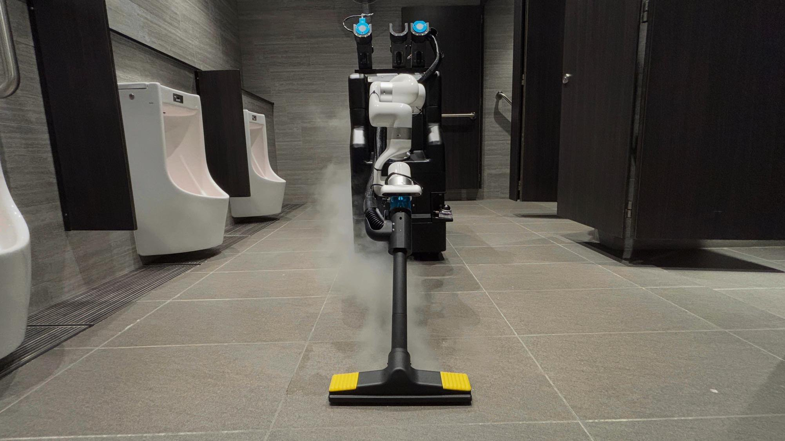
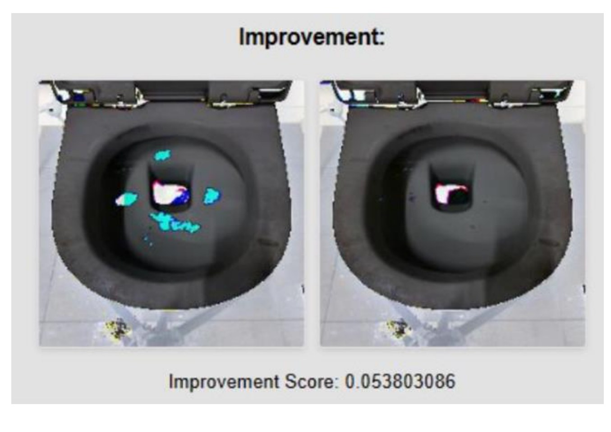
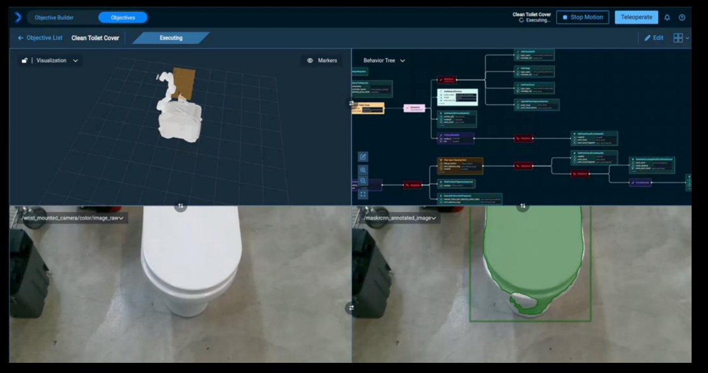
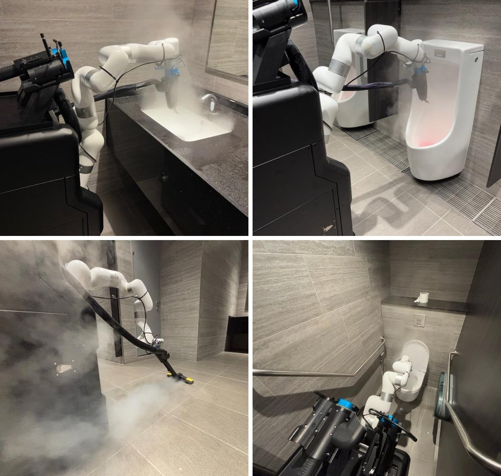

# Hivebotics Pre-A / Series A investor deck (24 Oct 2025)

[← Hivebotics profile](hivebotics.md) · [← Master document](../COMPETITOR_INTELLIGENCE.md) · Sources: **[S075]** deck, **[S076]** financial model / ROI calculator, **[S077]** video list · **Added:** 2026-10-10

**Source document:** `Series_A_Investor_Reading_Deck.pdf`, from the "Series A Fundraising" zip downloaded from the Hivebotics website (per Vishal). The deck folder is **kept local only, not pushed to GitHub**. Path: `hivebotics/Series A Fundraising/(1) Decks/`.
- **Format:** 31 pages: 15 main slides + appendix.
- **Cover date:** "Pre-A Investor Deck | 24 OCT 2025".
- **PDF metadata:** author **Rishab Patwari**; created 5 Jan 2026.
- **Page images:** all pages are in [deck_pages/](deck_pages/) (`series-a-deck_pNN.jpg`). **Local only, not pushed**; only the cropped figures in `screenshots/` are on GitHub.

All numbers below are **company claims made to investors** `[CC][S075]` unless tagged otherwise. Investor decks are optimistic by design.

---

## 1. ⭐ Cleaning validation: how the "scored before/after check" works (p.10, p.20, p.26)

**This is the most important finding for Ubanthu.** Our top open question was how Hivebotics scores cleaning. The deck shows it:

**What the screenshot shows** `[V][S075]`:
- Panel title "Improvement:"; two **top-down photos of the same toilet bowl**, before and after.
- **Everything outside the bowl is greyed or masked**, so only the bowl region is analysed.
- In the before image, **soiled areas are highlighted as cyan/white blobs**. Most are gone in the after image; one bright patch at the drain stays in both.
- Below: **"Improvement Score: 0.053803086"**, a single unitless number.
- Slide text: "Robot **verifies cleaning performance & repeats cleaning if necessary**."

**Analysis** `[INF]`:
- The mechanism looks like **(1) segment the fixture, (2) find stain pixels inside it, (3) compare stain area before vs after**.
  - The blob shapes and colours look like **pixel-level anomaly or colour-threshold detection**, not bounding boxes from a trained stain detector. Can't be sure from one screenshot.
  - Score 0.0538 is plausibly a **fraction of the bowl area** (≈5% of pixels changed from dirty to clean).
- **Weaknesses visible:** the drain/water patch is flagged in both images (likely specular reflection or water, a known false positive). The score is a raw float with no threshold or pass/fail shown.
  - **This is a demo UI, not a product-grade verification report.** It looks like a research prototype.
- **Implication for Ubanthu:** Hivebotics has *a* before/after metric, but it appears **simple (area-based, single score, RGB only)**. Ubanthu can differentiate on:
  - **what** is detected (contamination type: urine, faeces, biofilm, scale; not just "dirt");
  - **how robustly** (water/reflection rejection, lighting);
  - **the evidence produced** (an auditable, per-zone report rather than one float).

**Other AI evidence:**
- **p.10, "AI Scan & Plan" screenshot** `[V][S075]`:

  

  - This is the **PickNik MoveIt Pro** UI: "Objective Builder", "Objectives", a "Clean Toilet Cover" objective "Executing", a behavior tree, and "Teleoperate".
  - Camera topic **`/wrist_mounted_camera/color/image_raw`**, so **the wrist camera exists on real hardware**, not only in simulation (see [GitHub file](hivebotics-github.md): RealSense D435i `camera_name:='wrist_mounted'`).
  - Topic **`/maskrcnn_annotated_image`** shows the **toilet seat/lid segmented with Mask R-CNN** (green mask + box). So **fixture segmentation = Mask R-CNN** `[V]`.
- **p.20 "Our Tech – A.I." claims** `[CC]`:
  - Scan & Plan (real-time fixture detection, obstacle-aware path generation);
  - **"Multi-Surface Stain Detection – AI models detect spills, dirt, and stains to verify cleaning quality"**;
  - autonomous mapping/setup ("cuts setup time by 90%");
  - multi-floor path planning;
  - predictive clogging/maintenance detection.
- **p.26 roadmap (Q1 2025 → Q1 2026)** `[CC]`. *This slide is numbered "2", so it is borrowed from another deck.*
  - **Inspection track:** Stains Detection → **Automated Cleaning Quality Validation** → Clogging & Anomaly Identification → Scenario-based Cleaning Behavior.
  - **Set-up track:** Automated Cleaning Path Generation → Key Point Detection → Object Detection & Segmentation → "Robot can be set up by end user" (Q1 2026).

## 2. Traction claims (p.7, p.9, p.11) `[CC]`

| Claim | Value | Note `[INF]` |
|---|---|---|
| Sites piloted | **20+ sites over 12+ months, 4 countries** | Same as Vertex release (S056) |
| Run hours | ">2,000 hours of daily runs" (Oct 2025) | Vertex release (Sep 2026) says ~10,000 h, i.e. **~5× growth in ~11 months** |
| Pilot sites shown (p.7) | **Rome Airport Terminal 3** (video stamp 6 Mar 2025), **Airport Cargo Complex Singapore**, **airport terminal USA**, **hospitals Singapore**, **shopping mall Abu Dhabi**, **office building Abu Dhabi** | |
| LOIs | **"$150M+ worth of LOIs"** in SG, USA, Europe; "LOI: 1,200 units" (p.9); "LOI partners demand 2,000 robots/year at 50K/robot" (p.8); "committed pipeline >3,000 robots" (p.12) | **Internally inconsistent:** 1,200 vs 2,000 vs >3,000 vs 5,086 units (sum of the p.11 table) |
| Purchase orders | **"$1.8M+ POs received"** in SG, USA, Middle East (p.11); table total says "USD 1.8K +"; **"Orders: 11 units" (p.9)** vs **35 POs** in the p.11 table | **Inconsistent:** 11 units × ~US$55k ≈ $0.6M; 35 × $55k ≈ $1.9M |
| Capital raised (as of Oct 2025) | **US$2.5M, "Institutional & Sovereign Capital"** | ≈ Crunchbase pre-seed $1.3M + seed $1M + NUS GRIP. **Explains Gemini's "$2.5M": it was cumulative capital, not a bridge round** `[INF]`. "Sovereign" may refer to NUS (government-funded university) or a government fund |
| Dollars spent | **US$1.5M** to date (p.9) | Very capital-efficient |
| Cleaning efficacy | ">80% cleaning efficacy, tested with hospital infection control teams, cleaning experts and government bodies" | Method/metric not stated |
| Time saving | ">70% human time savings": restroom with 8 fixtures, 30 min human → 30 min robot + **5 min human** | Robot is *not faster* than a human; the saving is human labour |

**Pipeline table (p.11):**

| Region | Key clients | Estimated & LOI demand (units) | POs (units) |
|---|---|---|---|
| North America | Facility management | 1,000 | 10 |
| Singapore | Airports | 16 | 1 |
| Singapore | Commercial buildings | 500 | 15 |
| Singapore | Hospitals | 2,000 | 5 |
| Singapore | Schools | 1,500 | 1 |
| Hong Kong | Commercial buildings | 30 | 1 |
| Middle East | Commercial buildings | 40 | 2 |

## 3. Pricing & unit economics

| Item | Value | Source |
|---|---|---|
| **Robot price** | **~US$50k per robot** (p.8); model: **US$65k (yr 1) → US$55k (yr 5)**; ROI sheet "Selling price of robot + AMC: US$55,000" | `[CC][S075][S076]` |
| **RaaS (monthly)** | **US$2,000/month** (p.9). Rome case: **€1,250/month**; Singapore cases: **S$2,000/month** (+ S$1,000 security add-on); model: lease **US$2,275 → 1,925/month** (3.5% of purchase price per month) | `[CC][S075][S076]` |
| Paid trial | US$4,550/month (2× the lease rate; model) | `[S076]` |
| **Unit cost (COGS incl. 10% warranty)** | **US$53,750 (yr 1) → ~US$24,400 (yr 5)**. So **gross margin on the first robots was ~17%** (65k vs 53.75k) | `[S076]` (model dated 30 Jul 2024) |
| Robot life | 4 years | `[S075][S076]` |
| Prototype cost | "@ $50K per unit" for internal prototypes | `[S076]` |
| Business model | **CapEx** sale · **RaaS** · **AMC + features** (annual maintenance with software add-ons) · premium software tiers ("Hivebotics Tier 2 & 3 Software Bundles") | `[CC][S075]` |
| Planned mix (Singapore, from Phase 3) | Upfront sale + AMC **30%**, hybrid RaaS **70%** | `[CC][S075]` |

**Customer ROI case studies (p.22–24)** `[CC]`:

| Site | Before | After | Annual saving |
|---|---|---|---|
| **Rome Airport terminal** (106 restrooms, 3 shifts) | 53 cleaners × 3 shifts, €3.1M/yr | **27 robots** + 27 cleaners × 2 day shifts + 5 night | **€1.54M (49%)** |
| Rome: 8-floor building, 32 restrooms | 2 cleaners × 2 shifts, €78.4k | 1 robot + 1 cleaner × 2 shifts | €24.2k (30%) |
| **City Square Mall, Singapore** (26 restrooms) | 9 day + 2 night cleaners; 4 night security staff | 5 cleaners + **4 robots** day; robot security patrol at night | S$171k (30%), incl. S$72k from **robot security patrol** |
| **Singapore airport cargo complex** (8 buildings × 24 restrooms) | 2 cleaners per building | 1 robot + 1 cleaner per building | S$120k (19.2%) |

**Labour assumptions:** Rome cleaner €1,600/month loaded; Singapore cleaner S$3,250/month; US model US$3,500/month.

**Analysis** `[INF]`:
- At ~US$50–55k per robot and ~US$2k/month RaaS, the robot pays back on **roughly 0.6 of a cleaner's salary** in high-wage markets.
- **This only works where wages are ≥ ~US$2k/month.** In India (cleaner ~₹12–20k/month, ~US$150–250; general knowledge), the same robot cannot compete on labour arbitrage. That's a pricing gap a low-cost Indian design could fill.
- Note the **security-patrol add-on**: they pitch the robot as multi-purpose (roadmap: door opening, trash picking, lift).

## 4. Competitor comparison as Hivebotics sees it (p.9)

| | **Hivebotics** | **Somatic** (US) | **Primech AI** |
|---|---|---|---|
| Dollars spent | US$1.5M | US$20M+ | US$5M+ |
| Traction | LOI 1,200 units; orders 11 units | 10+ pilots | 2+ pilots |
| **RaaS monthly price** | US$2K | **US$4.5K** | **US$1.8K** |
| Geographies | Europe, North America, East Asia, Middle East | US | Singapore |
| Cleaning tools | High-pressure steam, chemical water jet, blower, vacuum | Chemical water jet, blower, vacuum | Mechanical brush, blower, wiper |

- Claim: "Hivebotics is the only one offering **multifunctional facility management** and not just toilet cleaning."
- Claim: "Hivebotics uses **professional cleaning tools from Kärcher**, the world's largest cleaning equipment manufacturer."
- **Somatic** was new to our knowledge base. Profile created: [somatic/somatic.md](../somatic/somatic.md).

**Competitor funding history (appendix p.28–29)**, PitchBook screenshots `[3P via CC][S075]`:

| Company | Rounds shown | Raised to date |
|---|---|---|
| **Somatic** | Capitalization Jan 2018 $0.05M; accelerator Jan 2018 $0.15M; accelerator 18 Mar 2020 $0.15M (post-val $2.14M); **Series A 1 Mar 2022 $7.16M (pre $20M, post $27.16M)** | $7.51M |
| **Pudu Tech** | Seed Jun 2016 → Series A Jun 2018 $7.85M (post $59.62M) → B/B1 2020 → C1 Apr 2021 $76.58M → C2 Aug 2021 $78M → C3 Feb 2023 $14.74M → later-stage VC May 2023 | $205.55M |
| **Avidbots** | Accelerators 2014 → seeds 2015–18 → Series A May 2018 $3M → Series B Feb 2019 $27M → later-stage VC Nov 2021 → **Series C Sep 2022 $70M** | $104.96M |
| **Peanut Robotics** | Accelerator Jun 2018 $0.1M (post $2M); grant Feb 2021 $0.05M; seed Feb 2021 $5M (post $20M); **seed May 2022 $4.5M (pre $35.5M, post $40M)** | $9.5M |

*Note: the deck says Somatic spent "US$20M+", but its own PitchBook slide shows only US$7.51M raised. One of the two is wrong (or Somatic raised more after 2022).*

**Valuation benchmarks (appendix p.30–31):** a seed–pre-IPO valuation table (e.g. Series A $15–50M at $0.5–2M ARR) and revenue multiples (hardware 3–6×, RaaS 8–15×, software 10–20×). **These are screenshots of a ChatGPT-style chat answer** (dark chat UI, scroll arrow), not market data `[INF]`.

## 5. Go-to-market, partners and distributors (p.21) `[CC]`

| Phase | Product | TRL/MRL | Units |
|---|---|---|---|
| 1 (Jun – Dec 2025) | **Mark 1**, build to order | TRL 7 / MRL 7 | **10** |
| 2 (Jan – Jun 2026) | **Mark 2A**, pilot production line | TRL 8 / MRL 8 | **30** |
| 3 (Jul – Dec 2026) | **Mark 2B**, certifications completed for US/EU/JP | TRL 8 / MRL 9 | **100** |
| 4 (Jan – Jun 2027) | **Mark 2C**, mass production at optimized cost | TRL 9 / MRL 10 | **210** |

**Partners by region:**

| Region | Partners | Role |
|---|---|---|
| **Singapore** (global HQ) | **Re-Sustainability**, **ISS – BSC**, **JTC** (government agency), **SKH** (hospital partner; likely Sengkang General Hospital `[INF]`), **CAG** (airport partner; likely Changi Airport Group `[INF]`) | Direct distribution & after-sales |
| **Hong Kong / Macau** | **Chaico** | Distributor; regional support office (HK) |
| **Middle East** | **Kintsugi** | Partner & distributor (Abu Dhabi videos: "Kintsugi Office") |
| **USA** | **PCCI / Nexus** | Distributors |
| **Canada** | **Bunzl** | Distributor |
| **Nordics** | **Ready Robotics** | Distributor (Europe pilots from H2 2026) |
| **Global strategic accounts** | **Sodexo, ISS, OCS** | Pilots, then commercial launch |

**Technology partners** `[CC][S075]`:
- **Kärcher Singapore:** "MOU partner and supplier for integration of Kärcher equipment". The steam, vacuum and floor tools are Kärcher; the photos show a Kärcher-style yellow floor nozzle.
- **PickNik Robotics (USA):** "Key R&D partner for robot arm control". The robot runs **MoveIt Pro** ("used by NASA & US Space Force"; "cut R&D time by months").
- **Formant:** "Integration with **Formant** for robot fleet management and AI driven deployment" (p.19).

**What they were raising:** **US$5M Series A** (closed at US$6M in Sep 2026, S056). They also sought strategic financing (supply chain, invoice financing), corporate pilots, co-development (e.g. **elevator integration**) and regional distributors.

**Market sizing (p.8):** TAM $1T (global FM labour spend 2024); SAM $600B; SOM $47B (global service robots 2024); launch market $100M. Service-robot CAGR 20% (2022–32).

**Growth plan (p.12):** "USD 150M ARR by 2029", 40%+ recurring, >50% gross profit.

| Year end | Revenue | Units | Note |
|---|---|---|---|
| Dec 2026 | $10M | 150 | |
| Dec 2027 | $30M | 450 | |
| Dec 2028 | $60M | 1,000 | Cashflow positive |
| Dec 2029 | $100M | 1,500 | |
| Dec 2030 | $150M | 2,000 | |

**Exit (p.25):**
- **Strategic M&A in 2–4 years at $100–300M**, "ongoing discussions" with **Kärcher, Xiaomi, SoftBank Robotics**.
- PE/growth equity in 3–5 years (3–6× revenue), **Boulevard Capital Partners**.
- IPO in 5–7 years.

## 6. Team & advisors (p.14) `[CC][S075]`

| Person | Role | Deck bio |
|---|---|---|
| Rishab Patwari | Co-Founder, CEO | Comp. Engineering (NUS); Marketing (Stanford); "3 years exp as full-stack developer in Series A to Series C startups" |
| Nguyen Tuan Dung | Co-Founder, COO | Mech. Engineering (NUS); "3x Team Lead for winning team for World Robotics Championship" |
| Vincent Sim | CSO | 8 yrs MD, Kärcher Singapore; 8 yrs GM, Fuji Xerox (ASEAN & Emerging Markets) |
| Viswanath B. | CTO | "7+ yrs as Lead Engineer (from early stage to IPO startups)", "10+ yrs in robotics". **Vorwerk** logo under his column (likely ex-Vorwerk `[INF]`) |
| YW Lee | Business Advisor | Ex-APAC Director, Sodexo |
| Prof Marcelo Ang | Technical Advisor | Director, Advanced Robotics Centre, NUS |
| **Avash Pardhootman** | US Fundraising Advisor | Plug & Play Tech Center |
| **Leong Siew Why** | Operations Advisor | — (HK PolyU logo on the slide; unassigned) |
| **Jonathan Chuah** | Finance Advisor, angel investor | INSEAD |
| **Clement Cheng** | Business Advisor, angel investor | "Raised USD 200+M as CEO of AsiaIndo Group" |

**Two angel investors are named:** Jonathan Chuah and Clement Cheng. They are likely among the "Hivebotics Pre-Seed Investors Holdings" (S073) `[INF]`.

## 7. Other claims worth noting

- **Patent:** p.10 says "**Patent Pending: WO 2023/075687 A2**". That application **ceased ~Apr 2024** with no national filings (S065/S066). Calling it "pending" in an Oct 2025 investor deck is **inaccurate** `[INF]`.
- "Proudly **Developed & Assembled in Singapore**" (p.10).
- **Problem slide (p.2):** Singapore cleaners average 70+ years of age; 40% monthly turnover; 30% daily absenteeism; >6% annual opex increase, labour 70% of cost.
- **Hardware (p.18):** "Custom Integrated AMR", "Custom Cleaning Tools" (Kärcher), "**Automatic Tool Switching**" (modular tool rack).
- **Software (p.19):** onboard UI (restroom/fixture selection, battery and tank levels), Formant fleet management, remote monitoring & **teleoperation**.
- **Airline-seat cleaning variant:** the zip contains "Airline Seat Cleaning Variant Concept Video" and "**ForSatek POC Demo**". This is a second product line in development (customer/partner "Satek"? unidentified) `[S077]`.

*Abluo Mark 1 in action (deck p.3): sink steam, urinal, floor steam (Kärcher-style nozzle), toilet. Note the **tool rack with blue quick-connect handheld wands** and the white **UFACTORY 850** arm.*

## 8. Operations history from the video file names `[V][S077]`

The zip's video folder dates every major milestone. Videos were not watched (Vishal has seen them); titles and YouTube links:

| Date | Milestone | Link |
|---|---|---|
| **Sep 2023** | Abluo **Proto 1**: JTC LaunchPad handicap-toilet testing | https://youtu.be/HNZ8SRwTuhI |
| **Oct 2023** | Proto 1: **Changi Airport T3 taxi-stand** toilet testing | https://youtu.be/HdkMvUTsyDA |
| Feb 2024 | Proto 1: Milestone 1 | https://youtu.be/Hu-yYZEUDtw |
| **Mar 2024** | Proto 1: **Kajima "The Gear"** demo (Kajima's Singapore R&D building) | https://youtu.be/z7rwFuWOntA |
| Jul 2024 | **Proto 2**: commercial cleaning system integrated | https://youtu.be/BAYHU8-0K4k |
| Oct 2024 | Proto 2: functional cleaning video | (mp4 in zip) |
| **Dec 2024** | **Abluo M1** (Mark 1), "Hivebotics V1B" clip | (mp4 in zip) |
| **Mar 2025** | Mark 1: **Abu Dhabi, Kintsugi office** | https://youtu.be/7gKrl6LHlz4 |
| Mar 2025 | Mark 1: **Abu Dhabi, One Nation Tower shopping mall** | https://youtu.be/oj-ehMQe35Q |
| **Mar 2025** | Mark 1: **Rome Airport Terminal 3** | https://youtu.be/OX2Frkye--I |
| Mar 2025 | Mark 1: "AI Restroom Cleaning Robot" | https://youtu.be/CJAWnxS1ZGA |
| — | Concept video | https://youtu.be/jk5z_yDPQMs |
| — | **Cleaning quality tests:** sink full clean, sink steam test, sink water-jet test, **toilet inner-bowl cleaning**, **toilet seat cleaning** | (mp4s in zip) |
| — | **Airline seat cleaning variant:** concept video + **ForSatek POC demo** | (mp4/mov in zip) |

**Other zip contents:**
- **Client ROI Calculator.xlsx** (S076). Sheets: Labour Arbitrage; Time-Motion Study (small/medium/large toilet); 5-year P&L, cash flow and valuation (DCF + P/S); last updated **30 Jul 2024**.
  - The 2024 model planned **20 robots sold in yr 1 (2024–25)**, R&D team 7 → 25 (at US$110k/yr each), founders 2 at US$50k/yr.
- **Market sizing:** Google Sheets links (SG, US), not opened.
- **Wage references:** US BLS janitor wages by state; Singapore MOM Progressive Wage Model (cleaning sector).
