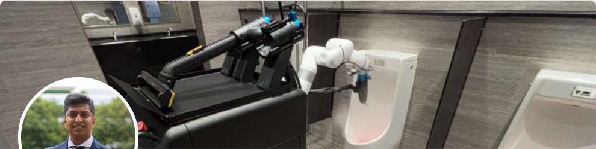
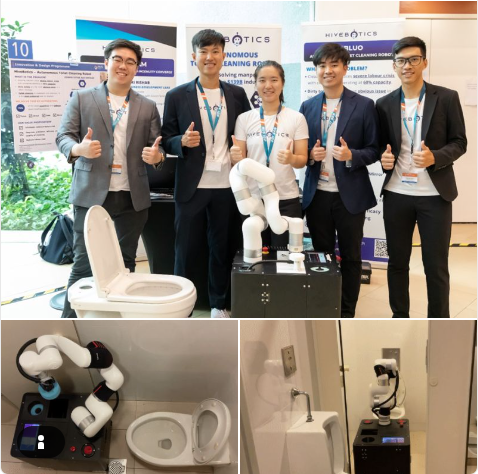

# Hivebotics

[← Back to master document](../COMPETITOR_INTELLIGENCE.md) · [Sources](../SOURCES.md) · **Last updated:** 2026-10-08

Tags: `[V]` verified · `[3P]` third-party · `[CC]` company claim · `[INF]` inferred · `[UNV]` unverified · `[CONFLICT]` · `[INT]` internal observation / opinion from our team. `[S012*]` = cited by S001, not yet opened by us.

**Threat level:** 🔴 **Main benchmark.** The best-funded and most-deployed direct competitor on file, and the **only one that claims scored before/after cleaning verification**, which is Ubanthu's core territory.

## Snapshot

| | |
|---|---|
| **Legal name** | Hivebotics Pte. Ltd., UEN 202224434W, incorporated **14 Jul 2022** `[UNV][S055]`. Verify on ACRA |
| **Founded** | **2021**, out of the National University of Singapore (NUS) `[CC][S056]`. *2021 = project start, 2022 = incorporation; both can be true* |
| **HQ** | Singapore; LaunchPad @ one-north, Ayer Rajah Crescent `[UNV][S055]` |
| **Website** | https://hivebotics.tech/ `[S056]` (older: hivebotics.com `[S020*]`) |
| **Product** | **Abluo** (Mark 1 → **Mark II**): mobile robot with an articulated arm; cleans toilets, urinals, sinks, floors `[CC][S056]` |
| **Software** | **HiveIntelligence**, a "physical AI layer that plans, monitors and validates every cleaning job"; fleet dashboard `[CC][S056]` |
| **Stage** | Moving from pilots to **volume production** `[CC][S056]` |
| **Traction** | **~10,000 operating hours over 12 months, 20+ sites** in Asia, Europe, Middle East and North America (hospitals, airport terminals, malls) `[CC][S056]` |
| **Team size** | ~15–18, scaling to ~18 after the Series A `[UNV][S055]`; **≥8 current staff named** on LinkedIn (SG, Zurich, Florida) `[S064]` |
| **Offices** | Singapore HQ (81 Ayer Rajah Crescent); US (Delaware address); Hong Kong (Tsim Sha Tsui) `[CC][S061]`; **field deployment in Orlando, FL** `[S068]` |
| **IP** | **WO 2023/075687** (NUS-owned; inventors incl. both founders): **ceased Apr 2024, no national filings**, so no protection `[V][S065][S066]` |
| **Folder** | [hivebotics/](./) |

## Funding history

| Date | Round | Amount | Investors | Source |
|---|---|---|---|---|
| 2023 | Accelerator / pre-seed | ~US$244k | — | `[UNV][S055]` |
| 2025 | Seed extension / bridge | ~US$2.5M | — | `[UNV][S055]` |
| **4 Sep 2026** | **Series A** | **US$6M** | **Vertex Ventures SEA & India (lead)**, **Fareast Land Development (Farglory Group)**, **Rigel** (smart-restroom products maker) | `[V][S056]` |

**Analysis** `[INF]`:
- **Rigel is a strategic investor**: a restroom-fixture manufacturer could become a distribution or OEM channel.
- **Farglory** is a large Taiwanese property group, suggesting a Taiwan or real-estate deployment channel.
- Vertex's remit covers India, so **India entry is plausible**.

## Products & technology

**Deep dive:** [Abluo Mark 2 specs and hardware identification](hivebotics-abluo-mk2-specs.md) (brochure, March 2026) · [Patent WO 2023/075687 (NUS, ceased): 2021–22 prototype](hivebotics-patent-WO2023075687.md) · [GitHub: what the code reveals](hivebotics-github.md)

**Hardware supplier summary (as of 2026-10-08):**

| Component | Supplier / model | Status | Source |
|---|---|---|---|
| **Robot arm** | **UFACTORY 850** (UFACTORY, China) | **Confirmed:** brochure specs match (S061/S063) **and** Hivebotics' GitHub edits UF850-specific config, URDF and meshes in UFACTORY's `xarm_ros2` driver (S071) | `[V][S071]` + `[S061][S063]` |
| **Force/torque sensor** | Likely **UFACTORY 6-axis F/T sensor** | Code enables UFACTORY FT-sensor API calls "for real-hardware FT streaming" (Aug 2026) `[INF]` | `[S071]` |
| **3D LiDAR** | **Livox Mid-360** (Livox, DJI-affiliated, China) | **Identified, high confidence:** all 6 brochure specs match, incl. the distinctive 360° × 59° FOV | `[CC][S061]` + `[S063]` |
| **Compute** | **AMD Ryzen Embedded 8845HS + NVIDIA RTX A400** | **Named in brochure** | `[CC][S061]` |
| **Depth + RGB camera** (brochure) | **Luxonis OAK-D S2 PoE** (auto-focus) | **Confirmed:** model file wired into Hivebotics' URDF (S071) **and** brochure specs match exactly: OV9282 1280×800 @120 fps GS 89.5°; IMX378 4056×3040 @60 fps 78° (S072) | `[V][S071][S072]` |
| **Depth camera** (newer) | **Orbbec Gemini 335Le** | Named in Hivebotics' Orbbec driver config (Jul 2026); role vs OAK-D unknown | `[V][S071]` |
| Wrist camera | **Intel RealSense D435i** (in robot description) | `wrist_mounted` D435i in arm URDF/sim (Jan 2026); real hardware unproven | `[S071]` |
| Mobile base | **Mecanum** drive (custom; ros2_control) | Commits: "added joint_velocity_cotnroller as mecanum won;t work" (sic); "added extra joints for wheel". Supplier unidentified | `[V][S071]`, `[S061]` |

**From the Series A release** `[CC][S056]`:
- **Contactless cleaning:** high-pressure steam, a targeted chemical jet, vacuum extraction and blow-drying. An arm reaches under rims and around fixtures. **No brushes or cloths**; they cite cross-contamination between cubicles.
- **Onboard vision identifies each fixture.** A proprietary AI pipeline **generates the cleaning route in real time**.
- ⭐ **"Every job ends with a scored before-and-after check, so cleaning outcomes can be audited rather than assumed."**
- Replaces ~30 min of manual work with a **5-minute human inspection**.

**Photo evidence: Abluo cleaning a urinal** `[V][S058]` (Rishab Patwari's LinkedIn banner, captured 2026-10-06):

- **Black box-shaped body** with an open **tool rack on top** holding several **long black handheld wands**: one with a rubber squeegee or extraction head, others with **blue quick-connect fittings and hoses** (steam, water or vacuum lines `[INF]`).
- A **white multi-joint collaborative arm** (white links, grey joint bands) holds a nozzle tool and sprays a **visible vapour plume** into a urinal, consistent with the contactless steam claim.
- Pattern `[INF]`: the arm **picks up handheld tools from a rack** (tool changing), not a fixed end-effector.
- No LiDAR is visible in this crop. The photo date is unknown, as is whether it shows Mark 1 or Mark II.

**Abluo Mark 2 key specs** `[CC][S061]`: 75 × 46 × 150 cm; 180 kg (200 kg full); 13 L water / 5 L waste / 2 L chemical; **steam up to 173 °C at 3/5/8 bar** (7 min start-up); hot/cold water spray, chemical spray, **wet & dry vacuum**, blow-dry; 3 h battery, **swappable**; toilet **5 min**, urinal 3–5 min, sink 2–4 min; a 3-toilet/3-urinal/3-sink/30 m² cycle takes **~40 min and ~5 L**. Navigation "within same floor" only (no lift use claimed). Full table in the [specs deep dive](hivebotics-abluo-mk2-specs.md).

**From the product page** (via S001, not yet opened) `[CC][S020*]`: Mark II adds **LiDAR / 3D SLAM**, a **6-DOF arm** and **173 °C steam**.

**From Gemini** `[UNV][S055]`: manipulator force-torque control; integrated steam + vacuum + air-blade toolhead; hot-swappable batteries; a public live fleet dashboard with "bowl counts, machine health, cleaning completion scores".

**Analysis** `[INF]`:
- This is **the opposite design philosophy to Primech**. Primech brushes (patents S041/S054) and its marketing says "contact-based" too. Hivebotics avoids contact entirely and markets that as a hygiene advantage.
- **The scored before/after check is direct competition for Ubanthu's contamination-CV positioning.** Our earlier finding that "only Amrita claims verification" no longer holds. How good their scoring is (a learned contamination model, or a simple image difference?) is now **the key technical question**.

## Timeline

| When | Event | Source |
|---|---|---|
| 2021 | Founded out of NUS by Rishab Patwari and Nguyen Tuan Dung | `[CC][S056]` |
| 2021–22 | Origin in NUS Graduate Research Innovation Programme (GRIP), with the NUS Advanced Robotics Centre | `[UNV][S055]` |
| Aug 2021 | First known hire: Zhicheng Lin (mechanical engineer, NUS student) | `[S064]` |
| 29 Oct 2021 | Patent priority filed (SG 10202112046S) by NUS: vision alignment + tool changer; arm = myCobot 320 | `[V][S065]` |
| 14 Jul 2022 | Incorporated (UEN 202224434W) | `[UNV][S055]` |
| 25 Oct 2022 | PCT filed (WO 2023/075687) | `[V][S065]` |
| 14 Apr 2023 | NUS iDP Showcase: **Best MVP Award**; prototype photographed at a **Western (pedestal) toilet** and a urinal | `[S064]` |
| ~29 Apr 2024 | Patent **lapses**: no national-phase entries | `[V][S066]`, `[INF]` |
| Dec 2025 | US field deployment (Orlando, FL) with an intern on site | `[S068]` |
| May 2026 | Robotics engineer hired in Zurich | `[S067]` |
| 2023 | Abluo Mark 1 proof of concept; ~US$244k pre-seed | `[UNV][S055]` |
| Mar 2024 | Won **JTC Innovation Challenge 2023** ("cleaning toilets with minimal human intervention"), opening Singapore government testbeds | `[UNV][S055]` |
| 2024 | Pilots in 5 territories (SG, HK, UAE/Abu Dhabi, EU, US), incl. Changi Airport and hospitals | `[UNV][S055]`; S056 confirms 20+ sites across Asia, Europe, ME, NA by 2026 |
| 2024 or **2025** | Vincent Sim (ex-Kärcher Singapore head) joins | **`[CONFLICT]`**: Gemini says 2024; **Vertex says 2025** `[S056]` |
| 2025 | Mark II; ~US$2.5M bridge; fleet dashboard; "unit-economics break-even" on early batches by Q4 2025 | `[UNV][S055]` |
| **4 Sep 2026** | **US$6M Series A** | `[V][S056]` |

## People Directory

*Current team as visible on LinkedIn (2026-10-08). "PYMK" = from a LinkedIn "People you may know" panel (photo + headline only) `[S064]`.*

| Photo | Name | Role | Background (short) | Links | Sources |
|---|---|---|---|---|---|
|  | **Rishab Patwari** | **Co-Founder & CEO** | NUS B.Eng Computer Engineering (2018 – exp. 2023) + 2nd major Innovation & Design; NOC Silicon Valley; patent inventor | [LinkedIn](https://www.linkedin.com/in/rishab-patwari/) · [GitHub](https://github.com/patwaririshab) · [Site](https://patwaririshab.github.io/) | S056, S058–S060, S065, S069 |
|  | **Nguyen Tuan Dung** | **Co-Founder & COO** | Headline: "Co-Founder, COO · HiveBotics – A Cleaning Automation Startup" `[S064]`; NUS Mechanical Eng. (patent address) `[V][S065]`; NUS iDP team 2023; "World Robotics Championships" `[UNV][S055]` | — | S056, S064, S065 |
|  | **Viswanath Goud Bellam** ("viswanath b") | **CTO** | Headline: "CTO at Hivebotics · Robotics & AI-Driven Software for Smart…" `[S064]`; background `[UNV][S055]` | — | S057, S064 |
|  | **Kendrick Chin** | **Head of Engineering** | Headline (PYMK); on GitHub merges PRs, real-hardware FT work, `hivebotics_description` (Jan – Aug 2026) | [GitHub](https://github.com/kendrickchin) | S064, S071 |
|  | **Vincent Sim** | **Chief Sales Officer** (confirmed by LinkedIn headline) | Formerly head of Kärcher's Singapore business `[V][S056]` | [LinkedIn](https://www.linkedin.com/in/vincent-sim-6245569a/) | S056, S057, S064 |
|  | **Cawley Mah** | **Sales & Service Director, Asia** | Headline only (PYMK); profile photo has a "#HIRING" frame | — | S064 |
|  | **Dmitri Manajev** | **Robotics Systems Engineer** (May 2026 –), **Zurich, Switzerland** | 10+ yrs software (iOS, full-stack, blockchain founder); RL/robotics since 2023; MSc Maths & CS, St Petersburg State Univ. | [LinkedIn](https://www.linkedin.com/in/dmitri-manajev/) · [manajev.com](https://manajev.com) · [GitHub](https://github.com/legalaspro) | S064, S067, S071 |
|  | **Peera (Paul) Tienthong** | **Robotics Field Deployment Intern** (Dec 2025 –), **Orlando, Florida, USA** | Open-RMF / fleet-management specialist; ex-Universal Robots integrator (Bangkok, 2017–21); MEng Stevens | [LinkedIn](https://www.linkedin.com/in/peera-tienthong/) | S064, S068 |
| — | *Unnamed LinkedIn member* | Robotics Engineer at Hivebotics | PYMK; name hidden | — | S064 |
| — | **Muhammad Arshad Khan** (GitHub `arsh09`) | Robotics software (Dec 2025 – Mar 2026): integrated UF850, OAK-D, Orbbec drivers, mecanum and FT controllers | GitHub profile: Senior Software Engineer, **JABAS.AI**, **Lincoln, UK**. Employee or contractor unknown `[INF]` | [GitHub](https://github.com/arsh09) | S071 |
| — | **Shalman Khan** (`shalman-khan`) | Robotics software (Jul – Sep 2026): **FDCC compliance control, FT services, seat-lift sim**, Orbbec stream modes | — | [GitHub](https://github.com/shalman-khan) | S071 |
| — | **Yuan Qi Chau** (`yqchau`) | Robotics software (controller params, Apr 2026) | GitHub company: "@hivebotics" | [GitHub](https://github.com/yqchau) | S071 |
| — | **Cherie Hu** (`cheriehu`) | Robotics software (UF850 low-poly meshes, Mar 2026) | — | [GitHub](https://github.com/cheriehu) | S071 |
| — | **M. Ege Kural** (`kuralme`) | Robotics software (MoveIt Pro 9 build, Jun 2026); **only public member of the GitHub org** | kuralme.github.io | [GitHub](https://github.com/kuralme) | S071 |
| — | Zuman Abdul J… | "Robotics Engineer" | PYMK on a Hivebotics-related page; **employer not shown, so link unconfirmed** `[UNV]` | — | S064 |
| — | Prof. **Marcelo Ang** | Technical Advisor | Director, NUS Advanced Robotics Centre `[UNV][S055]` | — | S055 |
| — | **YW Lee** | Business Advisor | Ex-APAC Director, Sodexo `[UNV][S055]` | — | S055 |

**Former / early team**

| Photo | Name | Role at Hivebotics | Now | Sources |
|---|---|---|---|---|
|  | **Zhicheng Lin** | **Mechanical Engineer** (Aug 2021 – Aug 2022) → **Software Developer** (Aug 2022 – May 2023); patent inventor | Senior Engineer, Industry 4.0 & Automation, **Infineon** (Singapore) | S064, S065 |
| — | **Praveenkumar Seenivasan** | Patent co-inventor (NUS Electrical & Computer Eng., 2021–22) | Unknown | S065 |
| — | Tan Teng Shin · Shiyun Huang · Huachen Wang | NUS iDP student team "Team Hivebotics" (with Zhicheng Lin and Nguyen Tuan Dung): **Best Minimum Viable Product Award**, NUS iDP Project Showcase, **14 Apr 2023** | Unknown | S064 |

**Team observations** `[INF]`:
- **≥8 named current staff/leaders on LinkedIn, plus 5 more engineers seen only on GitHub (S071).**
- **Distributed team:** Singapore core + an engineer in **Zurich** + field deployment in **Florida**. That confirms a **US deployment** exists (Peera: "Deploy, maintain, and optimize autonomous toilet-cleaning robots in public settings", Orlando, Dec 2025 –) `[V][S068]`.
- **Commercial layer exists:** CSO (ex-Kärcher) + Asia sales & service director + "#HIRING".
- **Open-RMF skills** appear on both sides: Primech's engineer Josef and Hivebotics' intern Peera. Neither company is proven to run Open-RMF on its product.
- **Early engineering (2021–23) was NUS undergrads**, e.g. Zhicheng Lin as mechanical engineer while still a student.

### Person cards

#### Rishab Patwari: Co-Founder & CEO, Hivebotics

| Field | Value |
|---|---|
| Current role | **Co-Founder & CEO**, Hivebotics `[V][S056]`. LinkedIn headline: "Leading HiveBotics in autonomy infrastructure and team management." `[S058]` |
| Location | Singapore `[S058]` |
| Orgs shown on LinkedIn | **HiveBotics**; **AppWorks**, very likely the Taiwan-based startup accelerator `[INF]`. It may link to the Taiwanese co-investor **Farglory** `[INF]` |
| Education `[S060]` (personal site, c. 2020) | **NUS, B.Eng Computer Engineering**, 2018 – expected Jul 2023, **2nd major in Innovation & Design**, CAP 4.26/5 · **NUS Overseas Colleges (NOC) Silicon Valley**, Batch 37 (2020–), took Stanford MS&E 271 *Global Entrepreneurial Marketing* · St Joseph's Institution, IB Diploma (2014–15) |
| Experience `[S060]` | iOS Developer Intern, **Vida Health** (Jan – Mar 2020) · student projects: AI-enabled CCTV crash detector (Splash Awards 2019 finalist), FPGA audio visualiser, Android fitness app, remote-sensing robot |
| Robotics trail `[S059]` | NUS robotics coursework 2022 (EE4308: autonomous drone path planning, EKF pose estimation, PID control in ROS) · CS4243 CNN classifier (Nov 2022) · **fork of UFACTORY `xarm_ros`** (Mar – May 2022, **no own commits**) |
| Other | Singapore Armed Forces ("Best Commander of the Quarter") `[S060]` |
| Links | [LinkedIn](https://www.linkedin.com/in/rishab-patwari/) (500+ connections, Premium) · [GitHub](https://github.com/patwaririshab) · [Personal site](https://patwaririshab.github.io/) (last substantive update ~2020) |
| Sources | S058 (LinkedIn screenshot 2026-10-06), S059 (GitHub), S060 (personal site) |

**Analysis** `[INF]`:
- **He co-founded Hivebotics (2021) while still an undergraduate** (expected graduation 2023). Industry experience before that was **one 3-month iOS internship**.
- Gemini's "software engineer with early-stage experience across Series A–C startups" is **not supported**; "Stanford (Marketing/Business)" was **one course via NOC**.
- This mirrors Sketch Robotics (student founders), but with VC backing and a hired CTO and sales head.

#### Dmitri Manajev: Robotics Systems Engineer, Hivebotics

| Field | Value |
|---|---|
| Current role | **Robotics Systems Engineer, Hivebotics**, May 2026 – present, **Zurich, Switzerland**: "Building robotics software for Hivebotics across navigation, manipulation, autonomy and Physical AI" `[S067]` |
| Also | Manajev AI Labs, AI/RL/Robotics Specialist (Jan 2023 – present): RL, ROS 2, policy deployment, sim-to-real `[S067]` |
| Previous | CryptoApps Manajev, founder (2018–24, blockchain dApps) · Swissmeda AG, Product & IT Manager and iOS Senior Engineer (2014–18) · SpotMe (2013) · Lanit-Tercom, St Petersburg (2010–12) `[S067]` |
| Education | MSc Mathematics & Computer Science, **Saint Petersburg State University** (2007–12) `[S067]` |
| Skills | ROS 2, C++, Python, reinforcement learning, navigation, manipulation, Edge AI `[S067]` |
| Languages | Russian (native), English (professional), German (elementary) |
| Links | [LinkedIn](https://www.linkedin.com/in/dmitri-manajev/) · [manajev.com](https://manajev.com) |
| Sources | S064 (screenshot), S067 (LinkedIn PDF export) |

*Analysis `[INF]`: a senior software generalist who moved into robotics/RL recently. Hired remotely in Europe right before the Series A, possibly linked to the "Physical AI" / HiveIntelligence push.*

#### Peera (Paul) Tienthong: Robotics Field Deployment Intern, Hivebotics

| Field | Value |
|---|---|
| Current role | **Robotics Field Deployment Intern, Hivebotics**, Dec 2025 – present, **Orlando, FL**: "Deploy, maintain, and optimize autonomous toilet-cleaning robots in public settings" `[S068]` |
| Also | Robotics Software Developer, The Construct Robotics Institute (Apr 2025 –): ROS 2/Nav2 multi-robot navigation, **Open-RMF** integration (Python API, Zenoh) `[S068]` |
| Previous | Ekumen, Robotics Developer (2024): **Open-RMF** fleet plugin, open-source · Stevens Institute of Technology research (2022–24) · **gerenga Group, Bangkok: Robotics Application Engineer (2017–21), integrating Universal Robots arms** with Siemens PLCs and NI vision `[S068]` |
| Education | MEng Mechatronics, Robotics & Automation, **Stevens Institute of Technology** (2021–23) · MS Computer Science, Univ. of the Cumberlands (2024–26) · BE Mechanical, **Chulalongkorn University** (2014–17) `[S068]` |
| Headline | "Robotics Engineer · System Integration Engineer · Autonomy Engineer · Fleet Management Systems – Open-RMF" |
| Links | [LinkedIn](https://www.linkedin.com/in/peera-tienthong/) |
| Sources | S064 (screenshot), S068 (LinkedIn PDF export) |

*Analysis `[INF]`: **direct evidence that Hivebotics has robots deployed in public settings around Orlando, Florida**, at least from Dec 2025. That matches the "North America" sites in the Vertex release (S056).*

#### Zhicheng Lin: former Mechanical Engineer → Software Developer, Hivebotics (2021–23)

| Field | Value |
|---|---|
| Hivebotics roles | **Mechanical Engineer** (Aug 2021 – Aug 2022): "Designed, fabricated and tested mechanisms involved in multiple cleaning tool management system"; 3D CAD; integrated "disinfectant/water dispense system into final prototype" · **Software Developer** (Aug 2022 – May 2023): "robotic arm motion pipelines… using MoveIt"; "gazebo toilet simulation environment" `[S064]` |
| Patent | Co-inventor, WO 2023/075687 (NUS) `[V][S065]` |
| Now | **Infineon Technologies**, Singapore: Senior Engineer, Industry 4.0 & Automation (Sep 2025 –); Infineon graduate programme 2023–25, incl. a **monitoring platform for MiR AMRs** `[S064]` |
| Other experience | **Dyson RDD intern** (May – Aug 2022): ROS 6D pose tracking · **A\*STAR Project Intern** (May – Aug 2021): **UR5 grasping simulation in PyBullet, deep RL (DDPG), custom grippers** (institute not named) · NUS teaching assistant, NUS BME research assistant `[S064]` |
| Education | NUS **B.Eng Mechanical Engineering (Robotics specialisation)** 2019–23 + **2nd major Innovation & Design** (iDP) `[S064]` |
| Awards | A\*STAR Research Internship Award; Dean's List AY21/22; NUS iDP **Best MVP Award (Team Hivebotics), 14 Apr 2023** `[S064]` |
| Links | [LinkedIn](https://www.linkedin.com/in/zhichenglin) |
| Sources | S064 (LinkedIn text + NUS iDP post screenshot pasted in Vishal's notes), S065 |

**2023 prototype photo** (NUS iDP showcase post, Apr 2023) `[V][S064]`: a white xArm-style arm on a black box base, shown at a **Western (pedestal) toilet, photographed top-down with seat and lid raised**, and at a urinal. *(Corrected 2026-10-08: first misread as a squat toilet; Vishal spotted it.)*

**Still to capture:** full profiles (PDF export) for **Viswanath Goud Bellam (CTO)**, **Kendrick Chin (Head of Engineering)**, Nguyen Tuan Dung, Cawley Mah, and whoever builds the before/after scoring (perception/CV).

## Internal notes / opinions

> From **Vishal**, 2026-10-08 `[INT][S064]` (notes in `temp_no_claude_credits_sad_face_emoji.docx`). Internal thoughts, not sourced facts.

1. *"I don't know why the patent says ceased…"* (WO 2023/075687).
2. *Zhicheng Lin "worked in A\*STAR… which also dealt with the same type of robot"* (Fonda's ALAC). *"Fonda collabed with A\*STAR is what I'm guessing."*
3. Flagged the MUSE Design Awards page (ALAC 2.0).

**Claude's analysis** `[INF]`:
- **(1) "Ceased"** = the international application lapsed at the 30-month national-phase deadline (~29 Apr 2024) with **no national filings anywhere**. So no protection, and the content is now free prior art. Details: [patent deep dive](hivebotics-patent-WO2023075687.md#why-it-says-ceased-your-question).
- **(2) The A\*STAR link is plausible but has no supporting evidence yet.**
  - ✅ **Confirmed:** Fonda's ALAC was developed with **A\*STAR's ARTC** (Advanced Remanufacturing and Technology Centre) `[V][S026]`. The article is dated 12 Jul 2024. ALAC 2.0 won **MUSE Design Gold 2025**, credited to Eugene Lee Joon Kiat and Leng Wai Hoong (A\*STAR) and Darren Ong (Fonda) `[V][S070]`.
  - ✅ **Confirmed:** Zhicheng Lin was an **A\*STAR Project Intern May – Aug 2021**, then joined Hivebotics in Aug 2021 `[S064]`.
  - ❌ **Not supported:** his internship work was **UR5 grasping simulation with reinforcement learning (PyBullet)**, generic manipulation research, not toilet cleaning. **His A\*STAR institute isn't named** (A\*STAR has many: ARTC, SIMTech, I²R…). ALAC only appears publicly in 2024, three years later. **No Hivebotics person is credited on ALAC.**
  - **Verdict:** a small-ecosystem overlap (NUS ↔ A\*STAR ↔ Fonda) is likely in general, but **no evidence of a specific knowledge flow** from ALAC to Hivebotics or back. *How to test:* find which A\*STAR institute he interned at (full LinkedIn entry or his award), and when ALAC development started.
- **Side finding:** Gemini's made-up Primech engineer **"Leow Joon Kait"** (S055) is almost certainly a garbled **"Eugene Lee Joon Kiat"**, the A\*STAR ALAC engineer. More evidence that Gemini mixed sources.

## Hivebotics vs Primech AI: team and experience

*Rebuilt from our verified files. Gemini's Primech column contained names and numbers that aren't in any of our Primech sources (see the source check below).*

| Dimension | Hivebotics | Primech AI | Basis |
|---|---|---|---|
| Origin | VC-backed NUS spin-out, founded 2021 | Subsidiary (51%) of a listed cleaning company, set up May 2024 | S056; S043 |
| Leadership | Engineer founders (CEO computer engineering, COO mechanical) + dedicated CTO + cleaning-industry sales head (ex-Kärcher) | CEO Ken Ho: business and investment background, not robotics. COO Charles Ng. **CTO slot vacant/unknown** since Zhang Youwei was fired and sued | S056/S057; S043/S044 |
| Technical team | ~15–18 total `[UNV]`; dedicated to one product | ≥4 technical hires **Mar–Jul 2026** (HK + SG); mostly mid-level or career-switchers; no senior CV lead visible | S055; S047–S053 |
| Stability | Founders still in place; fresh Series A | Founding CTO in litigation; team rebuilt in 2026 | S056; S044 |
| Cleaning approach | **Contactless** (steam, jet, vacuum, dry) | **Brush + detergent** (+ ozone/e-water claim) | S056; S041/S054 |
| Verification | **Scored before/after check** claimed | "May" detect stains (patent only); dashboard reports task status, not cleanliness | S056; S041/S042 |
| Traction | ~10,000 h, 20+ sites, 4 continents (company claim) | Few Singapore sites; **US$12k** robot revenue FY2026; MoUs elsewhere | S056; S043/S044 |
| Distribution | Distributor network (4 core markets); Rigel and Farglory strategic investors | Parent's own cleaning contracts; MoUs (Savills, Chinachem, Korea distributor, TCOrobotics) | S056; S044–S046 |
| Money for robotics | US$6M fresh equity (plus earlier rounds `[UNV]`) | Robotics R&D ~US$0.41M/yr; segment loss ~US$2.5M/yr, funded by the parent | S056; S043 |

**Bottom line** `[INF]`: **Hivebotics is ahead on team stability, focus, funding, traction and, critically, claimed cleaning verification.** Primech's main advantage is captive demand from its parent's cleaning contracts.

## Source check: Gemini (S055) vs official sources

| Gemini claim | Check | Result |
|---|---|---|
| Series A US$6M, 4 Sep 2026, Vertex lead | Vertex release (S056) | ✅ Confirmed. Gemini **missed co-investors Farglory and Rigel** |
| Founders Rishab Patwari and Nguyen Tuan Dung, from NUS | S056 | ✅ Confirmed |
| CTO "Viswanath B." | Web search (S057): "Viswanath Goud Bellam" | ✅ Name corroborated; background unverified |
| Vincent Sim, ex-Kärcher Singapore head | S056 | ✅ Confirmed. ⚠️ Title: **Chief Sales Officer** (S056), not "Strategy"; joined **2025**, not 2024 |
| Incorporated 14 Jul 2022, UEN 202224434W | Not checked | ⏳ Check ACRA / OpenCorporates. S056 says "founded 2021" (not a conflict: founding ≠ incorporation) |
| Pre-seed ~$244k; $2.5M bridge; Q4-2025 break-even; JTC Challenge win; 5-territory pilots; team 15–18 | Not checked | ⏳ Unverified. Specific numbers like these are typical AI-hallucination risks |
| Advisors Marcelo Ang, YW Lee | Not checked | ⏳ Unverified (Marcelo Ang is a real NUS robotics professor; general knowledge) |
| **Primech AI claims:** ~8–11 staff; "Luo Yi", "Leow Joon Kait"; "Richard Zhang"; "40+ years"; leadership "20+ year enterprise engineers" | Our Primech files (S041–S054) | ❌ **Not supported.** None of these names appear in any Primech source. The CEO's background is business, not engineering. **Not used** |

## Open questions

- [ ] GitHub follow-ups: OAK-D S2 vs Orbbec Gemini 335Le roles; real wrist RealSense?; UFACTORY F/T sensor model; contributors' employment status (see [GitHub deep dive](hivebotics-github.md))

- [ ] Which A\*STAR institute did Zhicheng Lin intern at (2021)? Tests the ALAC-link hypothesis
- [ ] Where are the Orlando, FL deployments (airport, mall, hospital)?
- [ ] Newer patents by Hivebotics / its founders (2023–26)?
- [ ] Squat-toilet capability: **no evidence**. Not in the Mk2 brochure; the 2023 photo shows a Western toilet.

- [ ] **How is the before/after check scored?** A learned contamination model, image differencing, or a checklist? What does the customer see? (Top priority for Ubanthu)
- [ ] Open the product page (S020) and case studies (S021) properly; the site is a single-page app and its pages didn't render in the browser on 2026-10-06
- [ ] CTO Viswanath Goud Bellam: background, prior companies, perception team
- [ ] LinkedIn screenshots for all leaders (photos, histories)
- [ ] Verify incorporation and UEN, earlier rounds, the JTC Challenge win
- [ ] Price / RaaS model; robot unit cost
- [x] ~~Arm and LiDAR suppliers~~: **UFACTORY 850** and **Livox Mid-360** identified from brochure specs (2026-10-08). Still open: depth/RGB cameras, mobile base, steam generator, battery
- [ ] Higher-resolution Abluo photos or video (arm model, sensors, tool list); is the banner Mark 1 or Mark II?
- [ ] India plans (Vertex mandate); Indian squat-toilet support
- [ ] What are the "4 core markets"?
