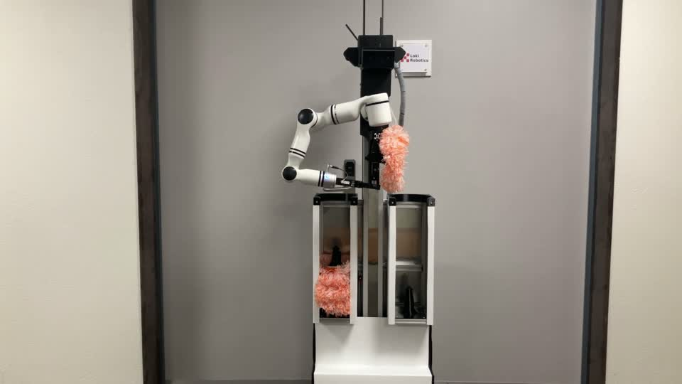
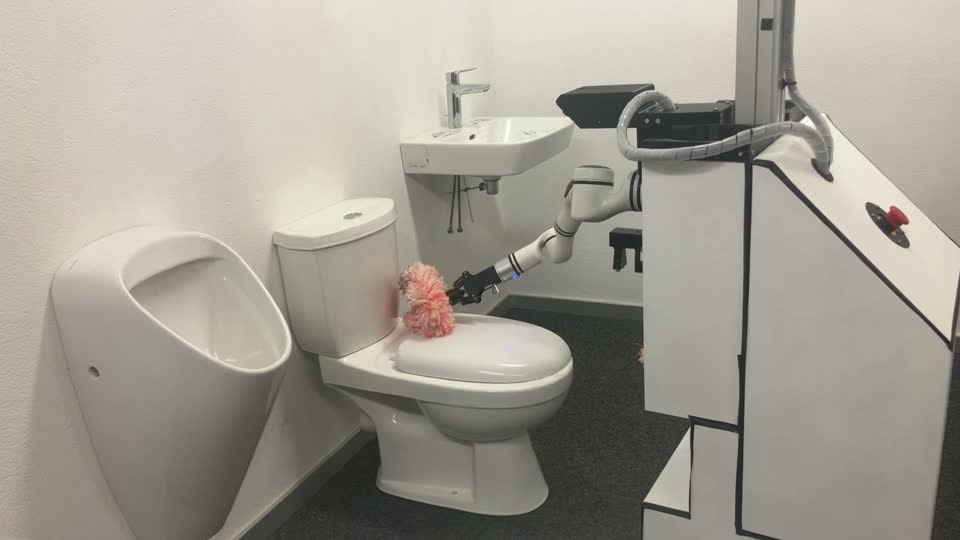
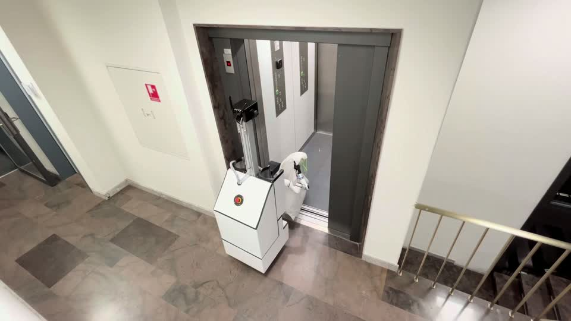

# Loki Robotics (Zürich, Switzerland / US): "cleaning like a person" facility robot

[← Back to master document](../COMPETITOR_INTELLIGENCE.md) · [Sources](../SOURCES.md) · **Last updated:** 2026-10-19

Tags: `[V]` verified · `[3P]` third-party · `[CC]` company claim · `[INF]` inferred · `[UNV]` unverified · `[CONFLICT]` · `[INT]` internal observation / opinion from our team.

**Threat level:** 🔴 **Direct, fast-moving competitor.** Same robot type (mobile manipulator + tool swapping), **restroom-first**. ~US$13M raised within ~18 months of founding. Learning-based ("end-to-end learning + teleoperation"). Already hiring for **US deployments (Dallas)** with "the largest facility services providers in the world". Tracxn lists Loki as a competitor of Peanut Robotics (S091).

*Loki robot (website video, real footage): white base with **two open tool bins** holding **pink microfibre/duster-type scrub heads**; a **vertical column (linear axis)** carrying a **white 6/7-axis cobot arm** with a parallel gripper; a hose along the column; "Loki Robotics" label.*

## Snapshot

| | |
|---|---|
| **Legal entity** | **Loki Robotics, Inc.** (Delaware; SEC Form D) `[3P][S103]` + Zürich operating base `[V][S101]` |
| **HQ / team location** | **Zürich, Switzerland** (all engineering roles on-site in Zürich) `[V][S101]`; **US field ops starting in Dallas, TX** (Field Engineer, start Oct 2026) `[V][S101]` |
| **Founded** | ~late 2024 / early 2025 `[INF]`: "in five months took Loki from idea to a working robot with several LOIs" by the May 2025 pre-seed `[3P][S102]` |
| **Founders** | **Miks Ozols** (Co-founder & CEO; ex-**Wingtra** autonomous drones) and **Antonio (Vittorio) Arbues** (Co-founder & CTO; ex-**Motional** self-driving cars). They met at **ETH Zürich** in the **Formula Student** team `[3P][S102][S103]` |
| **Website** | https://lokirobotics.co/ · founders@lokirobotics.co · [LinkedIn](https://www.linkedin.com/company/loki-robotics/) · [X](https://x.com/loki_robotics) · jobs: https://jobs.ashbyhq.com/loki |
| **Positioning** | "Building the **autonomous backbone of facility operations**". Robot that masters "**cleaning like a person**": swaps tools, applies agents precisely, physically interacts with fixtures. "From **deep overnight restroom cleaning** to continuous **day-porter** routines" `[CC][S100]` |
| **AI approach** | "We combine **end-to-end learning with teleoperation** to drastically shorten deployment time" `[CC][S100]`; "physical AI", "expert robots" `[CC][S101]` |
| **Target sites** | Airports, malls, stadiums, office buildings (field-engineer job ad) `[CC][S101]` |
| **Customers** | Not named. "The **largest facility services providers in the world** are adopting physical AI with us"; pipeline "larger than our current team can serve" `[CC][S101]`. Several LOIs by May 2025 `[3P][S102]` |
| **Folder** | [loki-robotics/](./) |

## Funding

| Date | Round | Amount | Investors | Source |
|---|---|---|---|---|
| **27 May 2025** (announced) | **Pre-seed** | **CHF 1.6M** (some reports say US$1.6M) | **byFounders** (lead; Nordic founder-led VC), **Acecap**, **Unruly Capital** | `[3P][S102]` |
| **15 Apr 2026** (first sale; Form D filed 21 Apr 2026) | Reg D offering, **likely Seed / Series A** `[INF]` | **US$11,824,995** | Not listed in Form D summary. **Yair Reem** appears as a **director** (likely the new lead investor's board seat `[INF]`, unconfirmed) | `[3P][S103]`; PitchBook snippet: "$11.8M raised, 7 investors" `[3P][S103]` |
| **Total** | | **~US$13–14M** | | `[INF]` |

## Product & technology

**From the 7 website videos (frame analysis, real footage, 2026-10-19)** `[V][S100]`:

| Scene | What it shows |
|---|---|
| Restroom with urinal, toilet and sink | Arm scrubs the **urinal** and the **inside of the toilet bowl with the lid/seat lifted**, using a **pink round microfibre scrub head**; also wipes the **sink** |
| Overhead restroom view | Robot drives between fixtures and scrubs the toilet. There is a vacuum/fluid hose |
| Robot front view | **Two tool bins** with spare scrub heads; arm **swaps heads** |
| Close-up at a black frame | Scrub head docking / **tool exchange station** |
| Office kitchen and meeting room | Navigates; works at kitchen counter and **tables** (day-porter tasks) |
| Lift lobby | **Enters an elevator** (multi-floor) |

 

**Website claims** `[CC][S100]`: deep fixture cleaning · surface cleaning · facility upkeeping · building navigation.

**From job ads (Jul – Oct 2026)** `[V][S101]`:
- **Building their own hardware:** "custom electromechanical systems **from a robot arm and grippers to automatic tool changers, to a docking station**"; cleaning end-effectors and **fluid systems** (pumps, valves, nozzles); HIL durability testing.
- **Scaling to production:** "industrialization… to manufacture **hundreds of robots**"; hiring a Production Manager (ERP, QA, supply chain).
- **Software:** low-level drivers, **behavior trees**, health management, **robot→cloud telemetry**, **teleoperation interface**, **fleet management**, data dashboards; classical 3D mapping, localisation and navigation alongside learned policies. C++/Python, Linux.
- **US Field Engineer (Dallas):** first dedicated field role; "make each deployment easier than the previous one".

**Analysis** `[INF]`:
- **Architecture = Peanut's, rebuilt with 2025 AI.** Vertical-column arm + scrub-head swapping + contact (microfibre) cleaning, but with **learned policies from teleoperated demonstrations** instead of hand-taught trajectories. That is exactly what Peanut's CTO says the industry must move to (S096/S097).
- **Contact-based cleaning** (microfibre scrubbing) is the opposite of Hivebotics' contactless steam.
- **No public evidence of cleaning verification / contamination detection.** The pitch is manipulation skill and deployment speed.
- **⚠️ IP note:** Peanut's active US 11,407,118 claim 1 covers a wheeled robot with an **arm travelling along a vertical "conveyor"** plus **before/after room imaging for comparison**. Loki has a vertical-column arm and is entering the US. **Whether Loki captures before/after images is unknown.** Not legal advice; flag for FTO watchers.

## People Directory

| Photo | Name | Role | Background | Links | Sources |
|---|---|---|---|---|---|
| — | **Miks Ozols** | Co-founder & CEO; Director (Loki Robotics, Inc.) | ETH Zürich; Formula Student; ex-Wingtra (autonomous drones) | — | S102, S103 |
| — | **Antonio Vittorio Arbues** | Co-founder & CTO; Director | ETH Zürich; Formula Student; ex-Motional (self-driving); built an LLM side project with 15k users in < 3 months | — | S102, S103 |
| — | **Yair Reem** | Director (Form D, Apr 2026) | Likely investor board member `[INF]` | — | S103 |

**Open roles (Oct 2026):** Field Engineer (Dallas), Senior Robotics SWE, Senior Mechanical Engineer, Robot Technician, Production Manager, GTM Lead (all Zürich except Dallas) `[S101]`.

## Assessment `[INF]`

- **Stronger than Somatic or Wangchao on capital per month of age**: ~US$13M in ~18 months, an ETH/Motional/Wingtra pedigree, and a real working robot in real restrooms on video.
- **Likely the most "AI-native" competitor** (learning from teleoperation). If their policies generalise, they solve Peanut's deployment-setup problem.
- **Gap for Ubanthu remains:** nothing on contamination detection or verified cleanliness. Contact scrubbing also needs scrub-head hygiene between fixtures (cross-contamination), a possible attack angle.
- **Markets:** Europe (Zürich) + US (Dallas). No Asia/India signal.

## Open questions

- [ ] Who led the US$11.8M round (Apr 2026)? Is Yair Reem the investor? Full investor list
- [ ] Named customers (which "largest facility services providers": ISS? Sodexo? ABM? CBRE?) and first US sites
- [ ] Which arm today (white cobot, brand?) vs the custom arm in development? Wheels/base supplier?
- [ ] Do they verify cleaning (before/after imaging)? Relevant to the Peanut patent
- [ ] Pricing (RaaS?) and unit cost
- [ ] Any patents filed (Loki Robotics, Inc.; Ozols; Arbues)?
