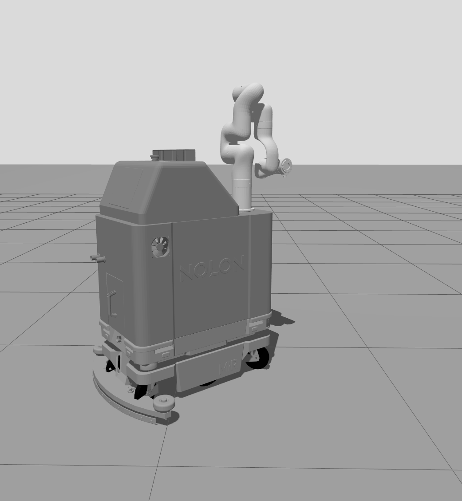
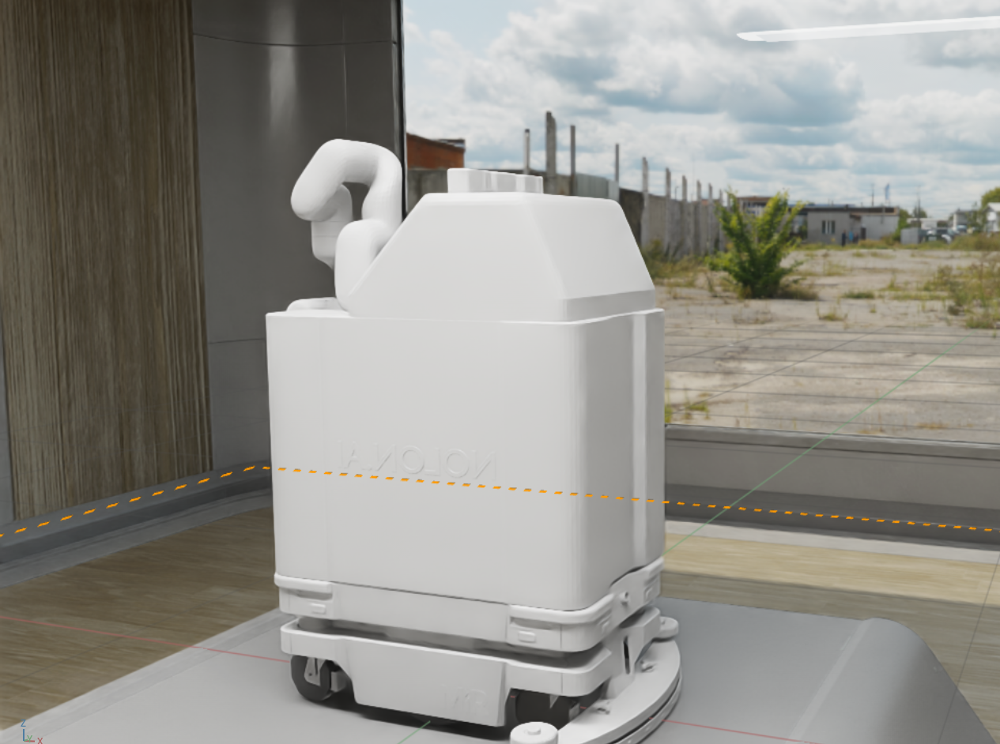
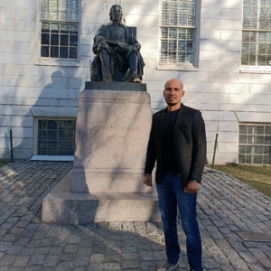

# Nolon AI (Bengaluru): toilet-cleaning mobile manipulator (early stage)

[← Back to master document](../COMPETITOR_INTELLIGENCE.md) · [Sources](../SOURCES.md) · **Last updated:** 2026-10-25

Tags: `[V]` verified · `[3P]` third-party · `[CC]` company claim · `[INF]` inferred · `[UNV]` unverified · `[CONFLICT]` · `[INT]` internal observation / opinion from our team.

**Threat level:** 🟡 **Direct (same problem, same robot type, same city) but very early.** A Bengaluru startup building an **autonomous toilet-cleaning mobile manipulator**. Evidence is a 2025 **simulation stack** (MiR-style base + UFACTORY xArm6 + toilet brush + urinal nozzle) built by an intern; no real robot, customer or funding found. ⚠️ **Its CEO, Sathya Narayanan R, now works at Origin** (supply chain and deployment, S111/S131), so Nolon may be dormant or a side project `[INF]`.

 

*Nolon Bot simulation renders (GitHub, Aug 2025): "NOLON"-embossed body on a MiR-style base, UFACTORY xArm6 on top `[V][S132]`.*

## Snapshot

| | |
|---|---|
| **Name** | **Nolon AI** / "nolon ai" / NOLON.AI. Website title: "Physical AI Agent Workforce \| Autonomous Robotics Solutions" `[V][S129]` |
| **Location** | **HSR Layout, Bengaluru South, Karnataka 560034** (LinkedIn company page) `[V][S130]` |
| **Size** | **2–10 employees**; 195 LinkedIn followers; slogan "Autonomous AI robots for cleaning" `[V][S130]` |
| **Founded** | Website footer "© 2024 nolon" `[V][S129]`; LinkedIn logo uploaded Jul 2025 `[INF]` |
| **Positioning** | "An AI Robotics company solving repetitive & mundane physical tasks, at scale, across various industries"; "Physical AI robots for commercial automation. **We AUTOMATE so you can INNOVATE.**"; vision: "give physical form to AI" `[CC][S129]` |
| **Product (as described by an intern)** | "**autonomous toilet-cleaning robots**", "delivering hygiene and efficiency beyond human capability" (Aayush Rath, Robotics Intern @ NOLON.AI, Jul – Sep 2025) `[3P][S133]` |
| **Target market** | Demo-request form offers company sizes 50–500+ and a "primary location" list that includes **New York** `[V][S129]`, a hint at a US focus `[INF]` |
| **Website** | https://nolon.ai (React single-page app; text extracted from the JS bundle) · hello@nolon.ai (company address) |
| **Funding** | None found `[V]` (absence checked: web search, LinkedIn) |
| **Folder** | [nolon/](./) |

## Robot: Nolon Bot (simulation stack, Aug 2025) `[V][S132]`

Source: public repo **[aayush-rath/Nolon-simulation-stack](https://github.com/aayush-rath/Nolon-simulation-stack)** (MIT licence), 12 commits by **one author (Aayush Rath)**, **23–30 Aug 2025**. Cloned locally to `nolon/repos/` (gitignored, 301 MB).

| Subsystem | What the code shows | Identification |
|---|---|---|
| **Mobile base** | Mesh file **`mir_base.stl`**; "MiR" lettering visible on the base in the render; 2 driven main wheels + 4 caster wheels (front/rear holders); ROS 2 **diff_drive_controller**, wheel separation 0.5 m, radius 0.1 m; robot radius 0.3 m | **MiR (Mobile Industrial Robots) AMR** model, probably MiR100/250-class. Could be a placeholder mesh from MiR's open ROS package rather than a purchased base `[INF]` |
| **Robotic arm** | 6-DOF, links `link_base`, `link1`–`link6`; joint offsets **0.267 m, (0.0535, −0.2845), (0.0775, 0.3425), (0.076, 0.097)** and limits joint2 −2.059…2.094, joint3 −3.927…0.192, joint5 −1.693…π | **Exactly UFACTORY xArm6** kinematics (UFACTORY's published description; general knowledge, high confidence). xArm6: 700 mm reach, 5 kg payload. **Same supplier family as Hivebotics (UF850)** |
| **Arm mount** | Arm on top of the "containment box" at 0.8 m height, rotated 180° | — |
| **"Containment system"** | `containment_box` mesh with embossed "NOLON" text; README: "**Specialized tools for cleaning applications**". Render: box body with fan, side door/handle, hose fitting, top hatch | Own enclosure (tanks/tool storage?) `[INF]` |
| **Cleaning tools** | **`toilet_brush.stl`** ("rotating brush for surface cleaning"), **`urinal_nozzle.stl`** ("liquid dispenser for sanitization"), `some_tool.stl` (generic tool interface), `ee.stl` (end effector) | **Contact cleaning (brush) + liquid spray**, like Primech; not steam |
| **Sensors** | RGB-D camera (**Intel RealSense D435/D455** CAD models; 640×480 @30 Hz in sim); 2D LiDAR (360°, 180 samples, 5 m, 5 Hz in sim); a mesh "**Intel RealSense D435 camera hold for MG-995 servo**" | D435/D455 used "for geometry"; a **servo-panned camera** mount suggests a hobby-grade prototype `[INF]` |
| **Software** | **ROS 2 Jazzy**, Gazebo (Ionic), **Nav2** (Smac 2D planner + Regulated Pure Pursuit), **slam_toolbox** mapping, **MoveIt 2** (OMPL, MoveIt Servo), ros2_control, Docker, **Isaac Sim USD** export | Standard open-source stack |
| **Teleop** | Two keyboard teleop nodes (velocity and "force-style" acceleration) | Basic |
| **Missing** | No perception code, no fixture/stain detection, no cleaning-task planner, no real-hardware drivers | — |

**Assessment `[INF]`:** a clean **simulation scaffold**, not a product. Built in one week by an intern; the arm and base are off-the-shelf models. It does show intent: **toilet brush + urinal nozzle on an xArm6 riding a MiR-class AMR**, plus Isaac Sim export for future training.

## People Directory

| Photo | Name | Role | Background | Links | Sources |
|---|---|---|---|---|---|
|  | **Sathya Narayanan R** | **CEO**, Nolon ("Global Supply Chain"; "Global Supply Chain expert") | LinkedIn headline: "**Physical AI, Origin \| Forbes 30 under 30, 2018**"; Greater Bengaluru; Visvesvaraya Technological University (VTU). Likely the Sathya Narayanan who co-founded **Cusmat Technologies** (Forbes 30 Under 30 **Asia** 2018, Industry/Manufacturing) `[3P][S134]`, not yet confirmed | [LinkedIn](https://www.linkedin.com/in/sathya-narayanan-r-3aa21479/) | S129, S131, S134 |
|  | **Raushan Kumar** | **CTO**, Nolon ("Robotics Development") | "**Deployed 150+ robots**", "**ex-Samsung**, Alumni **IIIT**" `[CC][S129]` | — | S129 |
|  | **Vijeth Rai** | **CRO** (likely Chief Robotics Officer `[INF]`), Nolon ("Vision & Robotic Arms") | "**MS & PhD in Robotics**", "Vision, Robotic arms expert" `[CC][S129]` | — | S129 |
| — | **Aayush Rath** | **Robotics Intern @ NOLON.AI (Jul – Sep 2025)**: simulations and planners for "autonomous toilet-cleaning robots" | B.Tech Naval Architecture/Ocean Engineering, **IIT Madras** (2024); Robotics Engineer, **Swaayatt Robots** (Aug 2024 – Jul 2025; perception/SLAM for autonomous driving); Formula Student (Team Raftar); research intern LBMC Lyon (2023); since Aug 2025 research intern at **IIIT Hyderabad RRC** (motion planning) | [GitHub](https://github.com/aayush-rath) · [site](https://aayush-rath.github.io/pages/resume.html) | S132, S133 |

*Website: "The founding team with complementary expertise in robotics, business operations, and AI systems, backed by **industry-leading advisors**" (advisors not named) `[CC][S129]`. LinkedIn "People" tab (https://www.linkedin.com/company/nolon/people/) needs a login; not read.*

#### Sathya Narayanan R — CEO, Nolon · also at Origin

| Field | Value |
|---|---|
| Current role | **CEO, Nolon AI** (website) `[CC][S129]` · **"Physical AI, Origin"** (LinkedIn headline) `[V][S131]` |
| At Origin | Very likely the **"Sathya …" who posted Origin's 4 Oct 2026 hiring post**: same headline text ("Physical AI, Origin \| …") and the same profile photo (man standing beside a statue). In it he says he has spent "the last year" **building Origin's supply chain and deployment functions from the ground up** `[V][S111]` + match `[INF]` |
| Location | Greater Bengaluru Area |
| Education | Visvesvaraya Technological University (degree not visible) `[S131]` |
| Recognition | "Forbes 30 under 30, 2018" (headline). A people aggregator lists a Sathya Narayanan, co-founder of **Cusmat Technologies**, on Forbes 30 Under 30 **Asia 2018** (Industry, Manufacturing & Energy) `[3P][S134]`: probably the same person, unconfirmed |
| Links | [LinkedIn](https://www.linkedin.com/in/sathya-narayanan-r-3aa21479/) |
| Source | [S129] website; [S131] LinkedIn screenshot 2026-10-25; [S111] Origin hiring post |

## Nolon ↔ Origin: what the evidence shows (and doesn't)

| Clue | What it proves | Source |
|---|---|---|
| Nolon website lists Sathya Narayanan as **CEO** | He was (or still is, per a possibly stale site) Nolon's CEO | S129 |
| His LinkedIn headline: "**Physical AI, Origin**" | He currently presents himself as working at Origin | S131 |
| Origin hiring post (4 Oct 2026) by "Sathya …", same headline and photo | He has led **Origin's supply chain and deployment** for ~a year (since ~late 2025) | S111 |
| Nolon intern worked **Jul – Sep 2025**; repo last touched 30 Aug 2025 | Nolon was active until at least Sep 2025 | S132, S133 |
| Nolon site footer "© 2024" | Site not updated recently `[INF]` | S129 |

**Not proven:** whether Origin **acquired or absorbed** Nolon, whether Nolon is **dormant**, or whether Sathya runs both. The timing (Nolon activity to ~Sep 2025, Origin role from ~late 2025) fits **"Nolon paused, CEO joined Origin"** `[INF]`. Both are Bengaluru physical-AI mobile-manipulator teams. **Watch item:** if Nolon's restroom work moved into Origin, Origin's "any interior trade" roadmap could include restrooms.

## Relevance to Ubanthu `[INF]`

- **Closest-to-home competitor on paper:** Bengaluru, restroom cleaning, mobile manipulator, US demo list. But no evidence of hardware, customers or funding.
- **Design choices:** contact brush + liquid nozzle (not steam), off-the-shelf xArm6 (5 kg, 700 mm reach) on a MiR-class AMR. The xArm6's 700 mm reach is short for reaching into toilet bowls from a 0.8 m mount, which suggests a concept-level sim.
- **No cleanliness verification or stain detection** anywhere in the code.
- **Talent:** CTO "deployed 150+ robots", ex-Samsung; CRO with a robotics PhD. If Nolon is dormant, these people may be hireable or advisors.

## Open questions

- [ ] Is Nolon still operating? (MCA filing for a "Nolon"/"Nolon AI" private limited; LinkedIn people list; recent posts)
- [ ] Origin–Nolon relationship: acqui-hire, merger, or Sathya moved alone?
- [ ] Raushan Kumar and Vijeth Rai: LinkedIn profiles, where they are now
- [ ] Any real prototype photos or videos? Any pilots (New York?)
- [ ] Advisors ("industry-leading advisors", unnamed)
- [ ] Confirm Sathya Narayanan R = Cusmat co-founder (Forbes Asia 2018 list)
