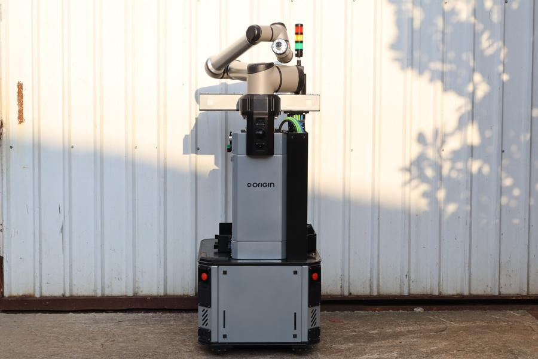
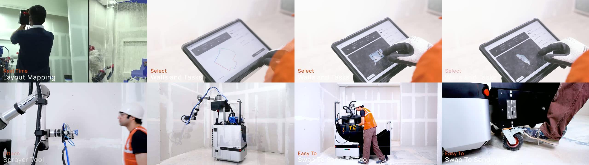

# Origin official media kit (Oct 2026): what it says

[← Origin profile](origin-artila.md) · Sources **S126** (4 PDFs) + **S127** (videos and photos) · From origin.tech "Media Kit", downloaded by Vishal 2026-10-24. The folder is kept locally (`origin-artila/Media Kit-*/`, gitignored: ~150 MB of video). Key frames are saved in [screenshots/](screenshots/). All statements are company claims `[CC]`.

Contents: Company Fact Sheet (2 pp), Founder Bios (1 p), Media FAQ (3 pp), Press Release (3 pp, embargoed to 15 Oct 2026 9am EST); 9 founder photos; 8 investor logos; 11 product photos; 4 product videos (Introducing OG-1 1:18; OG-1 In Action 2:16; Deployed Across NYC Job Sites 0:50).

---

## ⭐ Tool swapping and material: automatic or manual?

**Answer: manual. A crew member changes tools and loads material. The robot works autonomously only *within* a task once it is set up.**

| Step | Who does it | Evidence |
|---|---|---|
| Site mapping | **Crew** (handheld scan + robot), then 3D reconstruction | FAQ: "Crews handle **site mapping** and material replacement"; video caption "Real Time **Layout Mapping**", a person holding a scanner `[V][S127]` |
| Choosing walls and tasks | **Crew**, on a rugged tablet | Video caption "**Select** Walls and Tasks" (gloved hand on tablet) `[V][S127]` |
| Attaching the tool | **Crew** | Video caption "**Attach** Sprayer Tool": a worker attaches the spray gun to the arm by hand `[V][S127]` |
| Loading compound | **Crew** | Video caption "**Load** Material"; Press release: "crews handle site mapping and **material replenishment**"; Fact sheet / FAQ: "material **replacement**" `[CC][S126]` |
| Spraying, seam detection, reaching 14 ft | **Robot** | Captions "AI Powered Wall & Seam Detection", "Precision Compound Spraying", "Reaches Up to 14 Feet" |
| Swapping sprayer → sander | **Crew** | Video caption "**Easy To Swap To Sanding Tool**": the worker leans into the robot's rear tool bay and changes the tool by hand `[V][S127]` |
| Sanding with dust extraction, quality check, correction | **Robot** | Captions "Vacuum Captured Sanding", "… And Auto Correction" (end-of-arm vision + 3D LiDAR sander waypoints) |

**So what does "autonomously completes wall-finishing workflows without human intervention" (press release) mean?** It describes the **execution phase** only. The same press release says crews do mapping and material replenishment, Forbes (S120) adds that the operator "make[s] sure OG-1 has the right tool" and "handle[s] additional tool changes", and their own video labels tool swaps as a human step.
- "Interchangeable tools" / "swappable tool station + swappable end effector" (S105) means **tools are quick to swap by hand**, not an automatic tool changer.
- **No job ad mentions an automatic tool changer** (S112). Contrast: **Loki** is building automatic tool changers (S101), and **Hivebotics** markets "Automatic Tool Switching" from an on-board rack (S075).
- Your observation is right: there is no on-board rack of tools. There is a rear tool tray / bay that a person reaches into.

**Implication for Ubanthu `[INF]`:** Origin sells "autonomy" while keeping a human in the loop for setup, tools and material, and customers still buy it at US$25–40k/month because one operator replaces a crew. For restrooms, where a robot visits many short tasks per shift, **manual tool swaps would kill throughput**, so automatic tool changing (Hivebotics, Loki) matters more in our market than in drywall (long tasks per tool).

---

## New facts from the PDFs

| Topic | Detail | Note |
|---|---|---|
| **Founded** | **January 2025** (fact sheet, FAQ); "early 2025" (press release); "spent **18 months building** before coming out of stealth" | Website timeline says Dec 2024 start `[CONFLICT]` (likely work started Dec 2024, entity Jan 2025) |
| **Titles** | Ghaturle: Co-founder & CEO; **Makkar: Co-founder & Head of Autonomy** (press release: "heads autonomy"); **Daga: Co-founder & Head of Hardware** | Earlier sources called Makkar "CTO" (S106); official title is Head of Autonomy |
| **HQ / team** | HQ San Francisco; "an **engineering team in Bangalore**" | — |
| **Markets** | Active on **multiple New York sites**; **expanding into New Jersey, Florida, Texas and California**; pilots in Germany, Sweden, France, Saudi Arabia; "actively deploying … in the United States and Europe" | New: US expansion states |
| **Customers** | **Specialty contractors and self-performing general contractors**; sites: commercial, multifamily, data centres, hotels, warehouses | — |
| **Hardware** | **Three-wheeled platform**; **360-degree view**; works up to **14 ft**; **real-time force control** for consistent sanding pressure; works alongside crews without a cordoned area | — |
| **CAM** | Reasoning system (plans and orchestrates sub-tasks) + action policy (navigate, where to work, **how to use each tool**, **assess quality**) + controller (feedback-driven control). "A **foundation model** built specifically for construction"; transfers learned capabilities between workflows | Quality assessment is part of the action policy |
| **Manufacturing** | "Origin's platform is **ready for manufacturing at scale**"; investor: "the company can **manufacture it at volume**" | — |
| **Roadmap** | Taping, drywall installation, drilling, conduit installation on the same hardware and CAM | Matches Forbes |
| **Investors** | Accel, Zacua (co-leads); Unilazer, Schema, Z21, **ISAI**, **Imad Ventures**; angels from Anduril, Skild AI, 1X, Tesla. **Media-kit logo folder also has "Better Capital"**, which is not named in the PDFs | Better Capital: likely an earlier/pre-seed investor `[INF]` |
| **Board** | Vivin Hegde (Zacua) joined the board as a director | Confirms S120 |
| **Accel partner** | **Anagh Prasad** (Investor, Accel) quoted: "a foundational physical AI model built specifically for construction" | — |
| **Speed / quality** | "Three times human speed … human-level quality … generalising across different site conditions" | Company claim |
| **Market data** | Zacua Construction Robotics Report 2026 (with Hilti Ventures, 94 Ventures): US$1.36B in Q1–Q3 2025 (+125% vs 2024); robots < 0.03% of construction spend; 2026 survey: shortages delayed projects for 42% of US firms; interior work = "more than 65% of construction timelines" | — |
| **PR agency** | **Antenna Group** (Zacua's PR contact) | — |
| **Videos listed** | Introducing OG-1 (1:01); OG-1 in Action (2:16); Deployed Across NYC (0:51); **Interchangeable Tools (0:06)**; Autonomy Stack: Reasoning Layer (0:59), Action Expert (1:05); **Simulation-First Stack: Training Autonomous Construction Robots (1:31)** | Two not yet viewed: Interchangeable Tools, Simulation-First Stack |

## Founder bios (new details) `[CC][S126]`

| Founder | New details |
|---|---|
| **Yogesh Ghaturle** (CEO) | Perpule (cloud POS / omnichannel retail; customers incl. **KFC, Starbucks**); after Amazon's 2021 acquisition, **2 years at Amazon** scaling the platform; **Forbes 30 Under 30**; **ACM ICPC World Finalist**; Computer Engineering, **NITK Surathkal**. LinkedIn: linkedin.com/in/yogesh-ghaturle-307b1585 |
| **Tushar Makkar** (Head of Autonomy) | Led Eightfold AI's core ML platform and enterprise knowledge graphs; Rivigo AI freight pricing and graph network models; Google (Kurzweil group) semi-supervised word-sense disambiguation; CS, **NITK Surathkal**; "more than **20 patents and research publications**". LinkedIn: linkedin.com/in/tusharmakkar08 |
| **Ashish Daga** (Head of Hardware) | **Head of R&D, Morphle Labs** (electro-mechanical design, automated microscopy, "world's first **robotic microtomy** system", multiple patents); earlier **Wrig Nanosystems** (biomedical devices); microfluidics research at **Purdue, TU Darmstadt, IIT Kharagpur**; **Mechanical Engineering, IIT Kharagpur**, led its robotics group, represented India in international **robot soccer**; declined funded PhD offers from Purdue and CMU; **10+ years** in robotics/hardware. LinkedIn: linkedin.com/in/ashishxdaga |

## Product photos and videos: notes `[V][S127]`

- **"Origin_Gen3.jpg"** (their filename) shows a **grey box-style robot**: UR arm (grey links, dark caps), **stack light**, a **horizontal sensor bar** on top, a vertical **stereo camera** module on the front, a black lift column at the back, red e-stops. This differs from the silver/black styled OG-1 in the other photos.
  - Our earlier "V1/V2/V3" labels should follow **their own naming: this robot is "Gen 3"**. The styled silver/black body may be a later or production shell of Gen 3, or a Gen 4 `[INF]`. Unresolved.
- "In Action" video caption sequence: Any Trade, Any Job Site → **Real-Time Layout Mapping** (handheld) → **Reconstructed 3D Environment** → **AI Wall & Seam Detection** (green walls / magenta seams overlay) → **Select Walls and Tasks** (tablet) → **Attach Sprayer Tool** (human) → **Load Material** (human) → Precision Compound Spraying → Reaches Up to 14 Feet → **Easy To Swap To Sanding Tool** (human) → Vacuum Captured Sanding → Detection and Auto Correction (end-of-arm vision image-capture sequence; "3D LiDAR sander waypoints") → Flat & Smooth Walls.
- Spraying setup: a **blue pump unit and hoses** mounted on the robot body; the spray gun is hand-fitted to the UR wrist.

*Top: layout mapping, task selection on tablet. Bottom: attaching the sprayer, spraying, swapping to the sanding tool (human), rear tool bay.*
