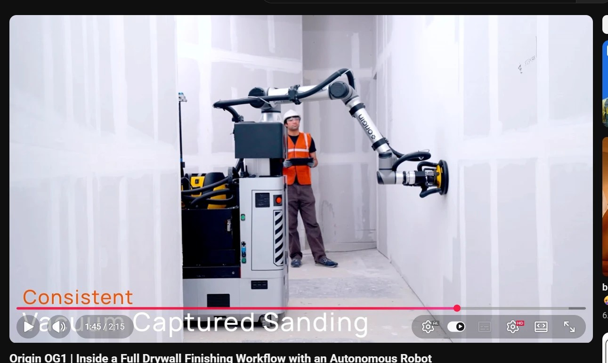
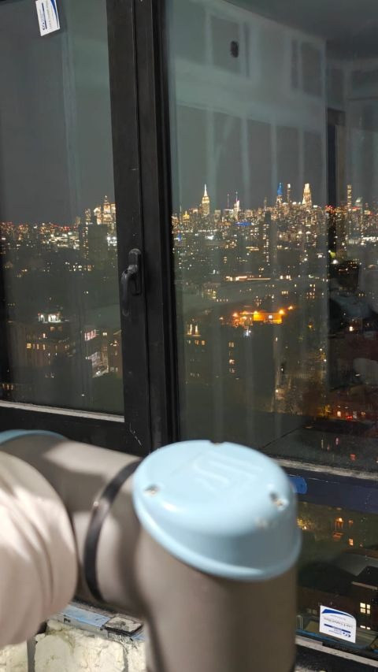
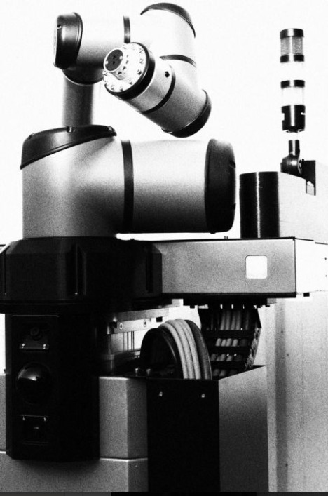

# Origin (Artila Robotics, Inc.): OG-1 interior-construction robot

[← Back to master document](../COMPETITOR_INTELLIGENCE.md) · [Sources](../SOURCES.md) · **Last updated:** 2026-10-24 (Day Zero Ventures; Saketh Vaishya; threat level raised)

Tags: `[V]` verified · `[3P]` third-party · `[CC]` company claim · `[INF]` inferred · `[UNV]` unverified · `[CONFLICT]` · `[INT]` internal observation / opinion from our team.

**Threat level:** 🟡 **Adjacent competitor / potential entrant** (raised from ⚪ on 2026-10-24: the team rates the robot as very similar to Ubanthu's). Different job (construction), near-identical robot. Origin does drywall finishing, not restrooms. Its architecture is the closest analogue in the KB to a restroom mobile manipulator: wheeled base + tall arm + **swappable tool station** + learned policy + teleop + **per-pass quality grading**. Relevant as (1) a template for how a well-funded team builds this stack, (2) a **talent competitor in Bengaluru**, and (3) a possible future entrant: its pitch is "**One Robot. Any Trade.**" `[INF]`

> ### ⭐ Key insights (research 2026-10-23)
> 1. **Built in India, sold in the US.** Origin is moving **V3 robot assembly in-house to a Bengaluru plant**: 19 staff, **3–5 robots/month scaling to 20/month**, moving from an interim unit to an **SEZ (export-zone) factory**. Finished robots and spares are exported `[CC][S112]`.
> 2. **Pricing: US$25–40k per month** ("outcome as a service", no outright sale). Average deal **US$2–2.5M**, expected to grow to US$5–10M. Pitch: a US crew of 5 costs ~US$50k/month; the robot saves 20% from day one `[3P][S113]`. **That's ~15× Hivebotics' restroom RaaS (~US$2k/month)**: they price against a whole trade crew, not one cleaner `[INF]`.
> 3. **Engineering is almost entirely in Bengaluru:** **38 of 40 open roles** are there; only 2 (robot-learning research leads) are in San Francisco `[V][S112]`.
> 4. **Formerly "10xConstruction.ai"**, a seed-funded Bengaluru robotics startup (founded 2024) `[3P][S112][S114]`.
> 5. **6 robots operating** in the US and Europe (Oct 2026), target **150 by end-2027** `[3P][S113]`.
> 6. **Their own CV stack does "surface-defect detection" and "surface-quality models"**, the construction twin of our contamination detection `[CC][S112]`.

*OG-1 sanding a drywall seam (Origin YouTube video "Origin OG1 | Inside a Full Drywall Finishing Workflow with an Autonomous Robot", frame at 1:45 of 2:15; screenshot from Vishal) `[V][S107]`.*

## Snapshot

| | |
|---|---|
| **Brand / legal entity** | **Origin** (origin.tech); legal entity **Artila Robotics, Inc.** (site footer) `[V][S105]`, Delaware per AI summary `[UNV][S109]`. **"Three global entities"** (finance job ad; payroll across two, incl. US) `[CC][S112]`. Indian subsidiary **"Artila Robotics Private Limited"** (Bengaluru, inc. Nov 2024) claimed `[UNV][S109]`: not found in a web search; check MCA / Tofler |
| **Former name** | **10xConstruction / 10xConstruction.ai** ("Origin (Formerly 10xConstruction)", job ads). Job-board slug "origin-10x" `[V][S112]`. Earlier directories: Bengaluru, founded 2024, "seed funded robotics startup on a mission to make construction 10x faster", founders Ghaturle and Daga `[3P][S114]` |
| **HQ** | **San Francisco** `[3P][S106]`; team in **San Francisco · New York · Bengaluru** (careers page) `[V][S105]`. One aggregator lists Cambridge, Maryland `[CONFLICT][S106]` |
| **Founded** | **Dec 2024** (company timeline: "Started in Dec 2024") `[CC][S105]`; press says "early 2025" / "January 2025" `[3P][S106][S113]`; 10xConstruction directories say 2024 `[3P][S114]` |
| **Founders** | **Yogesh Ghaturle** (CEO; ex-co-founder **Perpule**, acquired by Amazon 2021), **Tushar Makkar** (CTO; ex-**Eightfold AI**), **Ashish Daga** (hardware; ex-**Morphle Labs**) `[3P][S106][S110]` |
| **Market** | Interior construction. First application: **drywall finishing**: joint compound (L4/L5), sanding (L4/L5), priming `[CC][S105]` |
| **Customers** | "Two of the largest drywall finishing contractors in the US" (unnamed); pilots planned in **Germany, Sweden, France, Saudi Arabia** `[3P][S106]`. Live on **NYC commercial construction sites** `[CC][S112]`. **Pitching** big US homebuilders (**D.R. Horton, Lennar**); some customers are also investors `[3P][S113]` |
| **Strategic focus** | "Our priority is the buildout the US cannot afford to slow down: **data centres and power plants**" (Technical Program Manager ad, Oct 2026) `[CC][S112]`. Trades listed now include **painting** `[CC][S112][S113]`; long-term "entire interior build: HVAC, plumbing, drywall painting" `[3P][S113]` |
| **Traction claims** | **100k+ sq ft completed; 5,000 hours worked**; "5× time saved", "300% margin expansion", "20% cost reduction" `[CC][S105]`; job ads say "**250%+** margin expansion" `[CC][S112]` (website 300%); "3× faster than humans" (Forbes headline, company claim; not independently confirmed) `[3P][S106]`. **6 robots operational** across US and Europe `[3P][S113]` |
| **Target** | **150 robots deployed by end-2027** `[3P][S106]` |
| **Forbes (15 Oct 2026)** | 3× speed is measured over a full shift incl. setup and tool changes; **one crew member operates the robot**; recognises 200 object types; **three-wheeled counterbalanced base**; 2027 roadmap: taping, board hanging, studs, drilling, conduit; margins 5–7% → 15–25% claimed. Summary: [2026-10-15_S120_forbes-koetsier-origin.md](2026-10-15_S120_forbes-koetsier-origin.md) `[3P][S120]` |
| **Website** | https://origin.tech/ · sales@origin.tech · LinkedIn, X, YouTube linked from site |
| **Folder** | [origin-artila/](./) |

## Funding

| Date | Round | Amount | Investors | Source |
|---|---|---|---|---|
| Jan 2025 | First raise ("Fundraising and HQ Opening") | Not disclosed | — | `[CC][S105]` |
| **1 Mar 2025** | **Seed** (CB Insights listing) | Not disclosed | **Day Zero Ventures** (Bengaluru pre-seed / "first cheque" fund), listed as a new investor in "Origin" `[3P][S119]`. Probably the same Jan 2025 raise `[INF]` | `[3P][S119]` |
| **15 Oct 2026** (announced, emerged from stealth) | Total to date; labelled **seed** by Fundz and a job board, "early-stage" by Dealroom, "Series A" by one aggregator `[CONFLICT]` | **US$20M total** | **Accel** and **Zacua Ventures** (co-leads); **Unilazer Ventures**, Schema Ventures, Z21; **ISAI**, **Imad Ventures** and **some of Origin's customers** (Dealroom/Mint); angels from **Anduril, Skild AI, 1X, Tesla** | `[3P][S106][S113]` |

**Use of funds:** build and deploy the OG-1 fleet, large pilots in the US and Europe, extend to new interior trades `[3P][S106]`.

**Day Zero Ventures (per AI summary, mostly unverified)** `[UNV][S119]`: Bengaluru-based; invests at inception / pre-seed, before incorporation or product; cheques **up to US$1M**; bridges founders to US seed/Series A leads (e.g. Accel, Lightspeed, Together Fund); theses = physical intelligence (robotics for labour-constrained industries), applied AI, AI-native services. CB Insights confirms portfolio entries for **Origin (Mar 2025)** and **Zeno** (seed II, Sep 2024) `[3P][S119]`; Exponent Energy link **not** confirmed. *Relevance `[INF]`:* the "Day Zero → Accel" path is exactly what happened with Origin, and Day Zero is a **Bengaluru fund that already backs a mobile-manipulator company**. Worth knowing as a potential investor for Ubanthu (they like the thesis) and as a conflict risk (they back a similar robot).

**Board:** Zacua founding partner **Vivin Hegde has joined Origin's board** `[3P][S120]` (Forbes; confirms the earlier AI-summary claim S109).

**`[CONFLICT]`:** Dealroom says "Accel's India fund is the only Indian entity on the cap table" `[3P][S113]`, but Unilazer Ventures (Ronnie Screwvala's fund) is usually described as Indian (general knowledge). Possibly invested through a non-Indian vehicle.

## Business model

- **Subscription RaaS, no outright sale: "outcome as a service"**, **US$25,000–40,000 per month** for access `[3P][S113]` (Dealroom, citing Mint; CEO quoted). **Average deal US$2–2.5M**, expected to rise to **US$5–10M** as contracts grow `[3P][S113]`.
- **Value pitch (CEO):** "For a US contractor with a crew of five people, they pay **$50,000 a month**. Replacing them with a robot from us saves them **20% of the cost from day one**" `[3P][S113]`.
- **Implied economics `[INF]`:** at US$40k/month a robot earns ~US$480k/year. Even a BOM of US$100–150k pays back in ~3–4 months of rental. Price is set by the **labour it replaces (a whole crew)**, not by hardware cost.
- Works alongside crews without safety cages; **dust-free sanding** via a vacuum shroud `[UNV][S109]`. Vacuum-captured sanding is visible in the video `[V][S107]`.
- **Site types:** commercial offices, hotels, multifamily, **data centres**; first runs in New York `[UNV][S109]` (NY deployment Nov 2025 is on the company timeline `[CC][S105]`).
- **Market claim:** drywall mudding/taping is "60–65% of interior finishing timelines" `[UNV][S109]`: no source given.

## Manufacturing & supply chain (job ads + LinkedIn post) `[CC][S111][S112]`

| Item | Detail |
|---|---|
| **Robot version** | **V3** ("moving V3 robot assembly in-house in Bengaluru") |
| **Plant** | **Bengaluru**: an **interim unit** now, then an **SEZ factory** (export-oriented; SEZ/EOU or MOOWR bonded filings). Plant Admin & HR role: "today there is a bare shed and a plan" |
| **Capacity** | **19-person plant team building 3–5 robots a month, scaling to 20**; "plans to **build 80 robots in the next 12 months** and to scale to **200 units a year**" (Lead Manufacturing Engineer) |
| **Exports** | Stores role packs "**finished robots and spares for export**". Finance role covers customs, letters of credit, FX, transfer pricing, FEMA/RBI, and export incentives (**RoDTEP, duty drawback, EPCG, PLI**) |
| **Sourcing** | Inbound from **India, China, Taiwan, South-East Asia, the US and Europe** (Logistics & Freight Manager ad, new 24 Oct). Motors, drivers, PCBs, connectors, harnesses, sensors, controllers, batteries from "**India, China, and other sourcing regions**"; Approved Vendor List with **3–5 vendors per critical BOM line** (Technical Sourcing Manager). LinkedIn post: "sourcing components across **three continents**" `[S111]` |
| **Plant org** | Supply Chain Lead & Plant Head → Plant Supervisor, Manufacturing Engineer, technicians (mechanical, embedded, IQC), stores, QA, logistics, sourcing. Technicians hired via ITIs and diploma colleges |
| **Quality** | ISO 9001-style audits; incoming / in-process / end-of-line checks; HIL tests; mechanical validation for "construction-site abuse" |
| **Compliance** | Regulatory program for **UL, CE, FCC**, IEC, ISO, OSHA, machinery and functional safety, EMC, radio. Hardware safety loop to **ISO 13849 / IEC 61508** |

**Analysis `[INF]`:** the playbook is **Indian engineering and assembly cost + US pricing**. Robots are built in a duty-advantaged Bengaluru export zone and rented to US contractors at US$25–40k/month. This is the most direct template in the KB for an India-based robotics company selling abroad.

**🔧 Full tech & hardware stack (by subsystem, with source ads):** [origin-tech-stack.md](origin-tech-stack.md)

**📋 Full job-board digest:** [jobs/origin-jobs-digest.md](jobs/origin-jobs-digest.md): all 41 roles seen (34 open on 24 Oct, 7 closed since 23 Oct, 1 new), synthesis table, per-role summaries and tools.

## Tech stack (from 40 job descriptions, Jul – Oct 2026) `[CC][S112]`

| Area | Detail |
|---|---|
| **Compute** | **Dual NVIDIA Jetson AGX Orin** on the robot; TensorRT / ONNX; INT8, LoRA, distillation for edge |
| **Middleware** | **ROS 2**, **MoveIt 2** (manipulation), **Nav2** (navigation); Docker on robot and cloud |
| **Simulation** | **NVIDIA Isaac Sim / Isaac Lab**, Gazebo; domain randomisation; diffusion-model synthetic data |
| **Sensors** | **LiDAR + IMU + stereo + RGB / RGB-D** cameras + wheel odometry; online calibration-drift detection ("self-healing") |
| **Learning** | "**Multi Agent Action Expert** architecture: classical precision algorithms orchestrated alongside learned policies". VLA for contact-rich manipulation; imitation learning; DAgger / HG-DAgger; **world models** for surface state and spray dynamics; learned policies propose, deterministic safety layers enforce |
| **Teleop / data** | **GELLO, SpaceMouse, VR** teleoperation; CVAT annotation; Weights & Biases / MLflow |
| **⭐ Quality CV** | "**surface-defect detection**", "**segmentation and surface-quality models deployed on our robots**", offline metrics "that predict real-world finishing quality", VLA "linking text work orders to pixel-level segmentation masks" |
| **Hardware (in-house)** | They design the "**multi-axis robotic arm structure**, the heavy-duty mobile base chassis, [and] the **lift column**"; high-torque actuators; robotic power tools; dust-extraction nozzles; battery trays. Onshape / SolidWorks |
| **Power** | **Custom BMS, high-power inverters, fast charging**; LFP / Li-ion packs; CAN, UART, RS485 |
| **Test rigs** | Experimentation roles ask for **UR**, KUKA, ABB or Fanuc arm experience (DOEs on spraying and sanding) |
| **Ops metrics** | Availability, utilisation, task completion, **intervention rate** (Forward Deployment Engineer) |

### Robot arm: what we know `[V][S115]` + `[INF]`

| Period | Arm | Evidence | Confidence |
|---|---|---|---|
| **Nov 2025** (first NYC deployment, company still called "10x") | **Universal Robots (UR), e-Series-style light-blue joint cap** with the embossed UR logo, arm wrapped in a beige protective dust cover | Photo in Tushar Makkar's LinkedIn post, 20 Nov 2025, taken at night on a high floor in New York (Empire State Building visible across the river) `[V][S115]` | **High for UR brand.** Model (UR5e / UR10e / UR16e) **cannot be told from one joint cap**; Gemini's "UR10e" is a guess `[UNV][S116]`. Given the 14 ft reach, a UR10e/UR16e-class arm is plausible `[INF]` |
| **2026** (V3, video + Oct 2026 LinkedIn photo) | **Unknown.** Silver links with black/dark joint caps; "origin" branding on the forearm in the video | S107, S111 | No blue UR caps visible, so the arm (or its covers) **changed** `[INF]`. **Candidate: UR's newer UR20/UR30** (grey links with dark joint caps) re-badged, or a different/own arm; job ads mention designing a "multi-axis robotic arm structure" `[S112]`. Needs checking |

**Gemini's "RobotMeta" claim** (production OG-1 uses a "custom-wrapped, high-payload collaborative manipulator from RobotMeta") `[UNV][S116]`: **no evidence found.** RobotMeta is a Shenzhen company (founded 2017) known for **welding robots** and teach pendants; no source links it to Origin `[3P][S116]`. Gemini also called Artila Robotics Origin's *former* name; it is the current legal entity (S105). Treat the whole RobotMeta claim as a likely hallucination.

*UR joint cap (light blue, embossed logo, two screws) on a dust-wrapped arm, NYC site, Nov 2025 `[V][S115]`.*

**Post text (S115):** "Our Robot Is Now Powering Construction Work Across New York … From **Bangalore labs to New York buildings** … At **10x** we're building … perception pipelines, autonomous navigation stacks, manipulation systems, cloud dashboards, operator apps, teleoperation interfaces". Hiring link then: apply.workable.com/**10x-3** (old job board). Company LinkedIn page now: linkedin.com/company/**origin-autonomy**.

### OG-1 V3 photo (LinkedIn post, 4 Oct 2026) `[V][S111]` + analysis `[INF]`

- **Large 6-axis arm**: silver links with black joint caps and bands. Bigger than a UR5-class arm. Brand not visible. **No light-blue UR e-Series caps**, unlike the Nov 2025 arm (S115). Candidates: UR20/UR30 (similar grey-and-dark look), a re-housed arm, or their own design `[INF]`.
- Arm sits on a wide **black carriage** on top of a **lift column**: a **cable carrier (drag chain)** runs down the side, which fits a vertical axis giving the 14 ft reach `[INF]`.
- **Stack light** (signal tower) on the right; a small dark camera/sensor module at bottom left of the base.
- A **large wheel/drum** at the base (drive wheel or hose reel; unclear).

## Their competitors (construction robotics) `[UNV][S109]` + general knowledge

| Company | Note |
|---|---|
| **Canvas** (US) | Closest predecessor in commercial drywall finishing; boom-lift robot, later partnered with JLG. Origin's angle: smaller, doorway-sized base + one AI policy across mudding, sanding and priming |
| **PaintJet** (US) | Exterior coatings |
| **Okibo** (Israel) | Plastering / finishing |

*Relevance for us `[INF]`:* same pattern as restrooms: an earlier slow/struggling pioneer (Canvas ↔ Peanut) followed by a new, AI-first, well-funded wave (Origin ↔ Loki / Hivebotics).

## Fleet size over time (number of robots)

| Date | Robots | What happened | Source | Confidence |
|---|---|---|---|---|
| Dec 2024 | 0 | Company started | S105 | `[CC]` |
| Mar 2025 | **1** (prototype) | "First prototype ready": aluminium-extrusion base + arm, built in-house | S105, S122 | `[CC]` + photo `[V]` |
| 2025 (date unknown) | **2** | "Built **two working robots in 4 weeks**" | Vishal (source not yet captured) | `[INT]` / unverified |
| May 2025 | ≥1 | First test-site autonomy | S105 | `[CC]` |
| Jul 2025 | ≥1 | First customer-site deployment | S105 | `[CC]` |
| Nov 2025 | ≥1 (plural "sites") | First deployment in New York; "working across real customer sites in the US"; robot = UR arm with blue e-Series caps | S105, S115 | `[CC]` + photo `[V]` |
| Oct 2026 | **4 active** | Website figure quoted by Forbes, with 100k+ sq ft delivered | S120 | `[3P]` |
| Oct 2026 | **6 operational** (US + Europe) | Dealroom summary of Mint | S113 | `[3P]` `[CONFLICT]` with 4 (different date or definition) |
| From late 2026 | +3–5 / month → **20 / month** | V3 assembly moving in-house to the Bengaluru plant | S112 | `[CC]` plan |
| ~Oct 2027 | **80 built** | "Build 80 robots in the next 12 months" | S112 (Lead Manufacturing Engineer) | `[CC]` plan |
| End 2027 | **150 deployed** | Fleet target | S106, S120 | `[CC]` plan |
| Later | **200 / year** | Production run-rate target | S112 | `[CC]` plan |

**Robot generations `[INF]`:** **V1** extrusion prototype (2025, S122) → **V2** NYC robot with a blue-cap UR e-Series arm (Nov 2025, S115) → **V3** styled OG-1 with a black-cap UR (likely UR15) and in-house Bengaluru assembly (2026, S112, S123). "V3" is their own term (job ads); V1/V2 labels are our inference.

**Pace `[INF]`:** about **4–6 robots in ~22 months** so far, then a planned jump to **80 in 12 months** (a 13–20× step) on US$20M. For comparison: Hivebotics reports 20+ sites after ~5 years (S056); Peanut logged 13,000 h over ~6 years (S088).

## Timeline (company "Zero to Infinity" page) `[CC][S105]`

| Date | Milestone |
|---|---|
| Dec 2024 | Started |
| Jan 2025 | Fundraising and HQ opening |
| Mar 2025 | First prototype |
| May 2025 | First test-site autonomy |
| Jul 2025 | First customer-site deployment |
| Sep 2025 | Customer-ready product live |
| Nov 2025 | First deployment in New York |
| Oct 2026 | Emerges from stealth with US$20M |

**Speed:** prototype in ~3 months, customer site in ~7 months. Faster than any restroom competitor on file `[INF]`.

## Product: OG-1

**Official spec (product page)** `[CC][S105]`:

| Item | Value |
|---|---|
| Footprint | **30 × 35 in** (~76 × 89 cm), fits through doors |
| Reach | **Up to 14 ft** (~4.3 m) |
| Base | Wheeled robot base |
| Sensors | Camera and LiDAR |
| Tools | **Swappable tool station + swappable end effector** |
| Tasks today | Joint compound (spray), sanding, priming. Handles high walls, corners, pillars, soffits, edges `[3P][S106]` |

**From the video frame (S107)** `[V]` / `[INF]`:
- **Tall vertical column** on a grey/white base (black/yellow hazard stripes, e-stop button, vents). The arm is mounted high on the column, which is how it reaches 14 ft `[INF]`.
- **6-axis cobot-style arm, white/silver with black joints, branded "origin"** on the forearm. Make not identifiable from the frame; could be a re-branded commercial cobot or their own `[INF]`.
- **End effector: yellow round sanding head with a vacuum hose** ("Vacuum Captured Sanding"). The yellow/black style resembles a Mirka wall sander `[INF]`, unconfirmed.
- **Tool station on the base:** yellow-and-black tools and coiled hoses on the left side.
- **Mast-top sensor** (thin pole with a small head at top-left of the base): likely the LiDAR or a camera `[INF]`.
- An operator in hi-vis holds a tablet (supervision / teleop) `[V]`.

### AI: "Construction Action Model" (CAM) `[CC][S105]`

| Layer | What it does |
|---|---|
| **Training data** | High-fidelity simulation (RL in randomised rooms); 3D site mapping (handheld + robot scans); live deployments (robot + teleop data) |
| **Reasoning system** | Plans construction subtasks: locate seams and fasteners, plan spray passes, "spray, then inspect" |
| **Action policy** | Navigate, use tools, inspect; seam and wall detection. VLA pre-training, imitation learning, RL in sim, real-to-sim |
| **Controller** | Closed-loop motion: tool standoff, **Diff-IK**, position and **admittance** control, real-time servoing |
| **Human-in-the-loop** | Remote teleop (drive + dock), **semantic correction** (relabel seams and screws), map cleaning (validate planes, remove noise) |
| **Learning loop** | ⭐ **"Quality map: scan and grade each pass"** gives reward labels; **residual RL policy over a classical planner** in sim; **DAgger** adds operator corrections to the training data |

## Relevance to Ubanthu `[INF]`

- **Same blueprint, different room.** Base + tall arm + tool station + force control + learned policy + teleop fallback is exactly the restroom-robot architecture (Loki, Hivebotics, Peanut). Origin shows how fast a funded team can field it: customer site in ~7 months.
- ⭐ **"Scan and grade each pass" is their verification loop.** It is the construction equivalent of our contamination verification: a post-task quality map that both proves the work and trains the policy. This validates our thesis that **verification data = training signal**, and it shows investors already understand the idea.
- **"One Robot. Any Trade."** Restroom cleaning is not on their list today (interior trades: board hanging, drilling, conduit per the pasted summary `[UNV][S108]`). A pivot into facility cleaning is possible but unsignalled.
- **Bengaluru engineering team:** competes with us for robotics / CV / embedded talent in India. **38 of 40 open roles are in Bengaluru**, including 9 apprentice/intern roles (a cheap talent pipeline from IITs, ITIs and diploma colleges) `[V][S112]`. Expect them to hire the same perception, ROS 2 and embedded people we want.
- ⭐ **Pricing lesson:** they charge US$25–40k/month because they price against a **crew of five**, not one worker. Restroom robots (US$1.8–4.5k/month) price against one cleaner. For Ubanthu: **pricing power comes from how much labour (and liability) the robot replaces**, so a multi-restroom / multi-floor scope, or a verifiable hygiene SLA, supports higher prices `[INF]`.
- ⭐ **Manufacturing lesson:** an Indian startup can **assemble in a Bengaluru SEZ and export to the US** at small volume (3–5 → 20 robots/month). If Ubanthu ever sells abroad, this is the template, including export incentives (RoDTEP, duty drawback) `[INF]`.
- **Possible partner, not only competitor:** they will build an India-based supply chain (motors, drivers, harnesses, BMS) for mobile manipulators. Suppliers they qualify could serve us too `[INF]`.
- **Not plotted on the quadrant** (different problem).

## People Directory

| Photo | Name | Role | Background | Links | Sources |
|---|---|---|---|---|---|
| — | **Yogesh Ghaturle** | Co-founder & CEO (GitHub location: **NITK Surathkal**, so likely an NIT Surathkal alumnus like Makkar `[INF][S125]`) | Co-founder of **Perpule** (Bengaluru retail-tech, UltraPOS; co-founders Abhinav Pathak, Saketh BSV), **acquired by Amazon Mar 2021 for ₹107.6 cr (~US$14.7M)** `[3P][S110]`. Reported as expected to join Amazon after the deal; "several years at Amazon" per AI summary `[UNV][S109]` | — | S106, S110 |
| — | **Tushar Makkar** | Co-founder & CTO; leads autonomy / CAM | **B.Tech Computer Engineering, NIT Surathkal (2015)**. Senior Data Scientist, **Eightfold.ai** (Dec 2019 – ; NLP/BERT matching, patent pending); Data Scientist, **Rivigo** (2017–19, logistics pricing and network optimisation); SDE-2 **CodeNation** (2015–17); founding engineer **Trestor** (crypto, 2014–15); **Google** SWE intern (2014, Kurzweil's group). "Filed 10+ patents" (NLP/ML) `[CC][S124]`. **No robotics background before Origin** `[INF]`. Posted the Nov 2025 NYC post (S115) | [LinkedIn](https://www.linkedin.com/in/tusharmakkar08) · [GitHub](https://github.com/tusharmakkar08) | S106, S110, S115, S124, S125 |
| — | **Ashish Daga** | Co-founder; leads hardware (mechanical, tooling, chassis) | Previously at **Morphle Labs** (digital-pathology scanners, Bengaluru) `[3P][S110]` | — | S106, S110 |
|  | **Saketh Vaishya** | **Senior Robotics Software & Simulation Engineer**, Origin (Nov 2025 – present). LinkedIn headline: "Building physical agents \| Senior Robotics Engineer at Origin" | Sim-to-real specialist (Isaac Sim / Isaac Lab, PPO, ACT, Diffusion Policy, MoveIt 2, RMPFlow). Ex-Techolution (team lead, teleop), SS Innovations (surgical robot), IIIT Hyderabad / IIT Madras internships | [LinkedIn](https://www.linkedin.com/in/saketh-vaishya/) · [GitHub](https://github.com/Saketh-Vaishya) · [site](https://sakethvaishya.com/) | S117, S118 |
|  | **Sathya …** (surname cut off in screenshot) | Headline "Physical AI, Origin \| …"; built "Origin's supply chain and deployment functions from the ground up" over the last year. Possibly the "Supply Chain Lead & Plant Head" named in job ads `[INF]`, unconfirmed | Not visible | LinkedIn (URL not captured) | S111 |

#### Saketh Vaishya — Senior Robotics Software & Simulation Engineer, Origin

| Field | Value |
|---|---|
| Current role | Senior Robotics Software & Simulation Engineer, **Origin, Bengaluru** (Nov 2025 – present): "building physical agents — robots that learn in simulation and work in the real world" `[S118]` |
| Location | LinkedIn: **Hyderabad, Telangana**; site lists Origin · Bengaluru (remote or relocating?) `[S117][S118]` |
| Previous | **Techolution**, Hyderabad (May 2023 – Nov 2025): Associate Robotics Engineer → Team Lead, HIR (Human Intelligence Robotics): camera-based motion-capture teleoperation, ACT + Diffusion Policy trained in Isaac Lab, RMPFlow + MoveIt 2, digital twin for synthetic data, LLM robot bartender "Alice", ScrewQC (Doosan A0509, YOLOv8, 0.01 mm) · **SS Innovations**, Gurugram (Nov 2022 – Apr 2023, surgical robot; EtherCAT, Beckhoff, harmonic drives) · **SegriTech**, CIE IIIT Hyderabad (2022, fruit sorter) · **Touch Lab, IIT Madras** (2021, AR haptics research) `[S118]` |
| Education | International Institute of Information Technology (shown on LinkedIn; campus/degree not visible) `[S117]` |
| Skills / focus | Isaac Sim, Isaac Lab, ROS 2, PyTorch, RL (PPO), ACT, Diffusion Policy, MoveIt 2, RMPFlow, Gazebo, EtherCAT, MODBUS, SolidWorks `[S118]` |
| Links | [LinkedIn](https://www.linkedin.com/in/saketh-vaishya/) · [GitHub](https://github.com/Saketh-Vaishya) · [Portfolio](https://sakethvaishya.com/) |
| Source | [S117] LinkedIn screenshot 2026-10-24; [S118] portfolio site + GitHub, checked 2026-10-24 |

**What his public work tells us about Origin `[INF]`:**
- **Nothing Origin-specific is public.** All 12 portfolio videos are from earlier jobs (Techolution demos, an NVIDIA GTC "Blue" robot clip). The 7 GitHub repos are personal; the two robot-sounding ones (`camera-callibration`, `remote_template`) are **empty (0 KB)**; the friction-model repo is a fork of someone else's 2023 code. No leak of Origin's stack.
- **It confirms the hiring profile:** Origin hired a **sim-to-real engineer** (Isaac Lab, ACT / Diffusion Policy, teleop) in **Nov 2025**, the same month as the first NYC deployment. This matches the CAM "simulation-trained autonomy" and the job ads (S112).
- **Talent signal:** Origin recruits mid-level robotics engineers from Indian robotics services firms (Techolution) and medtech robotics (SS Innovations). Same pool Ubanthu would hire from.

**Team pattern `[INF]`:** software/AI founders with an Indian startup exit plus a precision-hardware engineer, Bengaluru-built. A close analogue to an Indian robotics team, and proof that such a team can raise US$20M from Accel for a US-first go-to-market.

## Unverified (pasted AI summaries, S108, S109) `[UNV]`

**S109 check (2026-10-23):** ✅ founders' backgrounds (Perpule → Amazon, Eightfold, Morphle) confirmed in press · ✅ investors, 150-robot target, pilot countries · ⚠️ "Series A" stage `[CONFLICT]` (others say seed/early) · ❌ not found: Indian subsidiary, Delaware, Vivin Hegde board seat, RaaS model, "60–65%" stat, "$1.3B+" sector funding.

**S108:** most of it matches the website. Not found on origin.tech: a roadmap to "board hanging, drilling, and conduit placement"; "high-density 3D LiDAR"; base "designed to traverse construction debris, cords". Treat these as unconfirmed.

## Open questions

- [ ] Which arm (re-branded cobot? own design?) and which column/lift; sanding head brand
- [x] ~~Founder backgrounds~~: Perpule/Amazon, Eightfold AI, Morphle Labs (S110)
- [ ] Indian entity: confirm "Artila Robotics Private Limited" on MCA (CIN, directors, date); Bengaluru headcount
- [ ] Board composition (Vivin Hegde?)
- [ ] Day Zero Ventures: cheque size into Origin; do they still invest in robotics (could be an investor for Ubanthu, or a conflict)?
- [x] ~~Pricing model~~: subscription RaaS US$25–40k/month; deals US$2–2.5M (S113)
- [ ] Named US contractors (which "two largest drywall finishing contractors"?)
- [ ] Sathya's full name and title; plant location in Bengaluru (which SEZ?)
- [x] ~~Arm in Nov 2025~~: **Universal Robots** (blue e-Series joint cap, S115); exact model unknown
- [ ] V3 arm (2026): UR20/UR30, another brand, or own design? Look for a joint-cap close-up or the arm base label in newer posts/videos. RobotMeta claim unsupported
- [ ] Read the Mint article (source of Dealroom's pricing figures) for detail
- [ ] Any patents (Artila Robotics, Inc.; inventors Ghaturle / Daga / Makkar)?
- [ ] Any signal of moving into facility cleaning / restrooms?
- [x] ~~Read the Forbes piece~~ (S120)
