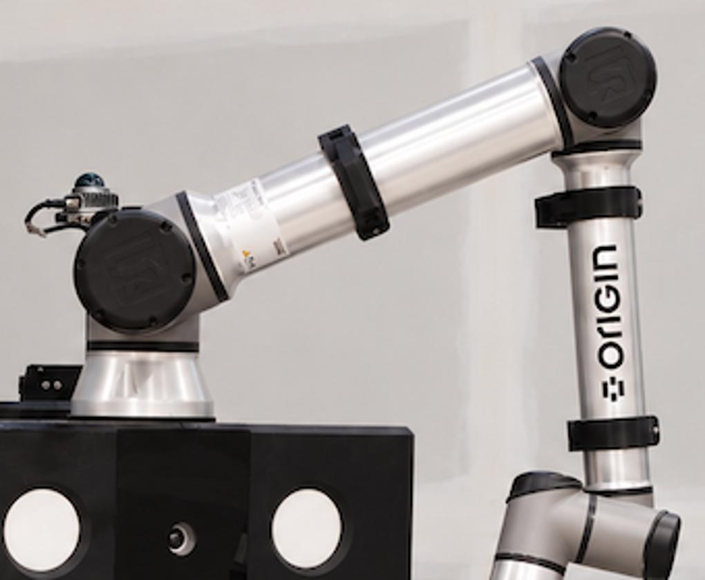
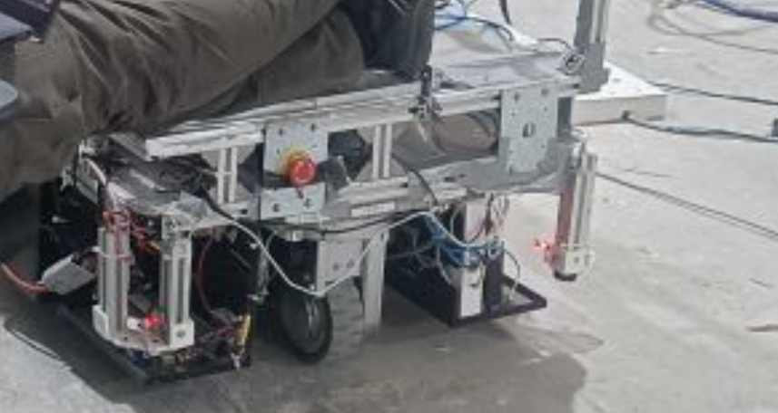

# Origin OG-1: tech and hardware stack

[← Origin profile](origin-artila.md) · [Job-board digest](jobs/origin-jobs-digest.md) · **Last updated:** 2026-10-24 (arm identified as UR; video benchmark table; base analysis; Forbes S120)

**How this was built:** every hardware/software statement in Origin's **41 job ads** (S112, Jul – Oct 2026) was extracted and grouped by subsystem, then combined with photos (S107, S111, S115) and the product page (S105). Job-ad text is a company statement `[CC]`; photo readings are `[V]` or `[INF]`. **Brand names of parts are almost never given in ads**, so most components below are "what kind", not "which supplier".

---

## At a glance

| Subsystem | What we know | Supplier / brand | Confidence |
|---|---|---|---|
| **Arm** | 6-DOF manipulator, force/**impedance** control | **Universal Robots in both generations.** Nov 2025: blue e-Series caps `[V][S115]`. **2026 OG-1: black joint caps with embossed UR logo + faceted UR base** `[V][S123]`; size fits the **1300 mm-reach class → most likely UR15**, alternative UR10e/UR12e with black caps (see §0) | Brand ✅ / model: UR15 likely `[INF]` |
| **Lift column** | Separate subsystem ("the lift column"); gives the **14 ft reach**; cable carrier visible down its side | Unknown (in-house design per ads) | Named subsystem ✅ |
| **Mobile base** | **Three-wheeled, counterbalanced** base `[3P][S120]`; "heavy-duty mobile base chassis", drivetrain, belts and bearings; wheel odometry; 30 × 35 in | **In-house design** (prototype built from aluminium extrusion, S122; job ads; non-standard 3-wheel layout) | ✅ in-house `[INF]` |
| **End effectors / tools** | "**Robotic power tools**" (sprayer, sander, primer/paint); **dust-extraction nozzle**; swappable tool station + swappable end effector; vacuum-captured sanding. **Tool changes are done by hand** by the crew operator (video captions "Attach Sprayer Tool", "Easy To Swap To Sanding Tool"); **material loaded by crew**; no automatic tool changer `[V][S127]` | Own designs; sander head looks Mirka-like `[INF]`; spray pump unit (blue) on the robot | ✅ manual swap |
| **Compute** | **Dual NVIDIA Jetson AGX Orin** on the robot | NVIDIA | ✅ `[CC]` |
| **Sensors** | **LiDAR + stereo + RGB / RGB-D + IMU + wheel odometry**; F/T sensing on end-of-arm tooling; encoders; thermal sensors on power | Brands not named | ✅ types / ❓ brands |
| **Power** | **Custom BMS**, **high-power inverters**, **fast charging**; **LFP / Li-ion** packs; 12 / 24 / **48 V** DC buses; Power Distribution Board | In-house designs; packs shipped as dangerous goods (UN 38.3) | ✅ |
| **Embedded / buses** | Custom PCBs (Altium); **CAN, Ethernet, SPI, I2C, UART, RS485**; motor drivers; HIL test rigs | Contract manufacturers for PCBs | ✅ |
| **Safety** | Hardware safety loop **independent of software**: E-stops, limit switches, over-current, thermal limiters, **hardware watchdogs** → central fail-safe E-stop; **ISO 13849 / IEC 61508**; certification **UL, CE, FCC**, EMC, radio | — | ✅ `[CC]` |
| **Robot software** | **ROS 2**, **MoveIt 2** (6-DOF motion planning), **Nav2** (navigation), SLAM, sensor fusion; Docker on robot; embedded Linux | Open source | ✅ |
| **AI** | "**Multi Agent Action Expert**": classical precision algorithms + learned policies; VLA fine-tuning (**π0/π0.5, OpenVLA, RT-2, Octo**); imitation learning, DAgger/HG-DAgger; RL; **world models** (DreamerV3, V-JEPA); **Isaac Sim / Isaac Lab** | NVIDIA sim; open-source VLAs | ✅ `[CC]` |
| **Perception / quality CV** | 3D semantic understanding; **"surface finish classification for quality control"**; defect synthesis with diffusion models; offline metrics that predict finishing quality | Own models | ✅ `[CC]` |
| **Teleop / data** | **GELLO, SpaceMouse, VR** teleop; auto-annotation; CVAT; data-ops team with internal + vendor annotators | — | ✅ |
| **Fleet / cloud** | Robot-to-cloud + inter-robot networking; **DDS vs MQTT**; Docker; fleet diagnostics; **AWS / GCP** | — | ✅ |
| **Operator app** | **Native Android app (Kotlin, Jetpack Compose, Room)** that operators use to control robots on site; **FastAPI** backend; REST + WebSocket telemetry; PostgreSQL / SQLite; React dashboards | — | ✅ |
| **Manufacturing** | CNC-machined, sheet-metal and welded parts; hand-built harnesses; PCBA integration; IP-rated enclosures (aluminium, composites, polymers, coated steel) | India / China / Taiwan / SEA / US / Europe sourcing | ✅ |

---

## 0. Arm identification (2026 OG-1) `[V][S123]` + `[INF]`

**Visible in the official product photo (S123):**
- **Black joint caps with the embossed interlocking "UR" logo** (shoulder and elbow), several screws around the rim.
- **Silver aluminium links**, black separator rings, a **faceted/sculpted silver base**, and UR-style product labels on the upper arm.
- Origin's additions: "ORIGIN" lettering on the forearm, black cable clamps, a small sensor/connector block on the shoulder.

So the **brand is Universal Robots** in 2026 as in Nov 2025. Black caps and the faceted base match UR's **newer-generation design** (UR15 / UR20 / UR30), not the light-blue e-Series caps of the Nov 2025 robot (general knowledge, medium confidence).

**Size check against UR datasheets** (scale from the 30-in robot width in the photo; ±15%, perspective not corrected):

| Measure (photo) | Estimate | UR5e | UR10e / UR12e | **UR15** | UR16e | UR20 | UR30 |
|---|---|---|---|---|---|---|---|
| Base diameter | ~190–220 mm | 149 mm | 190 mm | **204 mm** | 190 mm | ~245 mm | ~245 mm |
| Upper arm length | ~600–650 mm | 425 mm | 613 mm | similar to UR10e (1300 mm reach) | 478 mm | 862 mm | — |
| Forearm length | ~560–590 mm | 392 mm | 572 mm | similar | 360 mm | 728 mm | — |
| Upper-arm / forearm ratio | ~1.1 | 1.08 | 1.07 | ~1.1 | **1.33** | 1.18 | — |
| Reach | — | 850 mm | 1300 mm | **1300 mm** | 900 mm | 1750 mm | 1300 mm (very thick links) |
| Payload | — | 5 kg | 12.5 kg | **15 kg** (17.5 kg extended) | 16 kg | 20 kg | 30 kg |

**Verdict:** a **1300 mm-reach UR**. **UR15** is the best fit (black-cap new design + Ø204 mm base + 1300 mm reach; 40.7 kg arm). **UR10e/UR12e** fits the geometry but normally has light-blue caps. **Ruled out:** UR5e (too small), **UR16e (Gemini's suggestion: forearm far too short)**, UR20 (too long), UR30 (links far too thick).
- Gemini's claim that drywall tools weigh "6–9 kg" is unsourced. A 12.5–15 kg payload arm does leave room for a sander plus vacuum hose plus spray tooling.
- **To settle UR15 vs UR10e:** a close-up of the base connector or the wrist (UR15 has a slimmer new-generation wrist), or any Origin video showing the teach pendant / PolyScope X.

**Also visible on OG-1 (S123):** black "head" with **two white discs** (lights or ultrasonic sensors) and a **central camera**; **dome sensor** on the arm-base block (possibly a small LiDAR); red e-stop; hazard stripes; **rear tool tray**; **fire extinguisher** clipped at the back; a visible caster (three-wheeled base per S120); orbital sander head with vacuum hose.

## 0b. Off-the-shelf baselines vs Origin's own models (YouTube, 11 Oct 2026) `[CC][S121]`

Origin's two "Autonomy Stack" videos compare its models with standard open-source/commercial tools. **The baselines show what they started from** (your theory: prototype on the standard stack, then replace each layer with fine-tuned models). Results are Origin's own demos `[CC]`.

| Layer | Off-the-shelf baseline | What it is (general knowledge) | Origin's version / claimed result | Where |
|---|---|---|---|---|
| **Navigation: constrained spaces** | **Vanilla MPPI** | Model Predictive Path Integral controller, the standard local planner in **ROS 2 Nav2** | Origin model fits OG-1 through narrow corridors between partition walls where vanilla MPPI gets stuck/oscillates (Isaac-style sim, top view) | Action Expert video 0:02 |
| **Navigation: dynamic obstacles** | (same MPPI baseline) | — | Avoids a moving obstacle in an open room | 0:15 |
| **Manipulation policy** | **π0** (Physical Intelligence VLA) | Open robot foundation model (vision-language-action) | "**100% coverage vs limited VLA performance**"; "**100% corners coverage vs VLA collision**" (sim, OG-1 lift + arm at a wall) | 0:29 |
| **Motion planning speed** | **cuMotion** (NVIDIA Isaac ROS, GPU motion planner) | GPU-accelerated collision-free planner for arms | "Speed comparison": Origin's model reaches wall poses faster in sim | 0:46 |
| **Room / surface segmentation** | **SAM3** (Meta Segment Anything 3) | General open-vocabulary segmentation | Custom model labels **construction classes**: window, outlet, electrical outlet, screw, **L4 horizontal seam, L4 vertical seam, ceiling L4 seam**, drywall, frame for door, floor, ceiling. SAM3 only finds coarse regions | Reasoning Layer video 0:02 |
| ⭐ **Quality model** | **ChatGPT and Gemini** (general VLMs) | General multimodal LLMs | "**Foundational Quality Model**: heatmap accuracy on sanded drywall surface". Origin outputs a graded **defect heatmap**; ChatGPT marks the whole surface fine (all green); Gemini flags large blobs | 0:18 |
| **Depth** | **DA-V3** (Depth Anything V3, "SOTA") | Monocular depth foundation model | Per-frame MAE shown, e.g. **Origin 0.025 m vs DA-V3 0.079 m**; 0.215 vs 0.683 m; 0.135 vs 0.307 m | 0:28 |
| **Safety: human detection** | **Pretrained YOLO26s** (Ultralytics) | Standard real-time detector | Fine-tuned model finds people on cluttered sites that the pretrained model misses (e.g. "1 people, 1 missed" → "2 people") | 0:42 |

**What this tells us `[INF]`:**
- **Their base stack = ROS 2 Nav2 (MPPI) + NVIDIA Isaac ROS (cuMotion) + Isaac Sim + open foundation models (π0, SAM3, Depth Anything, YOLO).** Everything in the left column is free or near-free; the right column is their moat.
- **Your theory holds:** build on the standard stack, then **fine-tune or replace each layer with construction-specific data**. The depth frames include a real earlier robot (black frame, battery box, blue pump unit, red parts: likely a spray rig) `[V][S121]`.
- ⭐ **The "Foundational Quality Model" is the direct analogue of Ubanthu's contamination heatmap**: a per-pixel quality map on a reflective, low-texture surface, benchmarked against ChatGPT/Gemini. Our pitch should include the same kind of side-by-side (our contamination model vs GPT/Gemini/SAM on restroom images).
- Videos are simulation for navigation/manipulation and real footage for perception.

## 0c. Did they build the base themselves? `[INF]`

| Evidence | What it shows | Source |
|---|---|---|
| Prototype photos (LinkedIn) | Early AMR built from **aluminium extrusion**, exposed wiring, batteries, red e-stop, small wheels/casters; someone standing on it as a **load test** in their office | S122 |
| Forbes | OG-1 has a **three-wheeled, counterbalanced** base, designed "backward from the job" | S120 |
| Job ads | "**heavy-duty mobile base chassis**", "drivetrain", "assemble drivetrains … chassis", belt tension, custom BMS / inverters | S112 |
| Product photo | Custom-styled silver/black body with Origin logo, own head module, rear tool tray | S123 |
| Arm | **Bought** (Universal Robots) | S115, S123 |

**Verdict:** the **base, lift and body are designed in-house** (from extrusion prototype to production chassis); the **arm is bought from UR**; motors, wheels, sensors and compute are bought parts. A three-wheeled counterbalanced layout is not a standard catalogue AMR, which supports in-house design.

---

## 1. Mechanical

| Item | Detail | Source ad |
|---|---|---|
| Major subsystems | "the **multi-axis robotic arm structure**, the **heavy-duty mobile base chassis**, or the **lift column**", designed to "survive extreme physical abuse while maintaining **millimetre-level precision**" | Senior Mechanical Design Engineer |
| Three mechanical areas | "the mobile manipulator (**chassis, drivetrain and arm**), the **robotic power tools**, and the **enclosures and wire harnesses**" | Apprentice – Mechanical Design |
| Assembly tasks | "Assemble **drivetrains, manipulator joints, chassis and power tools** … press-fit bearings and set **belt tension**" | Apprentice – Mechanical Design |
| Example parts | "a **battery tray**, a **sensor shroud**, a **dust extraction nozzle**, a **motor controller bracket**, a cable guide" | Apprentice – Mechanical Design |
| Interfaces | "high-precision mounting interfaces for **high-torque actuators, LiDARs, and vision systems**, ensuring **zero backlash**" | Senior Mechanical Design Engineer |
| Analysis | FEA (static, fatigue, modal) for weight, stiffness, manufacturability | Senior Mechanical Design Engineer |
| CAD | **Onshape or SolidWorks** | Mechanical roles |
| Materials / processes | Machining, welding, casting, sheet metal; aluminium, composites, polymers, coated steel; **IP-rated** dust/water protection | Senior Mech, Industrial Designer, Lead Manufacturing Engineer |
| Validation | Structural, endurance, **vibration, shock, ingress (dust and water)**, thermal and abuse tests; torque checks; weld/coating checks | Mechanical QA Tester, Hardware Validation Engineer |

**Analysis `[INF]`:** "manipulator joints", "high-torque actuators" and "arm structure" suggest they are **building or heavily customising their own arm** for V3, moving away from the off-the-shelf UR of Nov 2025. Belt tension in the drivetrain points to belt-driven wheels or lift.

## 2. Electrical, power and embedded

| Item | Detail | Source ad |
|---|---|---|
| Architecture | "End-to-end electrical architecture of our **heavy-duty** autonomous robots … high-power systems capable of running demanding construction **end-effectors all day**" | Lead Engineer – Embedded Hardware, Power & Safety |
| Power electronics | "Architect **custom Battery Management Systems (BMS), high-power inverters, and fast-charging systems**" | Lead Engineer – Embedded |
| Battery chemistry | **LFP / Li-ion** packs; BMS connections | Electrical Technician |
| Voltages | **12 V / 24 V / 48 V** DC systems | Electrical Technician |
| Inverters | Tested alongside battery packs and custom PCBs. Likely to run AC power tools (sprayer pump, sander) from the battery `[INF]` | Apprentice – Embedded |
| Power distribution | Main **Power Distribution Board (PDB)**; power distribution units; control boxes | Apprentice – Embedded, Electrical Technician |
| PCBs | Custom boards in **Altium** (Eagle/KiCad for apprentices); high-current routing, thermal, **EMI/EMC**; contract manufacturers + end-of-line testing | Lead Engineer – Embedded |
| Buses | **CAN, Ethernet, SPI, I2C** (hardware level); **CAN, UART, RS485** wiring | Lead Engineer – Embedded, Electrical Technician |
| Test | **Hardware-in-the-loop (HIL)** test strategy; electronic loads; thermal cameras | Lead Engineer / Apprentice – Embedded |
| Shipping | Battery packs moved as **dangerous goods** (UN 38.3, IATA DGR, IMDG) | Logistics & Freight Manager |

## 3. Safety and certification

- **Hardware safety loop, independent of software:** E-stop buttons, **limit switches**, thermal sensor fault lines, **over-current faults, thermal limiters, hardware watchdogs** from "distributed compute and motor drives" feed a **centralised fail-safe E-stop circuit** on the PDB. Standards: **ISO 13849, IEC 61508** (Lead Engineer – Embedded; Apprentice – Embedded).
- **Learned policies are boxed in:** "learned policies **propose** actions and **deterministic safety layers enforce** constraints" (Founding AI Research Engineer).
- **Certification:** **UL, CE, FCC**, IEC, ISO, OSHA, machinery and functional safety, EMC, radio (Program Manager – Regulatory; Lead Engineer – Embedded).

## 4. Sensors and perception

| Item | Detail | Source ad |
|---|---|---|
| Sensor set | "**LiDAR, IMU, Stereo, and RGB cameras**"; "depth sensors, LiDAR, and RGB cameras"; "LiDAR, depth camera, IMU and **wheel odometry**" | Lead Perception, Perception Engineer, Perception Apprentice |
| End-of-arm sensing | "**Force/torque sensing**, IMUs, depth cameras, encoders" on end-of-arm tooling; time-synchronised multi-sensor capture | Experimentation Engineer |
| Calibration | Target-based and targetless extrinsic/intrinsic calibration (camera, LiDAR, IMU); **online calibration-drift detection and "self-healing"** for long deployments | Lead Perception Engineer |
| Fusion / SLAM | Classical + deep-learning fusion of "noisy, asynchronous data from heterogeneous sensors"; ego-motion; SLAM; obstacle avoidance | Lead Perception, Perception Apprentice |
| Geometry | Point clouds (PCL, Open3D), RANSAC planes/key-points, ICP, Kalman/EKF; Ceres, GTSAM | Perception Apprentice |
| ⭐ **Quality CV** | "Deep learning models for semantic world understanding and **surface finish classification for quality control**"; "3D semantic understanding and **quality evaluation**"; "segmentation and **surface-quality models deployed on our robots**" | Lead Perception, Perception Engineer, AI Research Apprentice |
| Video stack | NVIDIA **DeepStream, GStreamer, Holoscan** (nice to have) | Lead Perception |

**No sensor brands are named in any ad.** From photos: a mast-top sensor (likely the LiDAR) and a front camera module `[INF][S107][S111]`.

## 5. Compute

- **Dual NVIDIA Jetson AGX Orin** on OG-1 (Founding AI Research Engineer; Robot Learning Engineer).
- Models optimised with **TensorRT / ONNX / CUDA**, INT8, LoRA, distillation; "you understand why **200 ms policy latency kills contact control**".
- Embedded Linux on the robot (Platform roles).

## 6. Robot software and platform

| Layer | Detail | Source ad |
|---|---|---|
| Middleware | **ROS 2** (pub/sub, services, actions, launch); DDS; MQTT also considered for messaging | Robotics, Platform roles |
| Manipulation | **MoveIt 2**; motion planning for **6-DOF manipulators**; real-time control; force/impedance control | Lead Robotics Engineer, Robotics Software Engineer, Founding Robot Learning Lead |
| Navigation | **Nav2**; localisation, mapping, navigation | Robotics roles |
| Architecture claim | "perception, manipulation, planning, ROS integration, simulation, **force/impedance control, quality assessment, and autonomous recovery**" | Founding Robot Learning Research Lead |
| Deployment | **Docker** on robot and cloud; systemd; bash/Python fleet diagnostics and log collection | Platform Engineering roles |
| Networking | Linux networking (TCP/IP, DHCP, DNS, iptables) for **robot-to-cloud and inter-robot** communication | Lead Software Engineer – Linux |
| Cloud | **AWS / GCP** | SDE Apprentice |
| **Operator app** | Site operators control robots via a **native Android app (Kotlin, Coroutines, Jetpack Compose, Room)**; **FastAPI** backend; **REST + WebSocket** telemetry, commands, job data; **PostgreSQL / SQLite**; React dashboards | SDE Apprentice – Backend & Android |

## 7. AI / robot learning

| Item | Detail |
|---|---|
| Architecture | "**Multi Agent Action Expert** architecture: classical precision algorithms orchestrated alongside learned policies. The job is systematically expanding the learned components while keeping the system production-safe" |
| VLA | Fine-tune open-source VLA / foundation models: **π0 / π0.5, OpenVLA, RT-2, Octo**; VLMs (CLIP, BLIP-2, LLaVA, Flamingo) linking **text work orders, CAD plans and sensor data** to pixel masks and actions |
| Learning methods | Imitation learning, RL, learning from demonstration, **DAgger / HG-DAgger** |
| World models | **DreamerV3, V-JEPA**, latent dynamics; "surface state prediction, **spray dynamics**, anomaly detection" |
| Simulation | **NVIDIA Isaac Sim / Isaac Lab**; domain randomisation, system identification, sim-to-real |
| Synthetic data | Diffusion models (DDPM, LDM, ControlNet) for "photorealistic **wall-surface simulation, defect synthesis** and domain adaptation" |
| Data flywheel | Teleop via **GELLO, SpaceMouse, VR** → dataset → training → evaluation → deployment; auto-annotation (active learning, self-training); CVAT; data-ops manager with internal annotators + vendors |
| Evaluation | "Offline evaluation metrics that **predict real-world finishing quality** before deployment" |

## 8. Process R&D (spraying and sanding)

- **DOEs (design of experiments) on the spraying and sanding process**; test rigs with **UR, KUKA, ABB or Fanuc** arms; "cross-system interactions across the robot arm, end-effector, sensors, **surface material** and motion parameters"; coatings, surface finishing and abrasives knowledge (Experimentation Engineer, Apprentice – Robotics Experimentation).
- Trades: joint compound, sanding, priming, **painting** (S105, S113, Marketing Lead).

## 9. Production numbers in the ads

| Claim | Source ad |
|---|---|
| "Origin plans to **build 80 robots in the next 12 months** and to scale to **200 units a year**" | Lead Manufacturing Engineer |
| V3 assembly in-house in Bengaluru; **19-person plant, 3–5 robots/month → 20** | Plant Admin & HR Manager |
| Takt, line balance, yield, first-pass quality, FAI | Lead Manufacturing Engineer |

---

## Comparison with the restroom robots `[INF]`

| | Origin OG-1 | Hivebotics Abluo Mk2 | Loki |
|---|---|---|---|
| Arm | UR (2025) → own/unknown (2026) | UFACTORY 850 | White cobot → own arm (job ads) |
| Vertical reach | **Lift column, 14 ft** | Fixed mount | Vertical column |
| Compute | **2× Jetson AGX Orin** | AMD Ryzen + RTX A400 | Not known |
| Middleware | ROS 2, MoveIt 2, Nav2 | ROS 2, **MoveIt Pro** | Not known (behavior trees) |
| Learning | VLA + imitation + RL + world models + Isaac | Classical + Mask R-CNN | End-to-end learning + teleop |
| Quality CV | **Surface-finish classification** | Before/after stain score | None public |
| Power | Custom BMS, inverters, fast charge | 7.6 kWh, swappable | Not known |
| Operator UI | **Android app** + web dashboards | Touchscreen + app | Teleop interface |

**What this means for Ubanthu `[INF]`:**
1. **The stack is now standard:** ROS 2 + MoveIt 2/Nav2 + Jetson Orin + Isaac Sim + teleop/DAgger + a VLA layer. Ours doesn't need to be exotic to be credible. The difference will be data and the quality/verification loop.
2. **Their quality CV is the closest thing to our contamination CV** in the whole KB: classify the surface state, use it to grade the job and to train. Worth tracking whether their "surface finish classification" generalises to stains or soiling.
3. **Hardware-independent safety + certification (UL/CE, ISO 13849)** is clearly on their critical path for US sales. Plan for it early.
4. **An operator Android app** is how they put humans in the loop on site. A cheap, practical pattern for us too.

## Unknowns

- [x] ~~Arm brand~~: Universal Robots (2026 photo shows UR logo on black caps); model most likely UR15, check UR15 vs UR10e/UR12e
- [ ] Whether "manipulator joints" in job ads means own actuators (lift/joint modules) or just UR maintenance
- [ ] LiDAR and camera brands
- [ ] Drive type (differential, mecanum, swerve?)
- [ ] Battery capacity / runtime; inverter rating
- [ ] Which VLA they actually deploy (π0 vs OpenVLA vs in-house)
