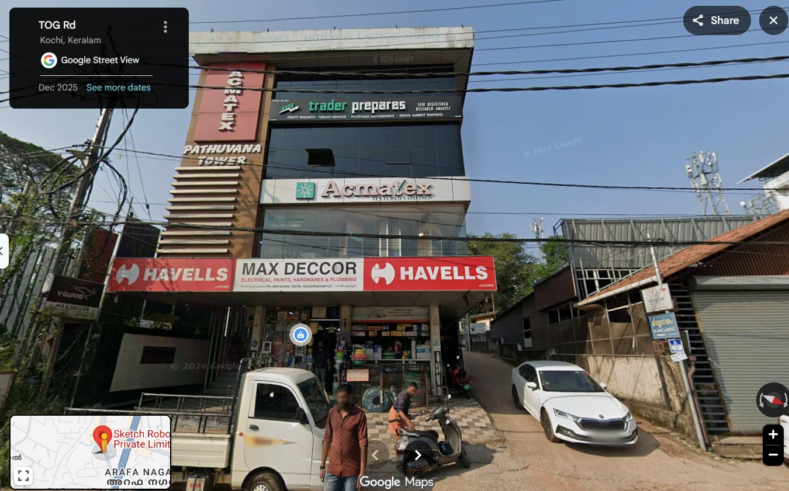
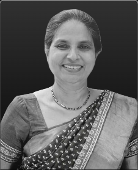
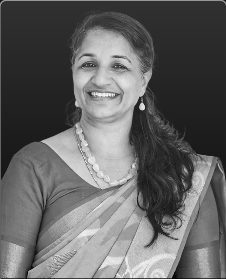
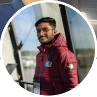
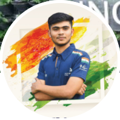

# Sketch Robotics

[← Back to master document](../COMPETITOR_INTELLIGENCE.md) · [Sources](../SOURCES.md) · **Last updated:** 2026-09-30

Tags: `[V]` verified · `[3P]` third-party · `[CC]` company claim · `[INF]` inferred · `[UNV]` unverified · `[CONFLICT]` · `[INT]` internal observation / opinion from our team. `[S012*]` = cited by S001, not yet opened by us.

**Threat level:** 🔴 Direct (by architecture), but execution capacity is doubtful. See [Internal notes](#internal-notes--opinions).

## Snapshot

| | |
|---|---|
| **Legal name** | Sketchrobotics Private Limited, CIN U27900KL2025PTC094344 `[3P][S013*]` |
| **Address** | 3rd Floor, Pathuvana Tower, TOG Rd, South Kalamassery, Kalamassery, Kochi, Kerala 682033 `[INT][S040]`. The Google Maps pin "Sketch Robo… Private Limit…" sits at this building `[V][S038]` |
| **Founded** | Incorporated May 2025 `[3P][S013*]` |
| **Website** | https://sketchrobotics.in/ |
| **Product** | Autonomous Washroom Cleaning Robot |
| **Architecture** | Mobile manipulator |
| **Stage** | Early-stage. **No public photos or videos of any prototype found** `[INT][S040]` |
| **Funding** | Estimated **₹10–15 lakh from Kerala Startup Mission** (as of Sep 2026) `[INT][UNV][S040]` |
| **Team size** | 9 staff on the website (3 founders + 6) plus 2 mentors `[CC][S034][S039]` |
| **Folder** | [sketch-robotics/](./) |

## Office

Google Street View, TOG Rd, Kochi, imagery dated **Dec 2025** `[V][S038]`:
- It is a 4-storey mixed-use commercial building. Visible tenants: Max Deccor (electrical/hardware shop, ground floor), Acmatex textured coatings, and "trader prepares" (SEBI research analyst).
- **No Sketch Robotics signage is visible** in the Dec 2025 imagery.
- The address is in South Kalamassery, close to the CUSAT campus.
- `[INF]` This looks like a small rented office, not a workshop or lab. Any hardware work may happen elsewhere, possibly at CUSAT.

## Products & technology

Source: Kerala Startup Mission listing `[CC][S002*]`
- AMR (autonomous mobile robot) base plus a **6-DOF robotic arm**
- Targeted spray cleaning, floor scrubbing, **UV-C** disinfection
- **VLM-based perception** (vision-language model) to recognise toilets and sinks and adapt to different restroom layouts
- Cleans toilets and sinks. *Urinals are not mentioned in the listing* (the S001 table's "urinal: claimed" is not supported by its own text).
- The company describes itself more broadly as robotics/AI engineering `[CC][S012*]`
- **No public evidence that any of this has been built**: no prototype images or videos found as of 2026-09-30 `[INT][S040]`

## Business / customers / deployments

_No information yet._

## Funding history

| As of | Amount | Source | Confidence |
|---|---|---|---|
| Sep 2026 | ~₹10–15 lakh (≈ US$12–18k), Kerala Startup Mission grant/seed | Team estimate `[S040]` | `[INT][UNV]` |

## People Directory

| Photo | Name | Role | Background (short) | LinkedIn | Sources |
|---|---|---|---|---|---|
|  | Muhammed Faisal P K | CEO / Co-founder | CUSAT; WorldSkills '22 #4; Mars rover mech & electronics lead | [link](https://www.linkedin.com/in/muhammedfaisalpk/) | S034, S035 |
|  | Romal Josbin | COO | _unknown_ | _not captured_ | S034 |
|  | Muhammed Siyad P | Co-founder | CUSAT CS student; WorldSkills '22 #4; Mars rover team lead | [link](https://www.linkedin.com/in/muhammedsiyadp/) | S034, S037 |
|  | Muhammed Sajeem | Hardware Engineer | CUSAT; PCB / hardware design, 1.5+ years; Mars rover team | [link](https://www.linkedin.com/in/muhammed-sajeem-2428b3278/) | S036, S039 |
|  | Afsal K | Software Engineer | _unknown_ | _not captured_ | S039 |
|  | Ashind V T | Robotics Engineer | _unknown_ | _not captured_ | S039 |
|  | Lakshmi M | Electronics Engineer | _unknown_ | _not captured_ | S039 |
|  | Varun M N | Electrical Design Engineer | _unknown_ | _not captured_ | S039 |
|  | Fadil C Basheer | Strategic Partnership Manager | _unknown_ | _not captured_ | S039 |
|  | Dr. Asha Elizabeth | Mentor | Retired Professor, CUSAT | — | S034 |
|  | Prof. Sheena K.M | Mentor | Faculty, CUSAT | — | S034 |

**Team profile:**
- The founders and at least one engineer come from **CUSAT's competition-robotics scene** (WorldSkills 2022 Mobile Robotics #4 in the world; Horizon Mars Rover team, #1 India and #18 world at ERC 2024) `[S035–S037]`.
- The team reports that **everyone is from the same college** `[INT][S040]`.
- The team is heavily engineering. Fadil C Basheer (Strategic Partnership Manager) is the only non-engineering role, and no sales or operations lead is visible `[CC][S039]`.
- Co-founder Siyad describes himself as a student `[S037]`.

### Person cards

#### Muhammed Faisal P K: CEO / Co-founder
 

| Field | Value |
|---|---|
| Current role | **CEO**, Sketch Robotics (website) `[CC][S034]`; "Co-Founder @ Sketch Robotics" (LinkedIn) `[S035]` |
| Location | Malappuram, Kerala, India `[S035]` |
| Education | Cochin University of Science and Technology (CUSAT) `[S035]` |
| Achievements (self-reported) | #4 in World, WorldSkills '22 (Mobile Robotics); Mech & Electronics Lead @ Horizon Mars Rover (#1 India, #18 World, ERC '24) `[S035]` |
| LinkedIn | https://www.linkedin.com/in/muhammedfaisalpk/ · 497 connections · verification badge shown |
| Previous roles / skills | _Not visible in screenshot_ |
| Sources | S034 (website), S035 (LinkedIn screenshot, 2026-09-30) |

#### Romal Josbin: COO

| Field | Value |
|---|---|
| Current role | **COO**, Sketch Robotics `[CC][S034]` |
| LinkedIn | Linked from the website, but the URL is not captured yet |
| Everything else | _No information yet_ |
| Sources | S034 |

#### Muhammed Siyad P: Co-founder
 

| Field | Value |
|---|---|
| Current role | **Co-Founder**, Sketch Robotics `[CC][S034]`. His LinkedIn headline does not mention Sketch Robotics `[S037]` |
| Location | Malappuram, Kerala, India `[S037]` |
| Education / orgs on profile | CUSAT; Abu Dhabi Centre for Technical and Vocational Education and Training (ACTVET). ACTVET's role is unclear: it could be an employer or education `[S037]` |
| Status | Describes himself as a "Computer Engineering student" in his About section `[S037]` |
| Achievements (self-reported) | #4 in World, Robotics, WorldSkills '22 (represented India in Mobile Robotics); Team Lead, Horizon Mars Rover Team (#1 India, #18 World, ERC '24); led a 50+ member team to the ERC finals two years running `[S037]` |
| Skills | ROS, ROS2, Gazebo, kinematics, sensor fusion, navigation; Nvidia Jetson Orin, Raspberry Pi, STM32, Arduino; C, C++, Python; deep learning `[S037]` |
| LinkedIn | https://www.linkedin.com/in/muhammedsiyadp/ · 500+ connections |
| Sources | S034, S037 |

#### Muhammed Sajeem: Hardware Engineer
 

| Field | Value |
|---|---|
| Current role | **Hardware Engineer**, Sketch Robotics (website) `[CC][S039]`. His LinkedIn shows **AMvertix** as current company and doesn't mention Sketch `[S036]`. The two sources don't match: he may be part-time, contracted, or have an out-of-date profile `[CONFLICT]` |
| Location | Kochi, Kerala, India `[S036]` |
| Education | CUSAT `[S036]` |
| Headline | PCB Designer, Hardware Design Engineer, 1.5+ years; #1 India Mars Rover Team (ERC '24) `[S036]` |
| Skills | Altium Designer, high-speed design, power electronics, embedded systems, industrial and robotics hardware `[S036]` |
| LinkedIn | https://www.linkedin.com/in/muhammed-sajeem-2428b3278/ · 500+ connections |
| Sources | S036, S039 |

#### Other team members (website card only) `[CC][S039]`
Afsal K (Software Engineer), Ashind V T (Robotics Engineer), Lakshmi M (Electronics Engineer), Varun M N (Electrical Design Engineer), Fadil C Basheer (Strategic Partnership Manager). Photos are in the directory above. Each card links to a LinkedIn profile, but those URLs haven't been captured yet.

## Internal notes / opinions

> From **Vishal**, 2026-09-30 `[INT][S040]`. These are internal observations and opinions, not sourced facts.

1. **No videos or images** of any Sketch Robotics project or prototype could be found.
2. **The whole team is from the same college** (CUSAT).
3. They have **probably received ₹10–15 lakh from Kerala Startup Mission**.
4. They are **very young with no industry experience**. The core team looks to be straight out of college. *"I doubt they can pull off building such a huge project."*

**Claude's analysis** `[INF]`:
- The notes are consistent with the evidence. The founders' profiles only show competitions and university teams. The company is 16 months old, there's no visible demo, and the office looks small.
- ₹10–15 lakh is far too little to build a mobile manipulator with a 6-DOF arm to production quality. A single industrial arm plus the base platform would take much of that.
- The risk is less that they ship a competing product soon. It is that they **raise a larger round on the strength of the KSM listing and their competition record**, or **hire people who are relevant to us**. Watch for funding announcements.

## Assessment `[INF]`

- On paper, Sketch is the Indian company closest to our architecture.
- In practice it is a very young, engineering-only team from one university, with no visible prototype and small grant funding.
- The team is technically strong in mobile robotics (navigation, ROS), but has no visible experience in commercial sales, facility management, or computer vision for hygiene.
- The VLM-perception claim is the part to probe hardest: is it working or aspirational?
- **Current threat: low to medium. Watch-list, not a direct near-term threat.**

## Open questions

- [ ] Confirm KSM funding amount (KSM grant records, news, the Tracxn/Inc42 startup databases)
- [ ] Any prototype photos or videos? (Instagram, YouTube, KSM demo days, CUSAT events)
- [ ] Pilot sites or LOIs (letters of intent)?
- [ ] Does VLM run on the robot or in the cloud? Indian (squat) toilet support?
- [ ] Any patents filed?
- [ ] Romal Josbin's background (COO)
- [ ] LinkedIn URLs for Afsal K, Ashind V T, Lakshmi M, Varun M N, Fadil C Basheer
- [ ] Sajeem: what is AMvertix, and is it related to Sketch?
- [ ] Does any hardware lab or workshop exist beyond the Pathuvana Tower office?
