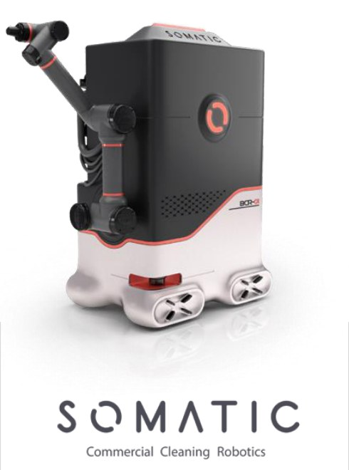

# Somatic (US): commercial restroom-cleaning robot

[← Back to master document](../COMPETITOR_INTELLIGENCE.md) · [Sources](../SOURCES.md) · **Last updated:** 2026-10-19

Tags: `[V]` verified · `[3P]` third-party · `[CC]` company claim · `[INF]` inferred · `[UNV]` unverified · `[CONFLICT]` · `[INT]` internal observation / opinion from our team.

**First-pass profile.** Everything here comes from **Hivebotics' investor deck** (S075), where Somatic is named as a direct competitor. A competitor's description of a rival is biased. **Nothing has been checked against Somatic's own sources yet.**

*Somatic robot as shown in Hivebotics' deck (p.9). It looks like a **3D render**, not a photo `[INF]`: white base with **four omni/mecanum-style wheel pods**, a black box body with a red circular logo and a model label that reads like "**BCR-01**" (partly legible), and a **dark grey 6-axis cobot arm with orange accents mounted on the side**. Tagline: "Commercial Cleaning Robotics".*

## Snapshot

| | |
|---|---|
| **Region** | **US** (traction geography "US") `[3P via Hivebotics][S075]` |
| **Product** | Mobile manipulator for commercial restroom cleaning; model label "BCR-01"? (partly legible) `[INF]` from image |
| **Cleaning tools** | Chemical water jet, blower, vacuum (no steam, no brush) `[S075]` |
| **Revenue (claimed by a competitor)** | **~US$1M ARR**, "inception 2018", "US$20M+ raised", per **Nolon AI's pitch deck** (Jul 2025, competitor table; no source given) `[UNV][S140]` |
| **Pricing** | **RaaS ~US$4,500/month**, the highest of the three in Hivebotics' comparison (Hivebotics US$2K, Primech US$1.8K) `[S075]` |
| **Traction** | "10+ pilots" (as of Oct 2025) `[S075]` |
| **Money** | "US$20+M" dollars spent per Hivebotics' p.9 table, **but** the PitchBook screenshot in the same deck (p.28) shows **US$7.51M raised to date** `[CONFLICT]` |
| **Website** | https://getsomatic.com/ ; video https://www.youtube.com/watch?v=tfeQvG-laB0 (from Vishal's notes; not yet opened) `[S087]` |
| **Accelerator** | "Incubated by YC" (Y Combinator), per Vishal's notes `[INT][S087]`; to verify |
| **Legal entity / IP** | **Somatic Holdings, Inc.**: patent **"Bathroom cleaning robot"** (priority 2023-08-08): **US 12,440,076 B2 (granted 2025-10-14)**, WO 2025/035010, EP 4757683 `[V][S094]`. See below |
| **Folder** | [somatic/](./) |

## Funding history (PitchBook screenshot in Hivebotics deck, p.28) `[3P][S075]`

| Date | Round | Amount | Valuation | Raised to date |
|---|---|---|---|---|
| 1 Jan 2018 | Capitalization | $0.05M | — | $0.05M |
| 1 Jan 2018 | Accelerator/Incubator | $0.15M | — | $0.20M |
| 18 Mar 2020 | Accelerator/Incubator | $0.15M | pre $1.99M / post $2.14M | $0.35M |
| **1 Mar 2022** | **Early-stage VC (Series A)** | **$7.16M** | **pre $20.00M / post $27.16M** | **$7.51M** |

## Assessment `[INF]`

- **The closest US analogue to Hivebotics**: same product shape (AMR + arm), same restroom focus, contactless-ish tools (jet + vacuum + blower).
- **Priced at ~2× Hivebotics**, which suggests US labour-arbitrage pricing; it also shows the price ceiling the market may bear.
- **Relevance to Ubanthu:** 🟠 benchmark (US market; not active in India or Asia per the deck).

## Patent: "Bathroom cleaning robot" (Somatic Holdings, Inc.) `[V][S094]`

- **Family:** US 18/231,476 → **US 12,440,076 B2 (granted 14 Oct 2025)**; US 2025/0049274 A1; US 2026/0033684 A1 (continuation); **WO 2025/035010** (A2 13 Feb 2025, A3 20 Mar 2025); **EP 4757683** (2026). Priority 8 Aug 2023.
- **Abstract:** main body + mobility module + **robotic arm** + several **cleaning tools mounted on the outer body**, removed and used by the arm + **tool-change module** (secure coupling/uncoupling) + **door-opening module that pulls and holds open a spring-loaded door** while the robot drives through.
- It cites Peanut Robotics' US 11,407,118 ([Peanut profile](../peanut/peanut.md#patents)).
- **Analysis** `[INF]`: Somatic has **granted US protection on the tool-rack + tool-change + door-opening bathroom robot**, the same architecture as Hivebotics (tool rack) and Wangchao (tool rack + door opening). **Claims not yet read in full; needs a freedom-to-operate read before any US entry.**

## People Directory

| Photo | Name | Role | Background | Links | Sources |
|---|---|---|---|---|---|
| — | **Michael Levy** | Patent inventor (Somatic Holdings) | — | — | S094 |
| — | Ievgenii Zasoba · Illia Pavliuk · Myroslav Borkovski · Roman Adler · Olga Avramidi | Patent inventors | Names suggest a Ukraine-based engineering team `[INF]` | — | S094 |

## Open questions

- [ ] HQ city, founders (CEO?), current team size; confirm YC batch
- [ ] Read US 12,440,076 claims in full (tool change, door opening); FTO relevance
- [ ] Funding after Mar 2022: does "US$20M+ spent" mean later rounds?
- [ ] Does Somatic do any cleaning verification or contamination detection?
- [ ] Arm supplier, sensors, current deployments and customers
