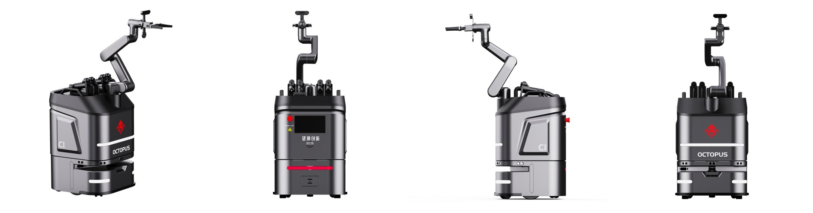
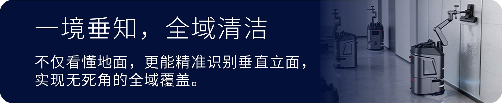

# Wangchao Innovation / Octopus Robotics (望潮创新), Hangzhou, China

[← Back to master document](../COMPETITOR_INTELLIGENCE.md) · [Sources](../SOURCES.md) · **Last updated:** 2026-10-13

Tags: `[V]` verified · `[3P]` third-party · `[CC]` company claim · `[INF]` inferred · `[UNV]` unverified · `[CONFLICT]` · `[INT]` internal observation / opinion from our team.

**Threat level:** 🔴/🟠 **New Chinese direct competitor** (found by Vishal, 2026-10-13). Restroom-cleaning mobile manipulator with steam, **very young (incorporated Dec 2025)** but moving fast. It already has a product family, trade-show presence and export marketing (YouTube, Facebook, Instagram, Canton Fair, Vietnam). Typical Chinese price/speed advantage `[INF]`.

*Octopus C1 product renders from the website: dark grey body, red octopus logo, **tool rack on top holding several handheld tools**, and a **6-axis arm with a tool/gripper end**. Very similar layout to Hivebotics' Abluo (tool rack + arm that picks tools) `[INF]`.*

## Snapshot

| | |
|---|---|
| **Legal name** | 杭州望潮创新机器人有限公司 (Hangzhou Wangchao Innovation Robot Co., Ltd.) `[3P][S079]`. Website footer: "望潮创新机器人有限公司"; English: "Octopus Innovation Robotics Co., Ltd." / "**Octopus Robotics**" `[CC][S078]`. One news item calls it "杭州望潮创新科技有限公司 (望潮科技)" `[CC][S078]` |
| **Founded** | **4 Dec 2025** `[3P][S079]` |
| **Registered capital** | RMB 6 million `[3P][S079]` |
| **Legal representative** | 何冰 (He Bing) `[3P][S079]` |
| **HQ** | 浙江省杭州市滨江区长河街道滨安路650号C座1F (Bldg C 1F, 650 Bin'an Rd, Changhe St., Binjiang, Hangzhou) `[CC][S078]` |
| **Website** | https://www.octoairobotics.com/ (ICP 浙ICP备2026003517号) `[S078]` |
| **Socials** | YouTube [@OctopusRobotics-1](https://www.youtube.com/@OctopusRobotics-1) · Instagram [octo_pusrobotics](https://www.instagram.com/octo_pusrobotics) · Facebook ["Wang Chao"](https://www.facebook.com/p/Wang-Chao-61583293276325/) (Hangzhou) · Weibo, Xiaohongshu (RedNote), Douyin, WeChat official account `[S078][S081]` |
| **Team** | R&D "rooted in labs of **Zhejiang University** and **China Jiliang University**", **PhD-led** core technical team plus a management team with industrialisation experience `[CC][S078]`. Names not disclosed |
| **IP** | "10+ core patents" claimed; "patented steam technology" `[CC][S078]`. Not yet searched |
| **Compute partner** | **中昊芯英 (Zhonghao Xinying)**, shown as co-brand "望潮创新 & 中昊芯英" and named "算力合作伙伴" (compute partner) for edge inference `[CC][S078][S081]`. Zhonghao Xinying is a Hangzhou maker of domestic AI (TPU-style) chips (general knowledge) |
| **Contact** | Website contact form (`/api/contact`). The phone and email in the site code look personal (a mobile number; an email at a different domain, hdc2014.com), so **not recorded** (privacy rule) |
| **Folder** | [wangchao-octopus/](./) |

## Products `[CC][S078]` (from the site's product API; "official lab test data")

| | **C1** "Spatial Embodied Cleaning Robot" (restroom) | **X1** | **C2** | **C3** |
|---|---|---|---|---|
| Role | **Restroom cleaning + disinfection robot with arm** (flagship) | Compact commercial robot **with arm**; RobotMap calls X1 the "全能卫生间清洁机器人" (all-in-one restroom robot) `[S079]` | Small floor scrubber (offices, supermarkets) | Large floor scrubber (garages, hospitals, transport hubs) |
| Size | **734 × 510 × 510 mm** | 450 × 600 × 1150 mm (740 mm without arm) | 520 × 420 × 490 mm | 1160 × 580 × 1210 mm |
| Weight | **50 kg** (payload versions 50 / 80 kg) | 90 kg (no water) | 30 kg | 199 kg |
| Arm | **6-axis, 900 mm reach, 3 kg payload** | Arm shown (branded "Octopus Robotics"; gripper + wrist camera in render) | — | — |
| Water | Clean **12.24 L** / dirty **9.384 L** | 16 L / 8 L / detergent 4 L | 10 L / 15 L | 70 L / 50 L |
| Mobility | 1–1.2 m/s; 18 mm step; 10° slope; 30 mm trench | 0.8 m/s; 5° slope | — | slope 0.06 |
| Protection | **IP54** | — | — | — |
| Battery | — | 48 V 60 Ah, ≥4 h | 24 V 20 Ah, 2.5–3.5 h | 25.6 V 120 Ah, 4 h scrub / 10 h dust |
| Compute | **NVIDIA Jetson Orin** ("super AI brain") | — | — | — |
| Sensors | LiDAR + vision + depth (VLA section) | Panoramic mono camera, **binocular structured-light camera**, IMU, LiDAR, ultrasonic, bumper strip, level sensors, speaker, mic | — | Panoramic mono camera, 270° LiDAR, 360° depth camera, ultrasonic, IMU |
| IoT | Elevator calling, access gates, lighting; multi-robot fleet; up to **80,000 m²** | Elevator control optional | — | — |

**C1 headline claims:**
- "World's first 'floor wash-dry + full-area human-like hand cleaning' robot".
- **99.2% cleaning coverage**; **>99% bacteria removal**; "300% efficiency boost".
- "**Four tool sets by zone**" (scrub pad, **steam-disinfection pad**, vacuum pad, squeegee), with quick tool change.
- **Patented pure-water steam >120 °C**; "floor dry in 3 seconds".
- **Human/robot dual mode**: remote-control teleoperation by day, autonomous at night.
- **Smoking detection + flame alarm** (Jetson Orin vision), i.e. security add-ons.

**From the YouTube description (19 Aug 2026)** `[CC][S080]`:
- Arm "deeply cleans **toilets, urinals, countertops, floors** and hard-to-reach corners".
- "Waterproof narrow body moves between stalls and handles thresholds".
- LiDAR + visual navigation.
- Target sites: malls, hospitals, offices, tourist sites, government facilities.

**From RobotMap** `[3P][S079]`:
- **X1** = integrated cleaning chassis (sweep/vacuum/wash/mop) plus a 6-axis arm (spray, scrub, wipe, air-dry).
- Claims ≥99% coverage, >99% steam bacteria removal, frees ~70% of repetitive work.
- Stated loop "**identify → clean → disinfect → quality inspection**", with no detail on how the inspection is done.

### AI: "望潮·垂境 VLA" (Chuijing / "VerticalSphere" VLA) `[CC][S078]`

- A self-developed "vertical-space large model", **based on an open-source VLA (vision-language-action) architecture**. It focuses on **walls, glass curtain walls, columns and restroom partitions**, aiming to move from floor cleaning to "full-space" cleaning.
- **Perception:** fuses LiDAR, vision and depth for cm-level 3D structure. Claims **material recognition** (tile, glass, metal, acrylic) to pick tool and force, and a **semantic map** (outlets, door handles, pipes).
- **Planning:** optimal cleaning path, sequence, brush frequency and mode switching ("single-pass, full coverage").
- **Edge inference on Zhonghao Xinying domestic chips.**
- **Stain or contamination detection is not mentioned.** The AI pitch is spatial/structural understanding, not dirt verification `[INF]`.
- **Hospital data logging:** each cleaning record (time, area, **steam temperature**) is uploaded for infection-control traceability `[CC]`.

### Other: inspection platform

An "intelligent inspection platform" integrates robot dogs, drones and IoT sensors, with alarm-to-work-order loops, for energy/power, petrochemical, rail and smart parks `[CC][S078]`. They also showed **warehouse AGVs** at the Canton Fair (S078 news).

## Market, partners & activity (website news, Jul – Aug 2026) `[CC][S078]`

| Date (posted) | Item |
|---|---|
| 2026 (Apr–May?) | **139th Canton Fair**: showed C1, C2, C3 and warehouse AGVs; "rich negotiation results" |
| May 2026 | "Three shows": Hangzhou embodied-AI competition, a humanoid-robot show, and **Vietnam** (smart-logistics overseas expansion) |
| 2026 | Visits by **AMANO (Korea)**, **Kunshan Huguang Auto Electric**, and the **Hangzhou Venture Capital Association** to see the floor and restroom robots |
| 2026 | Visits by the **Huzhou Moganshan Hi-tech Zone** committee and the Internet Industrial Park service centre |
| Aug 2026 | **Strategic cooperation with Hangzhou Lingqing Robotics (杭州领擎机器人)**, "relying on the **Vanke Service (万物云)** ecosystem": data, products, tech and resource sharing for smart property. Joint CSR visit to **Vanke Property** staff |

**Analysis** `[INF]`:
- **Vanke Service / Vanke Property is one of China's largest property managers.** A channel into it would give scale quickly.
- The "AMANO Korea" visit hints at Korean distribution. AMANO is a Japanese/Korean facility-equipment maker (general knowledge).
- **No named restroom-robot customers yet.** "Successfully deployed in transport hubs, commercial complexes, energy" is a claim only.

## YouTube channel @OctopusRobotics-1 `[S080]` (titles only; videos not watched)

- **Videos (14):**
  - **Restroom:** "Wangchao C1 Commercial Restroom Cleaning Robot" (1:42; 878 views as of the user's capture, 19 Aug 2026), "Tired of high labor cost for restroom cleaning?" (2:14), "Commercial Restroom Cleaning Robot" (1:38), "Wangchao C1 Embodied AI Restroom Cleaning Robot is here!" (1:14), "Wangchao C1 | Embodied AI Restroom Cleaning Robot" (1:28), "Commercial Toilet Cleaning Robot" (0:26), **"The robot opens the door…"** (0:46).
  - **Other products:** C2/C3 launches, "Meet Wangchao Full-Series Robots" (3:35), parking-lot sanitation, "Precision in Motion".
- **Shorts (5):** incl. "**Wangchao Innovation's X1 Public Restroom Cleaning Robot made its grand debut**".
- **Worth frame-analysing for Ubanthu:** the restroom videos and the door-opening clip, to see real (not rendered) C1/X1 hardware, the arm supplier and any dirt-detection UI.

## Hardware / supplier notes

| Component | Finding |
|---|---|
| Compute | **NVIDIA Jetson Orin** (C1, named) `[CC][S078]`; AI inference partner **Zhonghao Xinying** chips `[CC][S078]` |
| Arm | 6-axis, 900 mm reach, 3 kg payload (C1). Supplier unknown. X1 arm is branded "Octopus Robotics" (likely a rebadged Chinese cobot `[INF]`) |
| Cameras | X1: panoramic mono + **binocular structured-light**; C3: 360° depth camera `[CC][S078]` |
| LiDAR | Yes (C1 VLA; X1; C3 270°) `[CC][S078]`; supplier unknown |

## People Directory

| Photo | Name | Role | Background | Links | Sources |
|---|---|---|---|---|---|
| — | **何冰 (He Bing)** | Legal representative | — | — | S079 |
| — | "Wang Chao" | Facebook page name (brand page, logo avatar; not a person) | — | [Facebook](https://www.facebook.com/p/Wang-Chao-61583293276325/) | S081 |

## Assessment `[INF]`

- **Closest Chinese analogue to Hivebotics:** steam plus a tool-rack arm, restroom-first. It is **smaller and lighter (50 kg vs Abluo's 180 kg)**, with elevator/door/gate IoT, which Hivebotics lacks.
- **Speed:** incorporated Dec 2025, yet it had a 4-product line, a Canton Fair booth and English marketing within ~6–9 months. Possibly a spin-out of an existing team or company (PhDs from Zhejiang University / China Jiliang University) or a rebrand of OEM products. **C2/C3 look like standard Chinese OEM scrubbers** (generic spec-sheet format).
- **On verification:** Wangchao claims a "quality inspection" step and hospital logs (time, area, steam temperature), but **no stain detection or before/after scoring**. Its AI focus is spatial/VLA. **Contamination verification remains a gap here too.**
- **Relevance to Ubanthu/India:** Chinese pricing could reach India via distributors. **Watch for an India distributor.**

## Open questions

- [ ] Price of C1 / X1 (sale and rental)
- [ ] Arm and LiDAR suppliers; which arm is on the real C1 vs the renders
- [ ] Founders and team names; relationship to Zhejiang University / China Jiliang University labs; any funding round
- [ ] "10+ core patents": search CNIPA for 杭州望潮创新机器人有限公司 / He Bing
- [ ] Real deployments (named sites); Vanke/Lingqing pilot status
- [ ] Frame-analyse the restroom YouTube videos (real hardware, dirt detection UI)
- [ ] Does the email domain hdc2014.com indicate a parent or affiliate company?
