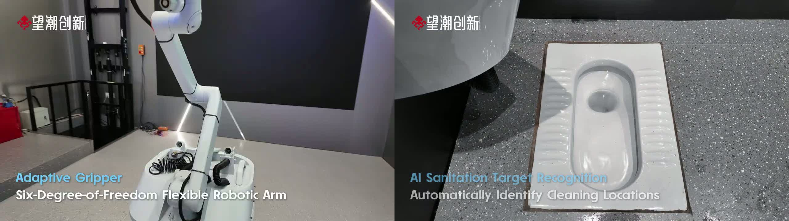
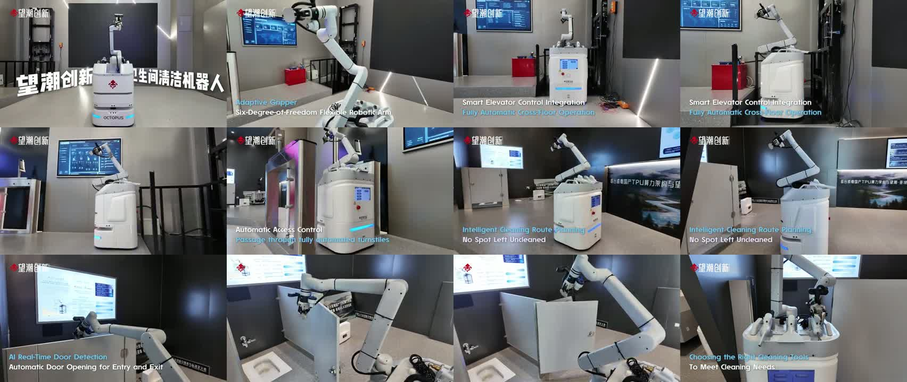
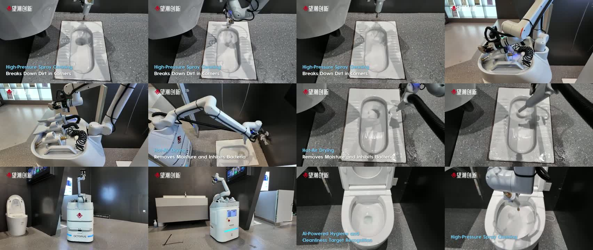
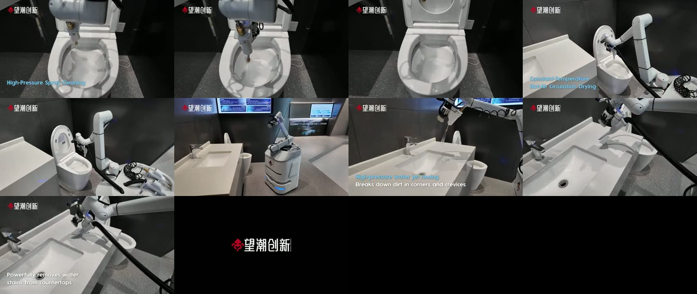
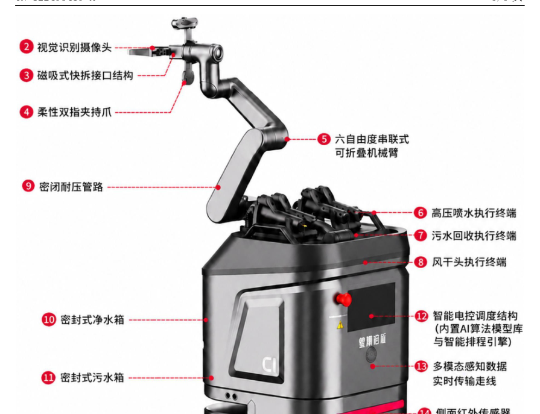

# Wangchao Innovation / Octopus Robotics (望潮创新), Hangzhou, China

[← Back to master document](../COMPETITOR_INTELLIGENCE.md) · [Sources](../SOURCES.md) · **Last updated:** 2026-10-13

Tags: `[V]` verified · `[3P]` third-party · `[CC]` company claim · `[INF]` inferred · `[UNV]` unverified · `[CONFLICT]` · `[INT]` internal observation / opinion from our team.

**Threat level:** 🔴/🟠 **New Chinese direct competitor** (found by Vishal, 2026-10-13). Restroom-cleaning mobile manipulator with steam, **very young (incorporated Dec 2025)** but moving fast. It already has a product family, trade-show presence and export marketing (YouTube, Facebook, Instagram, Canton Fair, Vietnam). Typical Chinese price/speed advantage `[INF]`.

*Octopus C1 product **renders** from the website (the real C1 in the YouTube video is **white**; see below): dark grey body, red octopus logo, **tool rack on top holding several handheld tools**, and a **6-axis arm with a tool/gripper end**. Very similar layout to Hivebotics' Abluo (tool rack + arm that picks tools) `[INF]`.*

## Snapshot

| | |
|---|---|
| **Legal name** | 杭州望潮创新机器人有限公司 (Hangzhou Wangchao Innovation Robot Co., Ltd.) `[3P][S079]`. Website footer: "望潮创新机器人有限公司"; English: "Octopus Innovation Robotics Co., Ltd." / "**Octopus Robotics**" `[CC][S078]`. One news item calls it "杭州望潮创新科技有限公司 (望潮科技)" `[CC][S078]` |
| **Founded** | **4 Dec 2025** `[3P][S079]` |
| **Registered capital** | RMB 6 million `[3P][S079]` |
| **Legal representative** | 何冰 (He Bing) `[3P][S079]` |
| **HQ** | 浙江省杭州市滨江区长河街道滨安路650号C座1F (Bldg C 1F, 650 Bin'an Rd, Changhe St., Binjiang, Hangzhou) `[CC][S078]` |
| **Website** | https://www.octoairobotics.com/ (ICP 浙ICP备2026003517号) `[S078]` |
| **Socials** | YouTube [@OctopusRobotics-1](https://www.youtube.com/@OctopusRobotics-1) · Instagram [octo_pusrobotics](https://www.instagram.com/octo_pusrobotics) · Facebook ["Wang Chao"](https://www.facebook.com/p/Wang-Chao-61583293276325/) (Hangzhou) · Weibo, Xiaohongshu (RedNote), Douyin, WeChat official account `[S078][S081]` |
| **Team** | R&D "rooted in labs of **Zhejiang University** and **China Jiliang University**", **PhD-led** core technical team plus a management team with industrialisation experience `[CC][S078]`. Names not disclosed |
| **IP** | "10+ core patents" claimed `[CC][S078]`. **Found 1 published: CN122493419A** (toilet-fixture recognition with RGB-D + vision model, filed 2 Jul 2026, inventor 王辉 Wang Hui) `[V][S083]`. See [Patents](#patents) |
| **Compute partner** | **中昊芯英 (Zhonghao Xinying)**, shown as co-brand "望潮创新 & 中昊芯英" and named "算力合作伙伴" (compute partner) for edge inference `[CC][S078][S081]`. Zhonghao Xinying is a Hangzhou maker of domestic AI (TPU-style) chips (general knowledge) |
| **Contact** | Website contact form (`/api/contact`). The phone and email in the site code look personal (a mobile number; an email at a different domain, hdc2014.com), so **not recorded** (privacy rule) |
| **Folder** | [wangchao-octopus/](./) |

## Products `[CC][S078]` (from the site's product API; "official lab test data")

| | **C1** "Spatial Embodied Cleaning Robot" (restroom) | **X1** | **C2** | **C3** |
|---|---|---|---|---|
| Role | **Restroom cleaning + disinfection robot with arm** (flagship) | Compact commercial robot **with arm**; RobotMap calls X1 the "全能卫生间清洁机器人" (all-in-one restroom robot) `[S079]` | Small floor scrubber (offices, supermarkets) | Large floor scrubber (garages, hospitals, transport hubs) |
| Size | **734 × 510 × 510 mm** | 450 × 600 × 1150 mm (740 mm without arm) | 520 × 420 × 490 mm | 1160 × 580 × 1210 mm |
| Weight | **50 kg** (payload versions 50 / 80 kg) | 90 kg (no water) | 30 kg | 199 kg |
| Arm | **6-axis, 900 mm reach, 3 kg payload** | Arm shown (branded "Octopus Robotics"; gripper + wrist camera in render) | — | — |
| Water | Clean **12.24 L** / dirty **9.384 L** | 16 L / 8 L / detergent 4 L | 10 L / 15 L | 70 L / 50 L |
| Mobility | 1–1.2 m/s; 18 mm step; 10° slope; 30 mm trench | 0.8 m/s; 5° slope | — | slope 0.06 |
| Protection | **IP54** | — | — | — |
| Battery | — | 48 V 60 Ah, ≥4 h | 24 V 20 Ah, 2.5–3.5 h | 25.6 V 120 Ah, 4 h scrub / 10 h dust |
| Compute | **NVIDIA Jetson Orin** ("super AI brain") | — | — | — |
| Sensors | LiDAR + vision + depth (VLA section) | Panoramic mono camera, **binocular structured-light camera**, IMU, LiDAR, ultrasonic, bumper strip, level sensors, speaker, mic | — | Panoramic mono camera, 270° LiDAR, 360° depth camera, ultrasonic, IMU |
| IoT | Elevator calling, access gates, lighting; multi-robot fleet; up to **80,000 m²** | Elevator control optional | — | — |

**C1 headline claims:**
- "World's first 'floor wash-dry + full-area human-like hand cleaning' robot".
- **99.2% cleaning coverage**; **>99% bacteria removal**; "300% efficiency boost".
- "**Four tool sets by zone**" (scrub pad, **steam-disinfection pad**, vacuum pad, squeegee), with quick tool change.
- **Patented pure-water steam >120 °C**; "floor dry in 3 seconds".
- **Human/robot dual mode**: remote-control teleoperation by day, autonomous at night.
- **Smoking detection + flame alarm** (Jetson Orin vision), i.e. security add-ons.

**From the YouTube description (19 Aug 2026)** `[CC][S080]`:
- Arm "deeply cleans **toilets, urinals, countertops, floors** and hard-to-reach corners".
- "Waterproof narrow body moves between stalls and handles thresholds".
- LiDAR + visual navigation.
- Target sites: malls, hospitals, offices, tourist sites, government facilities.

**From RobotMap** `[3P][S079]`:
- **X1** = integrated cleaning chassis (sweep/vacuum/wash/mop) plus a 6-axis arm (spray, scrub, wipe, air-dry).
- Claims ≥99% coverage, >99% steam bacteria removal, frees ~70% of repetitive work.
- Stated loop "**identify → clean → disinfect → quality inspection**", with no detail on how the inspection is done.

### AI: "望潮·垂境 VLA" (Chuijing / "VerticalSphere" VLA) `[CC][S078]`

- A self-developed "vertical-space large model", **based on an open-source VLA (vision-language-action) architecture**. It focuses on **walls, glass curtain walls, columns and restroom partitions**, aiming to move from floor cleaning to "full-space" cleaning.
- **Perception:** fuses LiDAR, vision and depth for cm-level 3D structure. Claims **material recognition** (tile, glass, metal, acrylic) to pick tool and force, and a **semantic map** (outlets, door handles, pipes).
- **Planning:** optimal cleaning path, sequence, brush frequency and mode switching ("single-pass, full coverage").
- **Edge inference on Zhonghao Xinying domestic chips.**
- **Stain or contamination detection is not mentioned.** The AI pitch is spatial/structural understanding, not dirt verification `[INF]`.
- **Hospital data logging:** each cleaning record (time, area, **steam temperature**) is uploaded for infection-control traceability `[CC]`.

### Other: inspection platform

An "intelligent inspection platform" integrates robot dogs, drones and IoT sensors, with alarm-to-work-order loops, for energy/power, petrochemical, rail and smart parks `[CC][S078]`. They also showed **warehouse AGVs** at the Canton Fair (S078 news).

## ⭐ Real hardware: C1 YouTube video (19 Aug 2026), frame analysis `[V][S082]`

Video: https://www.youtube.com/watch?v=TDdowbHThfw (1:42). Analysed 2026-10-13 from frames sampled every 3 s (no audio). **This is real footage, not a render** (point raised by Vishal).

**What the video shows:**
- **The real C1 is white** (white body, blue LED strip, red octopus logo, "OCTOPUS" label, touchscreen + e-stop on the back). The website images are **grey renders** of a later or styled version `[INF]`.
- **Arm:** white 6-axis cobot with black joint bands. Overlay: "Adaptive Gripper · Six-Degree-of-Freedom Flexible Robotic Arm". **Brand not legible** in frames.
- **Tool rack on top:** a **spray gun**, a **hot-air dryer nozzle**, coiled hoses and a vacuum hose. The arm grips the tools ("Choosing the right cleaning tools to meet cleaning needs").
- **Building integration (shown):** "Smart Elevator Control Integration – Fully automatic cross-floor operation" (robot next to a lift); "Automatic Access Control – passage through fully automated turnstiles"; "**AI Real-Time Door Detection – Automatic Door Opening** for Entry and Exit". **The arm pushes a cubicle door open.**
- **Navigation:** "Intelligent Cleaning Route Planning – No spot left uncleaned".
- **Perception overlays:** "**AI Sanitation Target Recognition – Automatically identify cleaning locations**"; "**AI-Powered Hygiene and Cleanliness Target Recognition**". These suggest detecting *what/where* to clean. There is **no before/after score or dirt map on screen** `[INF]`.
- **⚠️ SQUAT TOILET CLEANED ON CAMERA:** "High-Pressure Spray Cleaning – Breaks down dirt in corners" on a **squat pan**, then "**Hot-Air Drying** – Removes moisture and inhibits bacteria".
- **Western toilet:** high-pressure spray inside the bowl (lid up), then "Constant-Temperature Hot-Air Circulation Drying".
- **Sink/countertop:** "High-pressure water jet rinsing – breaks down dirt in corners and crevices"; "Powerfully removes water stains from countertops".
- **No steam visible in this video.** The cleaning shown is **high-pressure water spray + hot-air drying** (steam is claimed on the website).
- **No lid/seat lifting shown.** The Western toilet lid was already up.
- **Setting:** looks like a **showroom/demo restroom**, not a live public restroom. There are exhibition screens and a banner reading "…基于国产TPU算力架构与望…" (domestic TPU compute architecture, i.e. the Zhonghao Xinying tie-in) `[INF]`.

**Analysis** `[INF]`:
- **Wangchao is the first competitor on file to *show* squat-toilet cleaning** (Primech only *claims* it). For India this matters a lot: Wangchao's design already handles the Asian squat pan.
- **Cleaning method in practice: water jet + hot air** (contact-free, like Hivebotics minus steam). It's simple, and cheap to build.
- **Door opening + lifts + turnstiles are demonstrated.** Hivebotics only lists these on its roadmap.

## Patents

**Status 2026-10-13: 2 patents found** (Google Patents search + design patent PDF from CNIPA supplied by Vishal). Baidu AI also mentions **2 software copyrights** `[UNV][S085]`.

| No. | Title | Inventor | Filed (priority) | Published | Status |
|---|---|---|---|---|---|
| **CN310188487S** (design patent; appl. 202630095668.2) | 智能清洁机器人（望潮C1）*Intelligent Cleaning Robot (Wangchao C1)*. LOC 15-05; use: "automated cleaning, environmental inspection and safety management"; design point: **shape**; 8 views | **王辉 (Wang Hui)** (designer) | **4 Mar 2026** | **Granted 4 Sep 2026** | **Granted** `[V][S084]` |
| **CN122493419A** | 基于深度相机与视觉大模型的厕具识别方法及系统 (*Toilet-fixture identification method and system based on a depth camera and a vision large model*) | **王辉 (Wang Hui)** | **2 Jul 2026** | **31 Jul 2026** (published within 1 month, so early publication was requested `[INF]`) | **Granted 9 Oct 2026 as CN 122493419 B** (6 claims) `[S095]` |

**Design patent files:** [original CN PDF](patents/CN310188487S_design-patent_original-CN.pdf) · [**English translation PDF**](patents/CN310188487S_design-patent_EN.pdf) (Chinese text replaced in place by English; drawings unchanged; translated by Claude) `[V][S084]`.
- The drawings match the website's **grey C1 renders**: a top view shows a **tool rack with 4 handheld tools** and a **two-finger gripper** on the arm. The bottom view shows the drive-wheel layout.
- **Patentee address in the patent:** Room 102-1, 1F, **Bldg 4**, 650 Bin'an Rd (website says Bldg C 1F; same site `[INF]`).
- **Patent agency:** Shenzhen Zhongyuan Xinke Patent Agency (44757), agent Xie Xiaoyang.
- **So far, every filing names 王辉 (Wang Hui)** as inventor/designer. He is likely the technical founder `[INF]`.
- A design patent protects only the *look* of the robot, not how it works. It doesn't affect Ubanthu unless we copy the C1 shape.

**Full CN122493419A files** (from Vishal, 2026-10-13): [original CN PDF (26 pp.)](patents/CN122493419A_original-CN.pdf) · [**English PDF**](patents/CN122493419A_EN.pdf) (biblio, abstract and Fig. 3 legend translated by Claude; claims and description = Google Patents machine translation; original figures appended) `[V][S086]`. The PDF is the **A (application) publication**. **A B (grant) document has still not been seen**, so the grant remains unconfirmed.

**⭐ Fig. 3: labelled C1 hardware (the most useful part of the patent)** `[V][S086]`:

| # | Part (translated) | Note `[INF]` |
|---|---|---|
| 1 | **Depth camera, mounted low on the body** | Wide-view depth for fixture localisation |
| 2 | **Vision recognition (RGB) camera beside the gripper**, on the arm end | Close-up RGB that moves with the arm |
| 3 | **Magnetic quick-release interface** | Tool change |
| 4 | Flexible two-finger gripper | Grips handheld tools (matches the video) |
| 5 | 6-DoF serial **foldable** arm | — |
| 6 / 7 / 8 | End tools: **high-pressure water spray**, **wastewater recovery (suction)**, **air-drying head** | **No steam tool or brush is listed.** Matches the video (spray + hot air) |
| 9 | Sealed pressure-resistant tubing **routed inside the arm** | — |
| 10 / 11 | Sealed clean-water / wastewater tanks | — |
| 12 | Electronic control & scheduling unit with built-in **AI model library + scheduling engine** | — |
| 13 | Multimodal sensor cabling | — |
| 14 | **Side infrared sensor** | — |
| 15 | **Multi-line LiDAR** (front, low) | Model unknown |

**Algorithm details from the description** (examples given in the text): class confidence example 0.94 (toilet) vs 0.03 (urinal); anchor scales 64/128/256 px with ratios 1:1, 1:2, 2:1 (i.e. a **Faster R-CNN-style RPN**, despite the "large vision model" label `[INF]`); region-growing cluster radius **40 mm**; local-curvature radius 15 mm; confidence-weighted ICP with a sigmoid weight (centre 0.6, steepness 10) plus a curvature term; example world coordinate output (810.2, 50.6, 605.4) mm. The method again covers **fixture pose only; no dirt or cleanliness detection**.

**✅ Status of CN122493419 resolved (2026-10-19): GRANTED as CN 122493419 B on 9 Oct 2026** `[V][S095]` ([granted CN PDF](patents/CN122493419B_granted_original-CN.pdf), 28 pp., from Vishal). Filed 2 Jul 2026 and granted in **~3 months**, so it was fast-tracked (prioritised examination) `[INF]`. Baidu AI's "granted" claim (S085) was right. Google Patents had not yet updated.
- **Claims narrowed in grant: 9 → 6 claims.** Granted claim 1 now also requires:
  - the **per-point local-curvature (covariance eigenvalue) weighting** in the confidence-weighted ICP (former claims 6–8);
  - the **hand-eye transform + back-off along the surface normal + arm-reach envelope check** (former claim 7).
  - **Narrower = easier to design around** `[INF]`.
- **Examiner's cited prior art:** US 12,505,568 B1 (Ambarella, 3D point cloud from multiple vehicle cameras) and US 2026/0102658 A1 (an AI yoga/fitness trainer). Both are **far from robotic toilet cleaning**. Hivebotics' WO 2023/075687 (YOLO fixture detection + point-cloud alignment) was **not cited**, which suggests a light examination `[INF]`.

Link: https://patents.google.com/patent/CN122493419A/en · extract saved in [patents/](patents/CN122493419A_google-patents-extract.txt) `[V][S083]`.

**What it claims (claim 1, 5 steps):**
1. **Time-sync and align RGB + depth point cloud** (hardware timestamps, reject out-of-tolerance frames, project depth into pixels → RGB-D aligned data).
2. A **vision large model** detects the fixture: **2D anchor boxes + class confidence score** (toilet, urinal, …).
3. **Use the 2D box as a pixel mask** to crop the point cloud; statistical outlier filtering; cluster segmentation → isolated fixture point cloud.
4. **PCA for initial pose**, then **confidence-weighted ICP** against a **template point cloud from a database** (chosen by the class label) → **6-DoF fixture pose**.
5. **Hand-eye calibration** → robot base frame; **anti-collision check** (back-off along the surface normal by a safety distance; reachability envelope) → collision-free arm working coordinates.

**Analysis for Ubanthu** `[INF]`:
- This is **fixture localisation for arm motion**: detect, mask, ICP to a template, then a safe pose. It's standard robotics practice packaged as a patent. Hivebotics' lapsed patent WO 2023/075687 also covered YOLO fixture detection + point-cloud alignment.
- **It does NOT cover stain/contamination detection or cleaning verification.** No conflict with contamination-CV IP.
- Possible prior-art overlap with Hivebotics' WO 2023/075687 and generic RGB-D + ICP pipelines. A **weak patent** unless the confidence-weighted ICP is novel.
- The website's "10+ core patents" isn't reflected in published data yet. Chinese utility models and designs publish after grant, and other applications may still be unpublished, or held by founders/affiliates.

**How to search yourself:**
- **Google Patents** (easiest, English machine translation): https://patents.google.com/?assignee=望潮创新 . Also try `inventor:王辉 toilet` or keywords like `厕所 清洁 机器人 机械臂`.
- **CNIPA official search** (authoritative, includes utility models; free registration): https://pss-system.cponline.cnipa.gov.cn . Search by 申请人 (applicant) = 杭州望潮创新机器人有限公司.
- **Qichacha / Tianyancha** (企查查 / 天眼查): the company page has a "知识产权 → 专利" tab listing all patents incl. utility models and design patents, plus shareholders. Basic view is free; full view needs an account.
- **Espacenet** (EPO): https://worldwide.espacenet.com . Search applicant "Wangchao"; it catches PCT/WO filings if they go abroad.
- Tip: check **utility models (实用新型, "U" suffix)** and **designs ("S")**. Chinese startups often hold mostly these, and they are what "10+ patents" usually counts.

## Market, partners & activity (website news, Jul – Aug 2026) `[CC][S078]`

| Date (posted) | Item |
|---|---|
| 2026 (Apr–May?) | **139th Canton Fair**: showed C1, C2, C3 and warehouse AGVs; "rich negotiation results" |
| May 2026 | "Three shows": Hangzhou embodied-AI competition, a humanoid-robot show, and **Vietnam** (smart-logistics overseas expansion) |
| 2026 | Visits by **AMANO (Korea)**, **Kunshan Huguang Auto Electric**, and the **Hangzhou Venture Capital Association** to see the floor and restroom robots |
| 2026 | Visits by the **Huzhou Moganshan Hi-tech Zone** committee and the Internet Industrial Park service centre |
| Aug 2026 | **Strategic cooperation with Hangzhou Lingqing Robotics (杭州领擎机器人)**, "relying on the **Vanke Service (万物云)** ecosystem": data, products, tech and resource sharing for smart property. Joint CSR visit to **Vanke Property** staff |

**Analysis** `[INF]`:
- **Vanke Service / Vanke Property is one of China's largest property managers.** A channel into it would give scale quickly.
- The "AMANO Korea" visit hints at Korean distribution. AMANO is a Japanese/Korean facility-equipment maker (general knowledge).
- **No named restroom-robot customers yet.** "Successfully deployed in transport hubs, commercial complexes, energy" is a claim only.

## YouTube channel @OctopusRobotics-1 `[S080]` (titles only; videos not watched)

- **Videos (14):**
  - **Restroom:** "Wangchao C1 Commercial Restroom Cleaning Robot" (1:42; 878 views as of the user's capture, 19 Aug 2026), "Tired of high labor cost for restroom cleaning?" (2:14), "Commercial Restroom Cleaning Robot" (1:38), "Wangchao C1 Embodied AI Restroom Cleaning Robot is here!" (1:14), "Wangchao C1 | Embodied AI Restroom Cleaning Robot" (1:28), "Commercial Toilet Cleaning Robot" (0:26), **"The robot opens the door…"** (0:46).
  - **Other products:** C2/C3 launches, "Meet Wangchao Full-Series Robots" (3:35), parking-lot sanitation, "Precision in Motion".
- **Shorts (5):** incl. "**Wangchao Innovation's X1 Public Restroom Cleaning Robot made its grand debut**".
- **Worth frame-analysing for Ubanthu:** the restroom videos and the door-opening clip, to see real (not rendered) C1/X1 hardware, the arm supplier and any dirt-detection UI.

## Hardware / supplier notes

| Component | Finding |
|---|---|
| Compute | **NVIDIA Jetson Orin** (C1, named) `[CC][S078]`; AI inference partner **Zhonghao Xinying** chips `[CC][S078]` |
| Arm | 6-axis, 900 mm reach, 3 kg payload (C1). Supplier unknown. X1 arm is branded "Octopus Robotics" (likely a rebadged Chinese cobot `[INF]`) |
| Cameras | X1: panoramic mono + **binocular structured-light**; C3: 360° depth camera `[CC][S078]` |
| LiDAR | Yes (C1 VLA; X1; C3 270°) `[CC][S078]`; supplier unknown |

## People Directory

| Photo | Name | Role | Background | Links | Sources |
|---|---|---|---|---|---|
| — | **何冰 (He Bing)** | Legal representative | — | — | S079 |
| — | **王辉 (Wang Hui)** | Inventor/designer on **both** patents (CN122493419A, CN310188487S) | Likely technical founder / R&D lead `[INF]` | — | S083, S084 |
| — | "Wang Chao" | Facebook page name (brand page, logo avatar; not a person) | — | [Facebook](https://www.facebook.com/p/Wang-Chao-61583293276325/) | S081 |

## Assessment `[INF]`

- **Closest Chinese analogue to Hivebotics:** steam plus a tool-rack arm, restroom-first. It is **smaller and lighter (50 kg vs Abluo's 180 kg)**, with elevator/door/gate IoT, which Hivebotics lacks.
- **Speed:** incorporated Dec 2025, yet it had a 4-product line, a Canton Fair booth and English marketing within ~6–9 months. Possibly a spin-out of an existing team or company (PhDs from Zhejiang University / China Jiliang University) or a rebrand of OEM products. **C2/C3 look like standard Chinese OEM scrubbers** (generic spec-sheet format).
- **On verification:** Wangchao claims a "quality inspection" step and hospital logs (time, area, steam temperature). The video shows "AI hygiene & cleanliness target recognition" (finding *where* to clean), but **no before/after scoring**, and its patent is about fixture pose, not dirt. Its AI focus is spatial/VLA. **Contamination verification remains a gap here too.**
- **Relevance to Ubanthu/India:** Chinese pricing could reach India via distributors. **Watch for an India distributor.**

## Open questions

- [ ] Price of C1 / X1 (sale and rental)
- [ ] Arm and LiDAR suppliers; which arm is on the real C1 vs the renders
- [ ] Founders and team names; relationship to Zhejiang University / China Jiliang University labs; any funding round
- [x] ~~Patent search~~: 2 found: CN122493419A (invention) + CN310188487S (design, granted). CN122493419 **granted** (B, 9 Oct 2026, S095). Still open: utility models? The "patented steam" and "10+ patents" claims; the 2 software copyrights
- [ ] Real deployments (named sites); Vanke/Lingqing pilot status
- [x] ~~Frame-analyse C1 video~~ (S082): real white C1, squat toilet, water jet + hot air, doors/lift/turnstile. Still open: the door-opening clip, the X1 debut short, and real-site (non-showroom) footage
- [ ] Does the email domain hdc2014.com indicate a parent or affiliate company?
